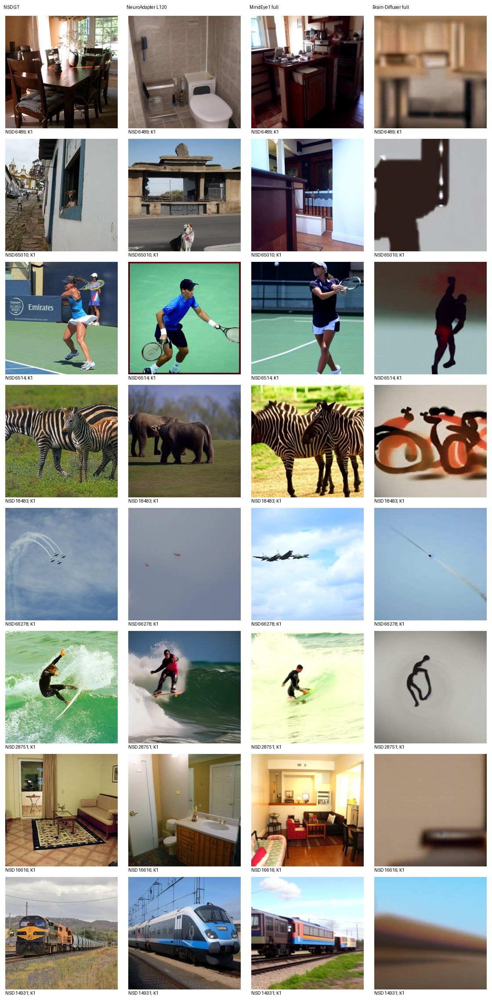
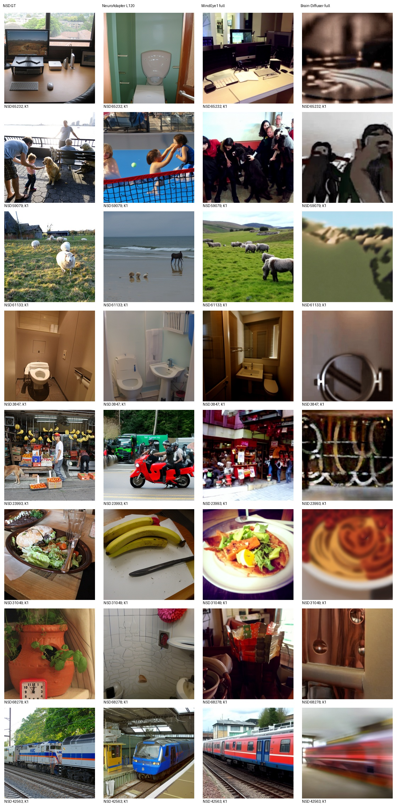
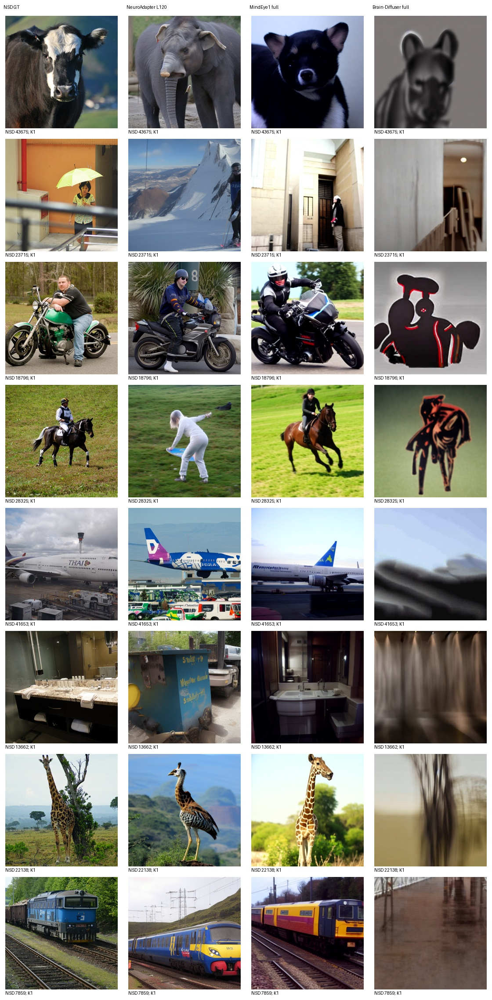
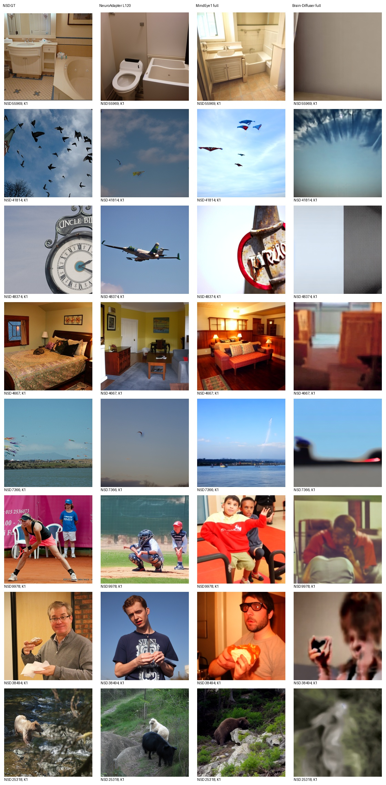

# Brain-Diffuser 完整通路实测

评价池：100张标准测试图；每图K=1，无选图。

| 方法 | PixCorr | SSIM | Alex(2) | Alex(5) | Incep | CLIP | Eff | SwAV |
|---|---:|---:|---:|---:|---:|---:|---:|---:|
| NeuroAdapter L120 | 0.097118 | 0.309756 | 73.616162 | 83.565657 | 83.505051 | 85.616162 | 0.793281 | 0.481802 |
| MindEye1 full | 0.382118 | 0.288528 | 97.484848 | 98.292929 | 94.969697 | 93.939394 | 0.608740 | 0.344277 |
| Brain-Diffuser full | 0.369911 | 0.370548 | 95.060606 | 93.090909 | 72.636364 | 71.282828 | 0.944776 | 0.628421 |

Eff/SwAV越低越好，其余越高越好。三个脑回归和VDVAE低层＋完整VD双条件通路均实际执行，非低层中间图分数。Brain-Diffuser保留50步日程、strength0.75（实际37步去噪）、CFG7.5、mixing0.4、作者一次seed0原982行序，100图从该输出提取，不重排随机流。

复现披露：兼容环境Python3.10/Torch2.0与作者旧版本不同；VDVAE原脚本未实际设置H.seed，本次固定0；原仅取形状的GT预热改用同shape全零输入，两种batch的随机终态检查通过，生成不读取GT。不能声称与作者历史输出逐像素相同。所有方法未依据本测试成绩调参。

首100与完整982独立评分，识别率不拼接；旧P0报告保留。固定32图全部候选如下，AI审阅记录另附。

## 实测结论

本次100图Brain-Diffuser的PixCorr/SSIM/AN2/AN5高于NeuroAdapter，但Inception/CLIP较低，Eff/SwAV距离更大。相对MindEye1仅SSIM更高。图册中明显模糊与语义错误不能被较高SSIM掩盖，详见[全部固定图AI审阅](AI_REVIEW_BD.md)。这是当前复现结果，尚未证明达到作者原版质量，不据此更换设置。
