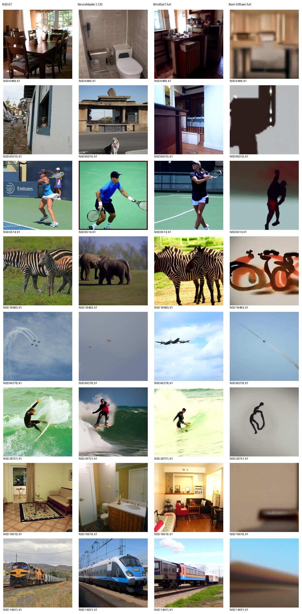
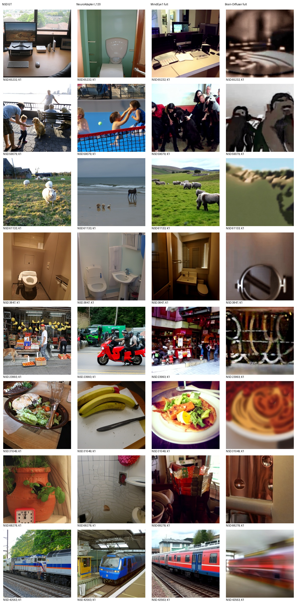
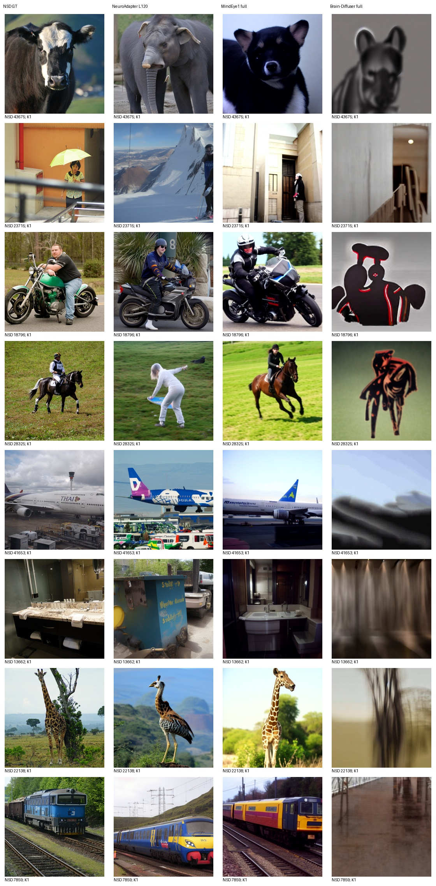
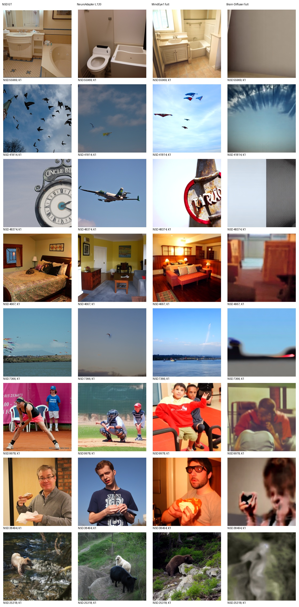

# Brain-Diffuser 完整通路实测

评价池：982张标准测试图；每图K=1，无选图。

| 方法 | PixCorr | SSIM | Alex(2) | Alex(5) | Incep | CLIP | Eff | SwAV |
|---|---:|---:|---:|---:|---:|---:|---:|---:|
| NeuroAdapter L120 | 0.071610 | 0.306504 | 72.390075 | 83.442744 | 81.472208 | 83.443990 | 0.804701 | 0.488233 |
| MindEye1 full | 0.365033 | 0.288355 | 96.555325 | 98.301330 | 94.264238 | 94.307629 | 0.637356 | 0.357735 |
| Brain-Diffuser full | 0.344484 | 0.372837 | 94.688179 | 92.114223 | 72.628516 | 71.268355 | 0.932979 | 0.626845 |

Eff/SwAV越低越好，其余越高越好。三个脑回归和VDVAE低层＋完整VD双条件通路均实际执行，非低层中间图分数。Brain-Diffuser保留50步日程、strength0.75（实际37步去噪）、CFG7.5、mixing0.4、作者一次seed0原982行序，100图从该输出提取，不重排随机流。

复现披露：兼容环境Python3.10/Torch2.0与作者旧版本不同；VDVAE原脚本未实际设置H.seed，本次固定0；原仅取形状的GT预热改用同shape全零输入，两种batch的随机终态检查通过，生成不读取GT。不能声称与作者历史输出逐像素相同。所有方法未依据本测试成绩调参。

首100与完整982独立评分，识别率不拼接；旧P0报告保留。固定32图全部候选如下，AI审阅记录另附。

## 完整结果结论

982图与首100图的比较方向一致：本次Brain-Diffuser相对NeuroAdapter在PixCorr、SSIM、AN2、AN5更高，但Inception、CLIP更低，Eff/SwAV更差；相对MindEye1只有SSIM更高。较高SSIM不代表语义正确，固定图册有明显模糊、剪影与类别错误，详见[AI审阅](AI_REVIEW_BD.md)。这是当前兼容复现流程的实测结果，尚不能认定达到作者原版质量，不泛化为论文方法能力，也不据测试结果调参。

全部982生成、100与982评分退出码均为0；原L120和best保护哈希全部通过。
