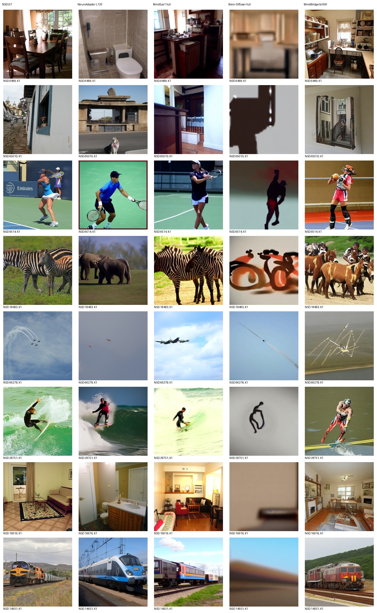
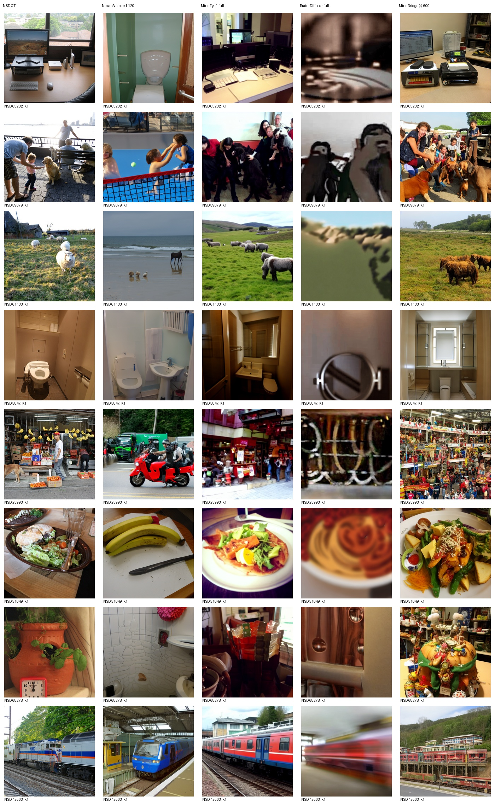
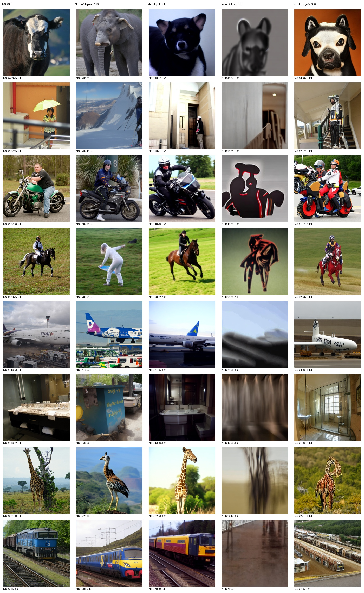
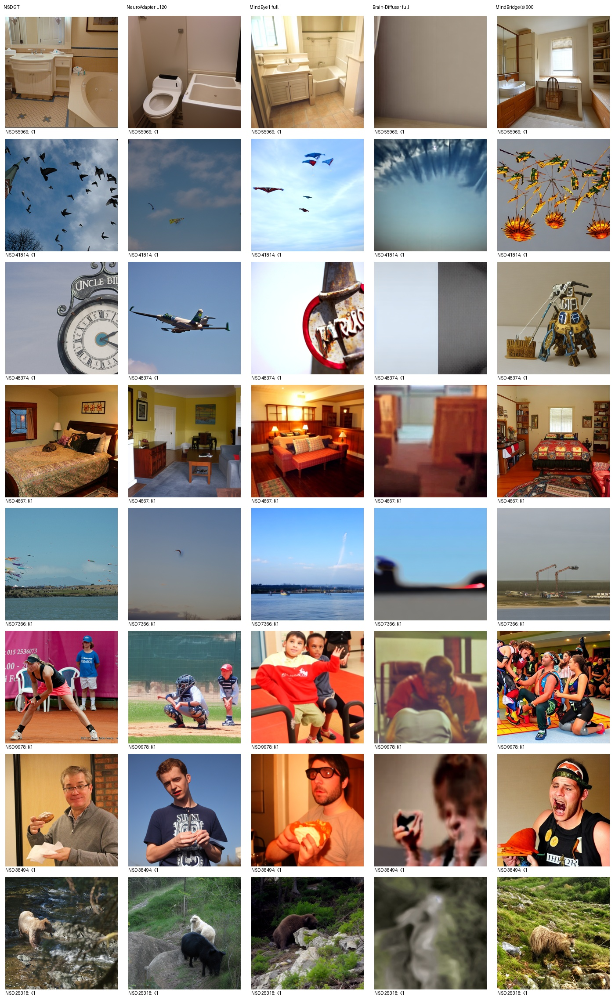

# MindBridge(s) 600 同测试集实测

评价池：100张标准测试图；每图K=1，无选图。

| 方法 | PixCorr | SSIM | Alex(2) | Alex(5) | Incep | CLIP | Eff | SwAV |
|---|---:|---:|---:|---:|---:|---:|---:|---:|
| NeuroAdapter L120 | 0.097118 | 0.309756 | 73.616162 | 83.565657 | 83.505051 | 85.616162 | 0.793281 | 0.481802 |
| MindEye1 full | 0.382118 | 0.288528 | 97.484848 | 98.292929 | 94.969697 | 93.939394 | 0.608740 | 0.344277 |
| Brain-Diffuser full | 0.369911 | 0.370548 | 95.060606 | 93.090909 | 72.636364 | 71.282828 | 0.944776 | 0.628421 |
| MindBridge(s) 600 | 0.162667 | 0.254196 | 88.090909 | 96.343434 | 90.878788 | 89.404040 | 0.761250 | 0.444305 |

Eff/SwAV越低越好，其余越高越好。全部识别指标使用当前同一完整评价池；100图与982图独立评分，不能拼接负例池。

实际使用Subject1 Vanilla完整600轮last，保留图像/文本双脑条件与原VD、UniPC20步、CFG5、mix0.5、seed42。原脚本未指定可选低层AE；未额外拼接MindEye低层。先对每个脑重复maxpool8192再均值，统一评价读取作者原FP32输出张量，PNG仅用于图册。

原训练在421轮保存best发生双rank分歧，完整last审计后继续至600轮；原调度器提前到达终点、后续固定低学习率的实际行为已保留。原生8选1使用GT CLIP，按用户要求列NA，不与无选图K1混用。实际GPU接入因原生重复前向非确定性失败后，明确启用PyTorch确定性算法和CUBLAS_WORKSPACE_CONFIG=:4096:8才通过逐元素身份检查；这不同于上游默认数值运行设置，不声称与作者历史CUDA输出等价。恢复与推理数值限制见MINDBRIDGE_RECOVERY_ZH.md、MINDBRIDGE_INFERENCE_PROTOCOL_ZH.md及实际接入检查记录。

各方法保留原生训练和采样，不代表等训练预算；本项目历史已查看部分测试结果，不是全局盲测。未按本测试成绩调参、选epoch或挑图。旧报告保持不变。

以下为预先锁定32目标的全部图册；AI非盲审阅记录单独附后，生成图册本身不代表已完成审阅。

## 实际首100结论与审阅

MindBridge相对固定NeuroAdapter七项更好、SSIM较低；MindEye1八项均更好。全部32图已实际AI非盲审阅，场景/动作恢复与物种混淆、布局偏移、虚构细节并存，见[完整逐图观察](AI_REVIEW_MINDBRIDGE_ZH.md)。生成及评分exit0。训练最终last SHA为5bd75a992755d70183633df514754b9084b0a4a681284afc83621b2387aac9ad；完整状态见[mindbridge-training-complete.json](mindbridge-training-complete.json)。
