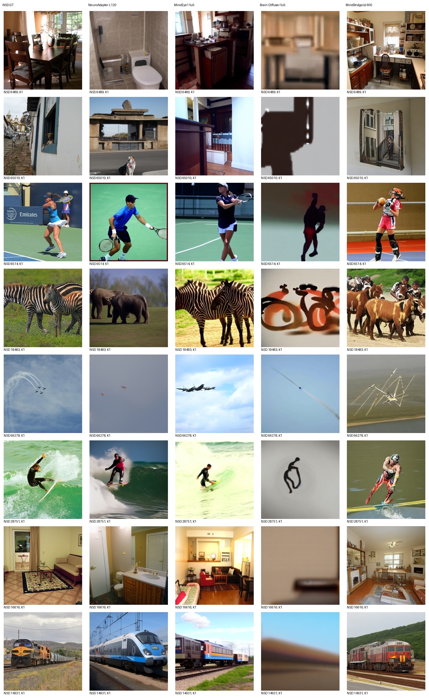
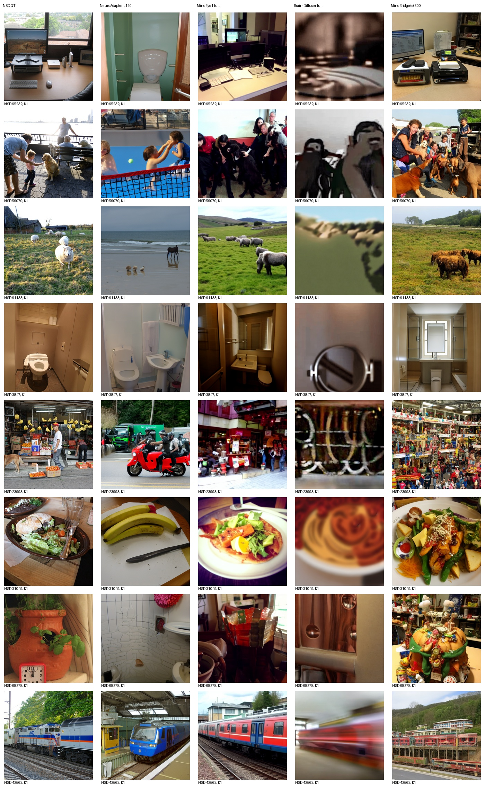
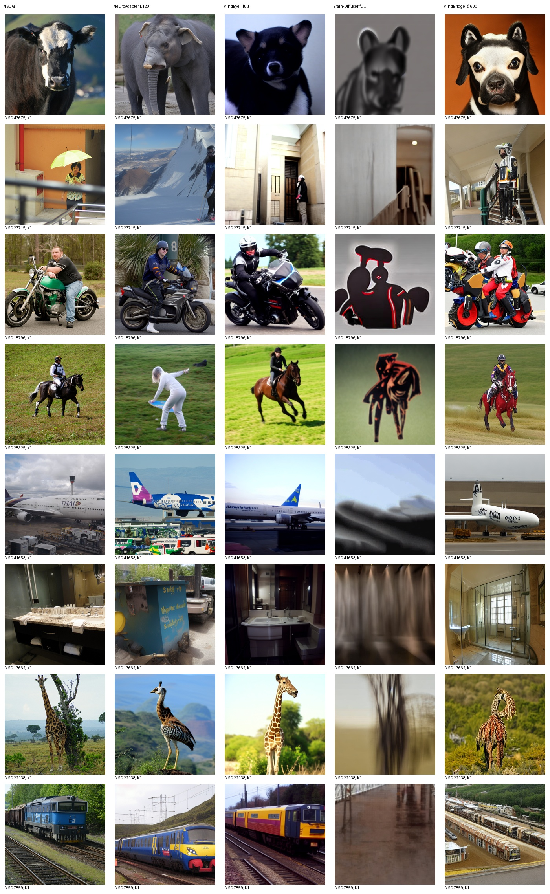
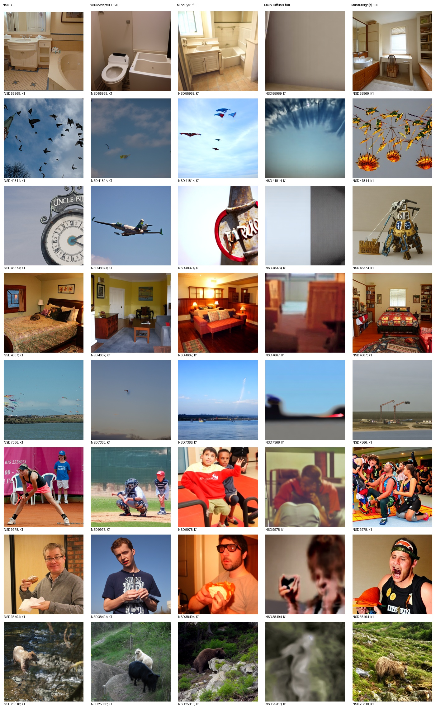

# MindBridge(s) 600 同测试集实测

评价池：982张标准测试图；每图K=1，无选图。

| 方法 | PixCorr | SSIM | Alex(2) | Alex(5) | Incep | CLIP | Eff | SwAV |
|---|---:|---:|---:|---:|---:|---:|---:|---:|
| NeuroAdapter L120 | 0.071610 | 0.306504 | 72.390075 | 83.442744 | 81.472208 | 83.443990 | 0.804701 | 0.488233 |
| MindEye1 full | 0.365033 | 0.288355 | 96.555325 | 98.301330 | 94.264238 | 94.307629 | 0.637356 | 0.357735 |
| Brain-Diffuser full | 0.344484 | 0.372837 | 94.688179 | 92.114223 | 72.628516 | 71.268355 | 0.932979 | 0.626845 |
| MindBridge(s) 600 | 0.157409 | 0.252720 | 85.617050 | 95.646717 | 91.357690 | 91.128696 | 0.761707 | 0.438395 |

Eff/SwAV越低越好，其余越高越好。全部识别指标使用当前同一完整评价池；100图与982图独立评分，不能拼接负例池。

实际使用Subject1 Vanilla完整600轮last，保留图像/文本双脑条件与原VD、UniPC20步、CFG5、mix0.5、seed42。原脚本未指定可选低层AE；未额外拼接MindEye低层。先对每个脑重复maxpool8192再均值，统一评价读取作者原FP32输出张量，PNG仅用于图册。

原训练在421轮保存best发生双rank分歧，完整last审计后继续至600轮；原调度器提前到达终点、后续固定低学习率的实际行为已保留。原生8选1使用GT CLIP，按用户要求列NA，不与无选图K1混用。实际GPU接入因原生重复前向非确定性失败后，明确启用PyTorch确定性算法和CUBLAS_WORKSPACE_CONFIG=:4096:8才通过逐元素身份检查；这不同于上游默认数值运行设置，不声称与作者历史CUDA输出等价。恢复与推理数值限制见MINDBRIDGE_RECOVERY_ZH.md、MINDBRIDGE_INFERENCE_PROTOCOL_ZH.md及实际接入检查记录。

各方法保留原生训练和采样，不代表等训练预算；本项目历史已查看部分测试结果，不是全局盲测。未按本测试成绩调参、选epoch或挑图。旧报告保持不变。

以下为预先锁定32目标的全部图册；AI非盲审阅记录单独附后，生成图册本身不代表已完成审阅。

## 完整982结果与核验

MindBridge相对固定NeuroAdapter七项更好、SSIM较低；MindEye1八项均更好。与首100方向一致，保留场景重建改善及物种/布局失败观察。全部982输出逐文件SHA核验、生成及评分exit0、全池负例评价、GPU释放及保护清单均通过，见[takagi-mindbridge-full-audit.json](takagi-mindbridge-full-audit.json)。固定32图册重建后逐字节未变，复用此前真实[AI非盲审阅](AI_REVIEW_MINDBRIDGE_ZH.md)，没有声称重新审阅。首100原表独立保留。
