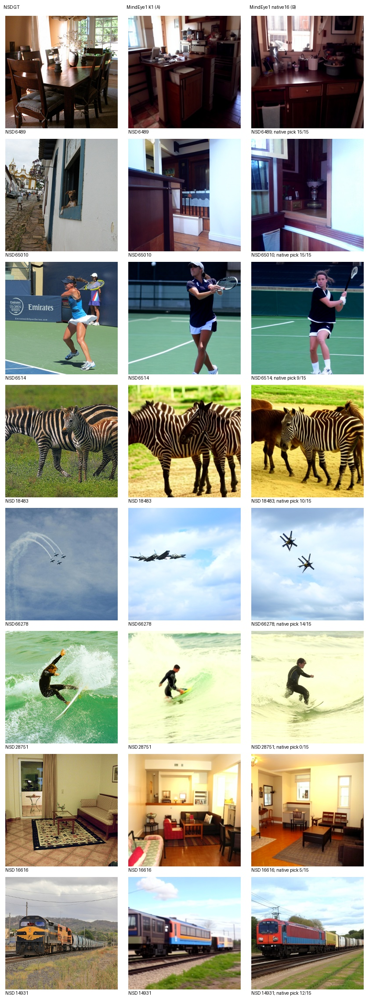
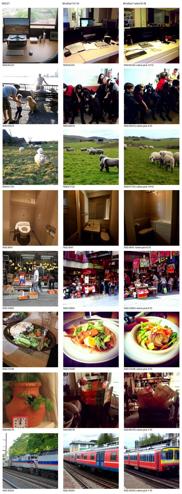
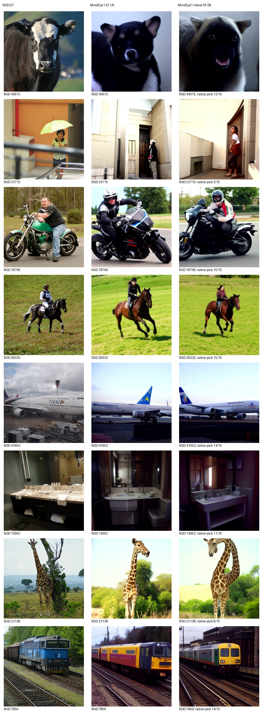
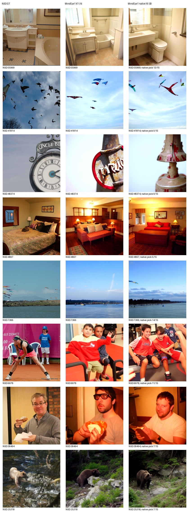

# MindEye1作者原生16候选：独立B表

评价池：100个锁定标准测试目标；每图生成16候选，原作者脑预测CLIP相似度选择1张。选择器不使用GT。

| 协议 | PixCorr ↑ | SSIM ↑ | AN2 ↑ | AN5 ↑ | Incep ↑ | CLIP ↑ | Eff ↓ | SwAV ↓ |
|---|---:|---:|---:|---:|---:|---:|---:|---:|
| A表K1参考（已发布PNG评价） | 0.382118 | 0.288528 | 97.484848 | 98.292929 | 94.969697 | 93.939394 | 0.608740 | 0.344277 |
| B表原生16选1（原张量评价） | 0.394388 | 0.292431 | 97.959596 | 98.969697 | 95.272727 | 95.181818 | 0.601039 | 0.346023 |

A行仅为参考，B结果未写入K1主表。完整高层prior和低层img2img保留；20步CFG3.5、strength0.85、prior100、每图seed42，原batch16，不按质量挑参数。原utils.reconstruction选择器只比较脑预测proj_embeddings与候选CLIP表示；GT仅用于评价、图册。

全部原16候选张量、作者选中下标和SHA均保留，逐文件SHA/形状/范围/有限值已核验，生成和评分exit0。B用原候选张量castFP32评价，PNG仅展示；A此前使用PNG评价。候选批量改变随机流且序列化精度不同，因此不是严格的纯K消融，也不声称逐配置复现论文数值。该100图与完整982负例池独立，不拼接评分。

固定32图由预先冻结列表决定；展示作者脑预测选择的候选，不由AI或GT重新选图。AI非盲观察另附。

相对A表K1，B表七项指标改善，SwAV距离略升（更差）；序列化及批量随机流差异使其不能作为纯K消融。固定32图已逐页实际AI非盲查看，主体失败仍存在，详见[审阅记录](AI_REVIEW_MINDEYE_NATIVE16_ZH.md)。
