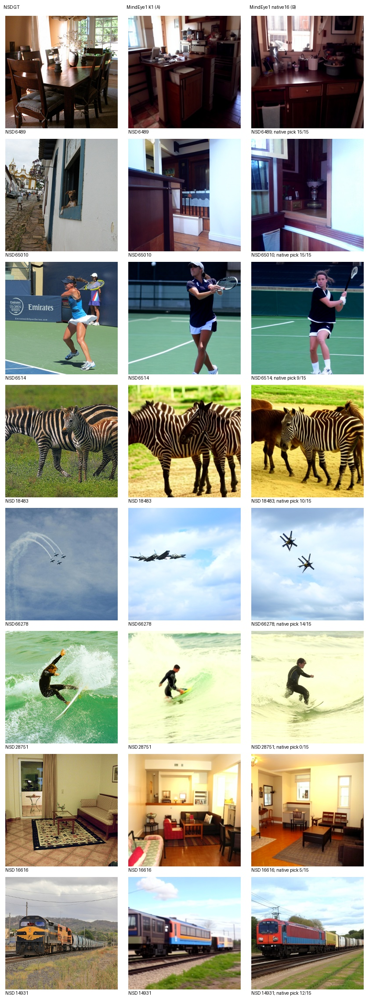
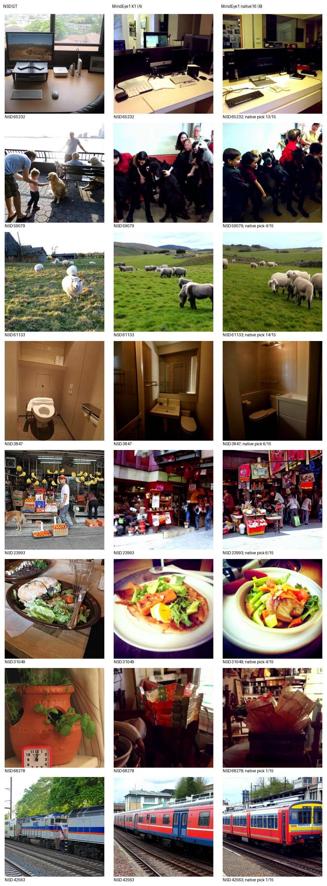
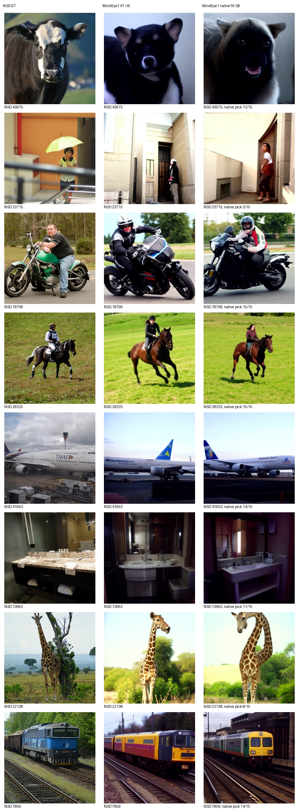
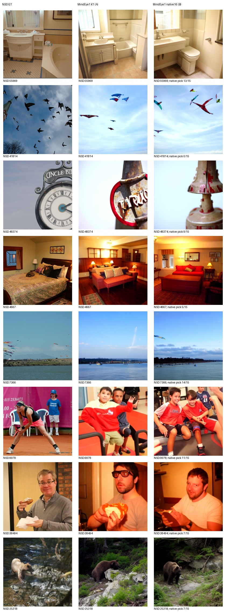

# MindEye1作者原生16候选：独立B表

评价池：982个锁定标准测试目标；每图生成16候选，原作者脑预测CLIP相似度选择1张。选择器不使用GT。

| 协议 | PixCorr ↑ | SSIM ↑ | AN2 ↑ | AN5 ↑ | Incep ↑ | CLIP ↑ | Eff ↓ | SwAV ↓ |
|---|---:|---:|---:|---:|---:|---:|---:|---:|
| A表K1参考（已发布PNG评价） | 0.365033 | 0.288355 | 96.555325 | 98.301330 | 94.264238 | 94.307629 | 0.637356 | 0.357735 |
| B表原生16选1（原张量评价） | 0.378405 | 0.290100 | 97.251651 | 98.796378 | 94.651432 | 94.598284 | 0.635289 | 0.352484 |

A行仅为参考，B结果未写入K1主表。完整高层prior和低层img2img保留；20步CFG3.5、strength0.85、prior100、每图seed42，原batch16，不按质量挑参数。原utils.reconstruction选择器只比较脑预测proj_embeddings与候选CLIP表示；GT仅用于评价、图册。

全部原16候选张量、作者选中下标和SHA均保留，逐文件SHA/形状/范围/有限值已核验，生成和评分exit0。B用原候选张量castFP32评价，PNG仅展示；A此前使用PNG评价。候选批量改变随机流且序列化精度不同，因此不是严格的纯K消融，也不声称逐配置复现论文数值。该100图与完整982负例池独立，不拼接评分。

固定32图由预先冻结列表决定；展示作者脑预测选择的候选，不由AI或GT重新选图。AI非盲观察另附。

完整982的八项指标均优于A表MindEye1 K1；存储精度与批量随机流不同，不能将差异全部归因于K。全部15712候选核验通过；四页固定32图册与首100已实际审阅版本逐字节相同，沿用[原非盲AI审阅](AI_REVIEW_MINDEYE_NATIVE16_ZH.md)，未声称重新查看或盲评。NeuroAdapter权重、元数据、parcel及best历史SHA保持不变。

权重身份与来源保持[模型清单](model_manifest.json)的MindEye1官方高低层两权重；实际运行协议在服务器outputs/mindeye1-native16/protocol.json，全982逐文件位置与SHA见[mindeye-native16-test_full_ids-manifest.csv](mindeye-native16-test_full_ids-manifest.csv)。
