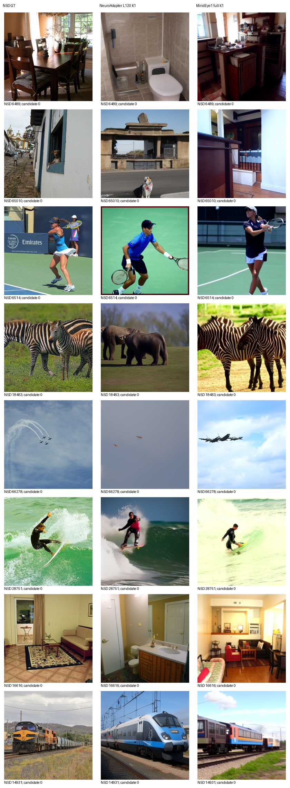
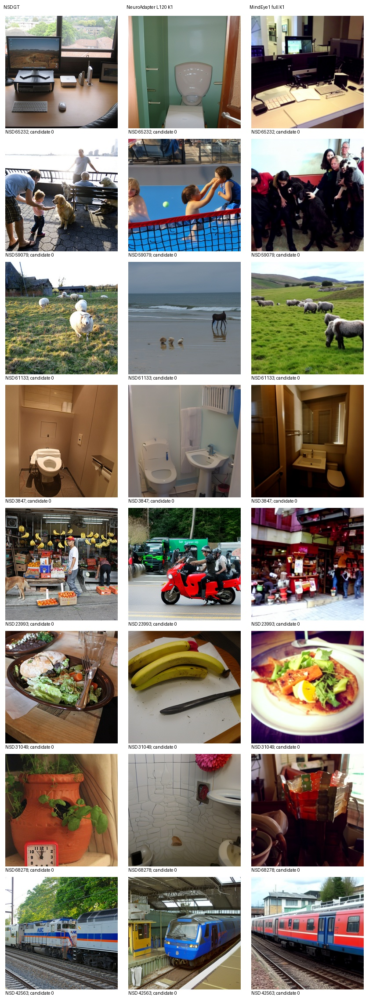
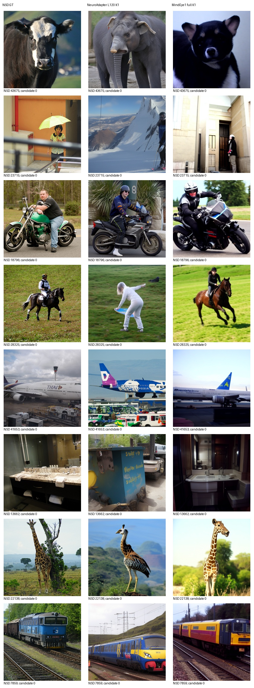
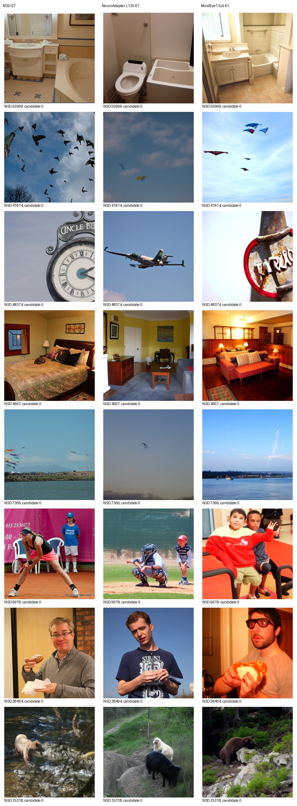

# NSD Subject1 同测试集重建比较

本表评价池：100 张；K=1，无选图。测试清单 SHA256：`63380f171be2852c280fc7c0c2737195e25c808adf4bf9c10c23981b4961732a`。

两种方法保留各自完整脑侧通路、原生预处理和采样。NeuroAdapter 为本项目固定 L120 复现权重，MindEye1 为官方 Subject1 高层与低层权重。该比较不代表等训练预算或论文原生多候选协议。

| 方法 | PixCorr ↑ | SSIM ↑ | AN2 ↑ | AN5 ↑ | Incep ↑ | CLIP ↑ | Eff ↓ | SwAV ↓ |
|---|---:|---:|---:|---:|---:|---:|---:|---:|
| NeuroAdapter | 0.097118 | 0.309756 | 73.616162 | 83.565657 | 83.505051 | 85.616162 | 0.793281 | 0.481802 |
| MindEye1 | 0.382118 | 0.288528 | 97.484848 | 98.292929 | 94.969697 | 93.939394 | 0.608740 | 0.344277 |

Eff 使用冻结实现的 EfficientNet-B1。所有识别指标在同一完整评价池计算；100 图预览与完整测试集分表，不能加权拼接。项目历史看过部分标准测试结果，本轮不根据分数改变模型、参数或候选。

## 固定32图图册

其他方法状态见 [resource_status.csv](resource_status.csv)。未完成方法没有实测分数；Cortex2Image 官方资产链接当前返回404，不能用论文拼图代替。

逐图分数保存在 `metrics/<method>/<pool>/per-image.csv`；原始输出、模型和随机协议独立保存。

## 首批结论与退出核验

同一100图、K=1下，MindEye1在PixCorr、AN2、AN5、Inception、CLIP、Eff、SwAV七项更好；NeuroAdapter仅SSIM更高。不能据此调整本轮权重或挑图。固定32图全部保留，具体改善与失败见[AI审阅](AI_REVIEW.md)。

两方法100图生成与评分退出码均为0；没有新增NeuroAdapter训练。首批发布后继续原锁定982图，其余882图只生成一次，完整池重新评分。

完整池特征提取使用小批前向、全池原公式。五图对照中PixCorr/SSIM及四项识别向量相同；Eff/SwAV最大逐图差异分别0.000110/0.000126（GPU批大小浮点差异），不是逐位相等，详见metric-batching-validation.json。首批100图仍使用原整批调用。
