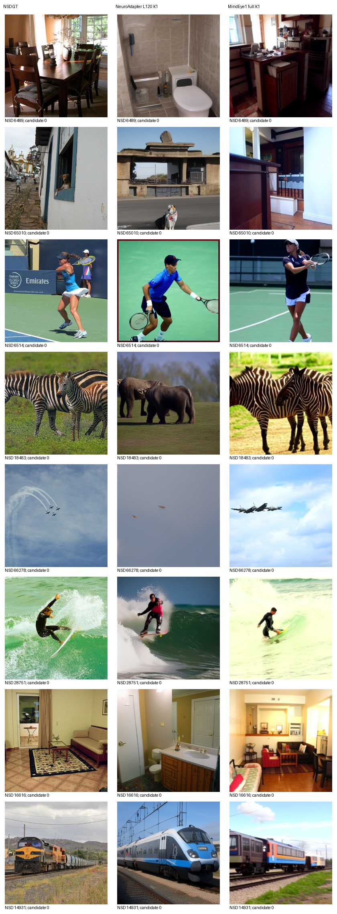
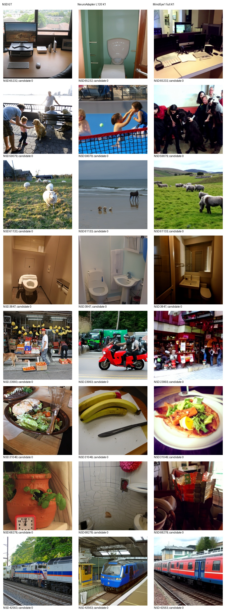
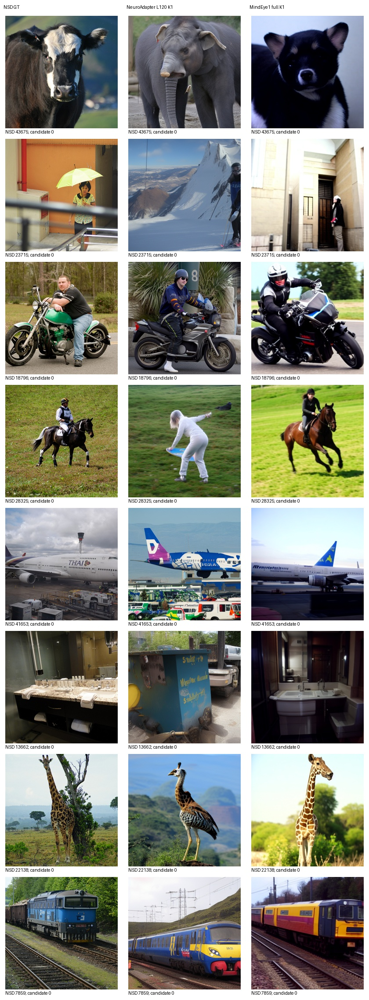
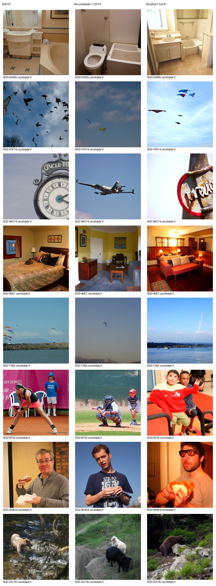

# NSD Subject1 同测试集重建比较

本表评价池：982 张；K=1，无选图。测试清单 SHA256：`4c438772ffa978ab8c5f781b8a3fc73df0159ae4892dc39d896f05a413d36441`。

两种方法保留各自完整脑侧通路、原生预处理和采样。NeuroAdapter 为本项目固定 L120 复现权重，MindEye1 为官方 Subject1 高层与低层权重。该比较不代表等训练预算或论文原生多候选协议。

| 方法 | PixCorr ↑ | SSIM ↑ | AN2 ↑ | AN5 ↑ | Incep ↑ | CLIP ↑ | Eff ↓ | SwAV ↓ |
|---|---:|---:|---:|---:|---:|---:|---:|---:|
| NeuroAdapter | 0.071610 | 0.306504 | 72.390075 | 83.442744 | 81.472208 | 83.443990 | 0.804701 | 0.488233 |
| MindEye1 | 0.365033 | 0.288355 | 96.555325 | 98.301330 | 94.264238 | 94.307629 | 0.637356 | 0.357735 |

Eff 使用冻结实现的 EfficientNet-B1。所有识别指标在同一完整评价池计算；100 图预览与完整测试集分表，不能加权拼接。项目历史看过部分标准测试结果，本轮不根据分数改变模型、参数或候选。

## 固定32图图册

其他方法状态见 [resource_status.csv](resource_status.csv)。未完成方法没有实测分数；Cortex2Image 官方资产链接当前返回404，不能用论文拼图代替。

逐图分数保存在 `metrics/<method>/<pool>/per-image.csv`；原始输出、模型和随机协议独立保存。

## 完整测试结论

完整982图与首100图方向一致：MindEye1在PixCorr、AN2、AN5、Inception、CLIP、Eff、SwAV七项更好，NeuroAdapter仅SSIM更高。各方法保留原生完整通路与采样，不代表等训练预算。未据测试分数调参或选图。

[首100图原报告与结论](RESULTS_TEST100_ZH.md)保留不变。固定32图输出没有改变，全部页沿用[已完成的AI审阅](AI_REVIEW.md)，不是人工盲评。

两方法完整生成与评分退出码均为0；保护清单全部通过，无新增NeuroAdapter训练。完整982图特征前向batch16、全池原公式；浮点差异及五图验证见[验证记录](metric-batching-validation.json)，不声称与整批逐位相等。
