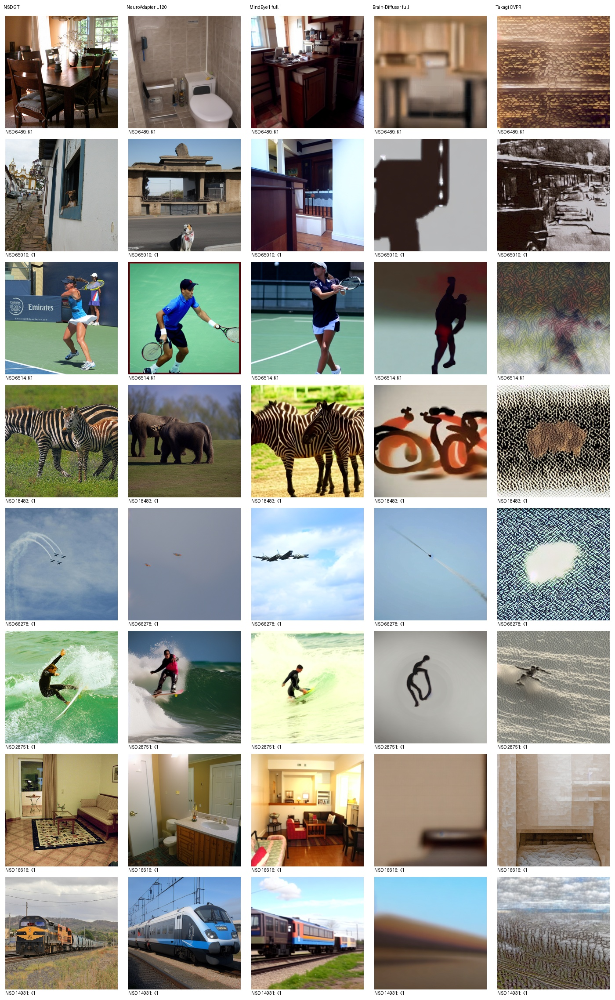
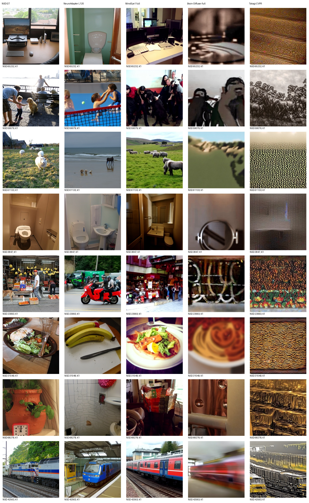
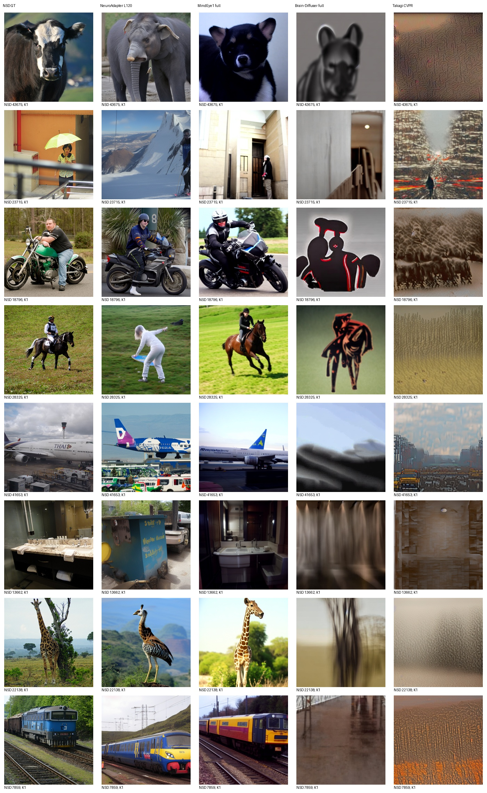
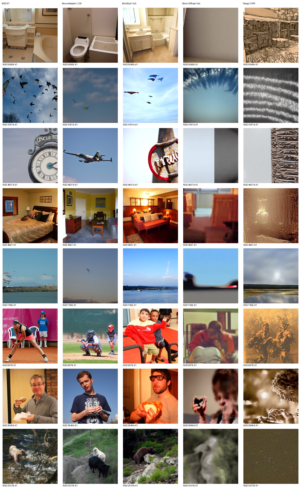

# Takagi CVPR 同测试集实测

评价池：100张标准测试图；每图K=1，无选图。

| 方法 | PixCorr | SSIM | Alex(2) | Alex(5) | Incep | CLIP | Eff | SwAV |
|---|---:|---:|---:|---:|---:|---:|---:|---:|
| NeuroAdapter L120 | 0.097118 | 0.309756 | 73.616162 | 83.565657 | 83.505051 | 85.616162 | 0.793281 | 0.481802 |
| MindEye1 full | 0.382118 | 0.288528 | 97.484848 | 98.292929 | 94.969697 | 93.939394 | 0.608740 | 0.344277 |
| Brain-Diffuser full | 0.369911 | 0.370548 | 95.060606 | 93.090909 | 72.636364 | 71.282828 | 0.944776 | 0.628421 |
| Takagi CVPR | 0.304914 | 0.219792 | 78.959596 | 77.080808 | 66.060606 | 67.252525 | 0.935380 | 0.681406 |

Eff/SwAV越低越好，其余越高越好。全部识别指标使用当前同一完整评价池；100图与982图独立评分，不能拼接负例池。

实际运行原CVPR SD1.4完整脑侧early潜变量与ventral文本回归条件；原50步DDIM日程、strength0.8（实际40步去噪）、CFG5、K1原第一候选。每图seed42在模型初始化前；缓存模型恢复初始化后的随机状态，首个固定目标的冷加载/缓存输出逐像素一致。生成不读取GT条件。

复现限制：兼容环境Python3.10/Torch2.0不等于作者历史环境；上游未锁版本的himalaya使用0.4.11。特征提取固定seed42按本次9841目标顺序，不能声称与作者历史73k分片随机流等价。只训练原脑回归模块，生成器冻结。

各方法保留原生训练和采样，不代表等训练预算；本项目历史已查看部分测试结果，不是全局盲测。未按本测试成绩调参、选epoch或挑图。旧报告保持不变。

以下为预先锁定32目标的全部图册；AI非盲审阅记录单独附后，生成图册本身不代表已完成审阅。

## 实际结论与质量限制

本次输出广泛出现密集纹理和主体缺失，未达到论文展示的视觉质量；完整流程运行成功不等于复现成功。MindEye1在当前100池八项均更好；相较固定NeuroAdapter，Takagi仅PixCorr、Alex(2)更高，其余六项更差。全部32目标的逐页观察见[AI非盲审阅](AI_REVIEW_TAKAGI_ZH.md)，失败样例全部保留。没有据本测试结果修改任何模型或采样设置。

权重、脑回归文件及SHA见[takagi-regression-complete.json](takagi-regression-complete.json)与[takagi-test100-complete.json](takagi-test100-complete.json)；首图接入逐像素验证见[takagi-decoder-cache-validation.json](takagi-decoder-cache-validation.json)。原始逐图八指标在metrics/takagi/test100_ids/per-image.csv；同池比较表见[takagi-test100_ids-comparison.csv](takagi-test100_ids-comparison.csv)。生成和统一评分均exit0。
