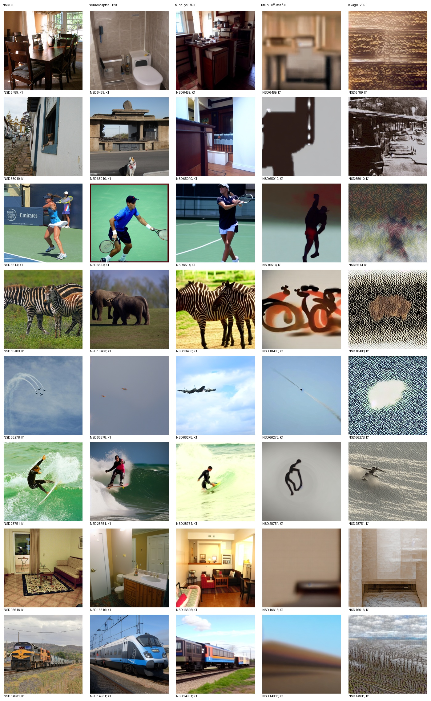
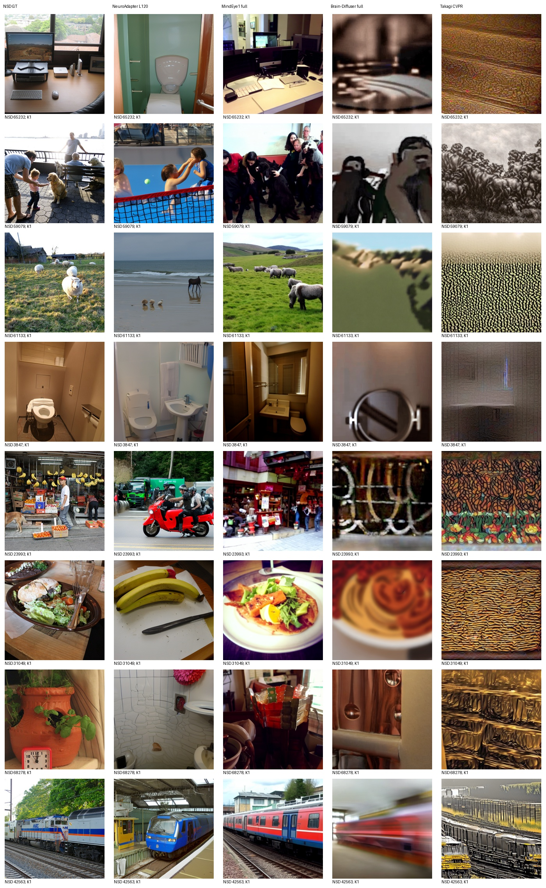
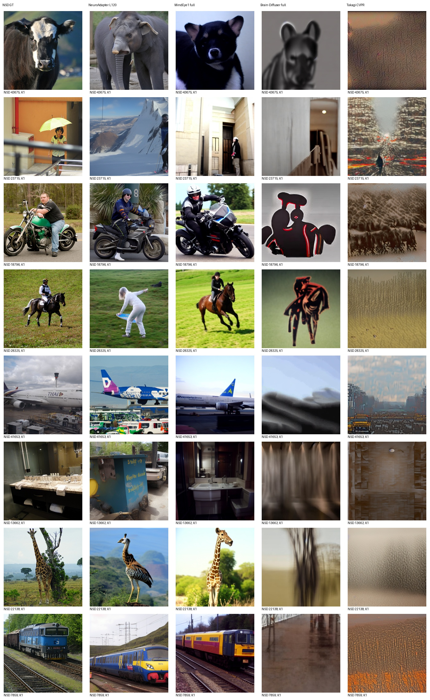
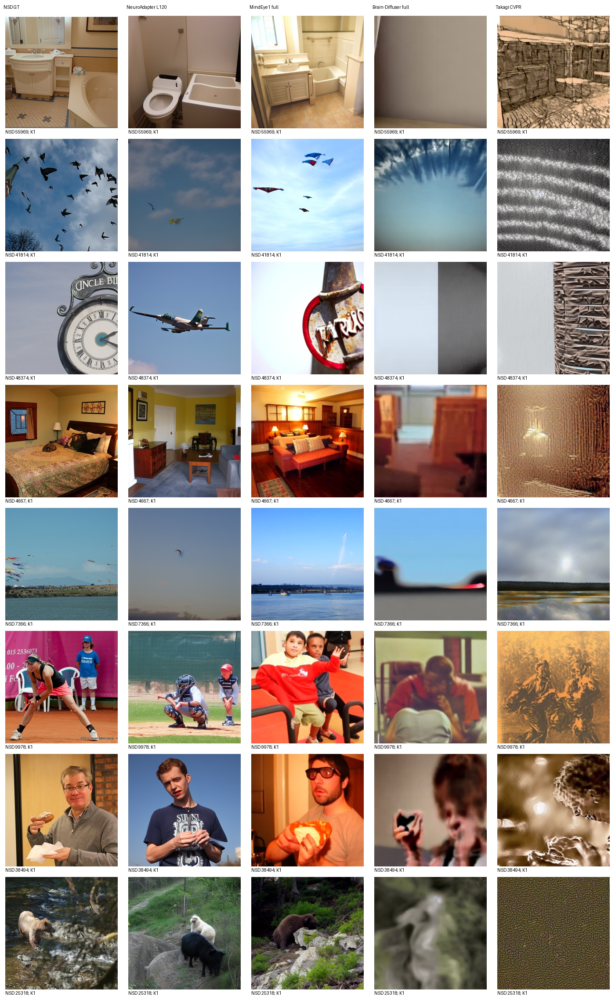

# Takagi CVPR 同测试集实测

评价池：982张标准测试图；每图K=1，无选图。

| 方法 | PixCorr | SSIM | Alex(2) | Alex(5) | Incep | CLIP | Eff | SwAV |
|---|---:|---:|---:|---:|---:|---:|---:|---:|
| NeuroAdapter L120 | 0.071610 | 0.306504 | 72.390075 | 83.442744 | 81.472208 | 83.443990 | 0.804701 | 0.488233 |
| MindEye1 full | 0.365033 | 0.288355 | 96.555325 | 98.301330 | 94.264238 | 94.307629 | 0.637356 | 0.357735 |
| Brain-Diffuser full | 0.344484 | 0.372837 | 94.688179 | 92.114223 | 72.628516 | 71.268355 | 0.932979 | 0.626845 |
| Takagi CVPR | 0.279962 | 0.223739 | 78.060128 | 76.558481 | 66.985972 | 69.996533 | 0.944405 | 0.674860 |

Eff/SwAV越低越好，其余越高越好。全部识别指标使用当前同一完整评价池；100图与982图独立评分，不能拼接负例池。

实际运行原CVPR SD1.4完整脑侧early潜变量与ventral文本回归条件；原50步DDIM日程、strength0.8（实际40步去噪）、CFG5、K1原第一候选。每图seed42在模型初始化前；缓存模型恢复初始化后的随机状态，首个固定目标的冷加载/缓存输出逐像素一致。生成不读取GT条件。

复现限制：兼容环境Python3.10/Torch2.0不等于作者历史环境；上游未锁版本的himalaya使用0.4.11。特征提取固定seed42按本次9841目标顺序，不能声称与作者历史73k分片随机流等价。只训练原脑回归模块，生成器冻结。

各方法保留原生训练和采样，不代表等训练预算；本项目历史已查看部分测试结果，不是全局盲测。未按本测试成绩调参、选epoch或挑图。旧报告保持不变。

以下为预先锁定32目标的全部图册；AI非盲审阅记录单独附后，生成图册本身不代表已完成审阅。

## 完整982结果与核验

Takagi相对固定NeuroAdapter仅PixCorr和Alex2更好；MindEye1与Brain-Diffuser八项均更好。纹理化和主体失败仍限制解释，不声称复现论文视觉质量。全部982输出逐文件SHA核验、生成及评分exit0、全池负例评价、GPU释放及保护清单均通过，见[takagi-mindbridge-full-audit.json](takagi-mindbridge-full-audit.json)。固定32图册重建后逐字节未变，复用此前真实[AI非盲审阅](AI_REVIEW_TAKAGI_ZH.md)，没有声称重新审阅。首100原表独立保留。
