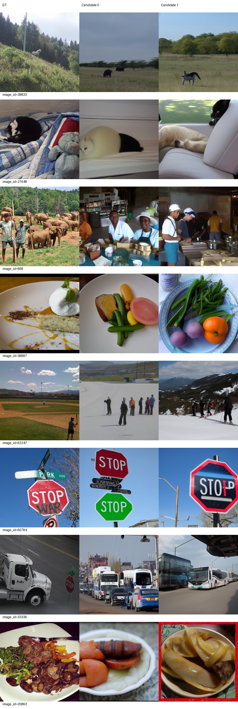
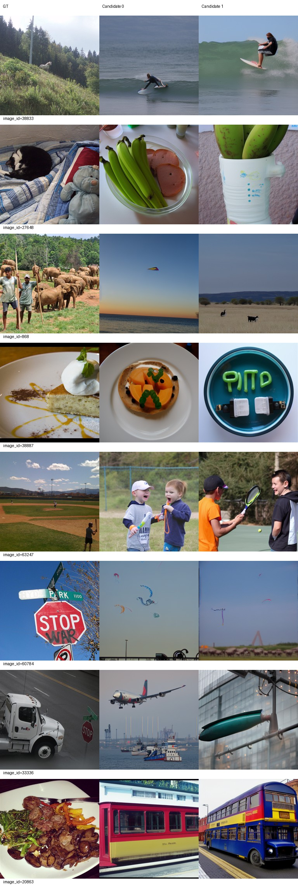
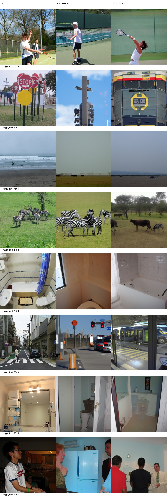
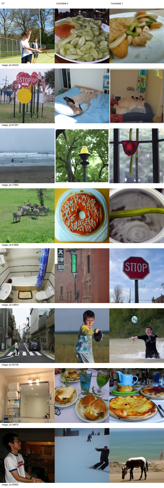
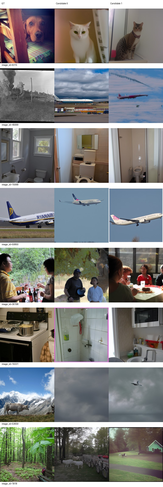
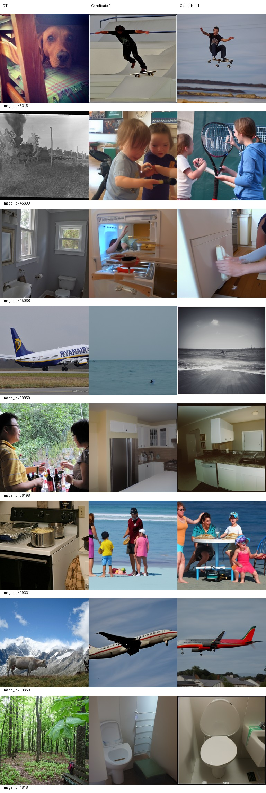
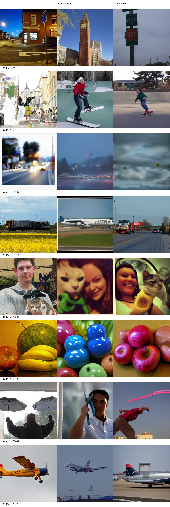
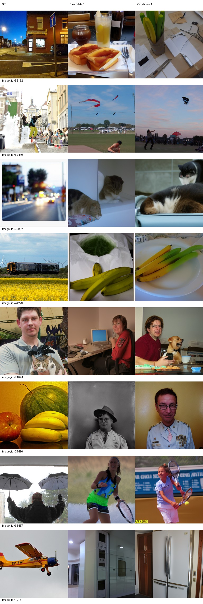

# L120脑输入对应性对照：已完成，零训练更新

结论：在本次固定L120权重、固定打乱映射和原500张内部开发图像下，与目标正确对应的脑输入有明显贡献。正确条件S=82.81904，打乱条件S=49.32258，差值+33.49646个百分点；名义95%描述性区间[31.58058, 35.40715]。全部八项指标的均值和辅助区间方向均支持正确对应条件。这个结论不等于重建已准确，也不能证明继续增加训练轮次有收益。

本次按[事先写定的计划](PLAN.md)只做这一项输入对应性对照，没有训练、改学习率或更新best。权重是L120原导出（120轮、63840更新），按L120/L130/L140既有固定val100 S最高选定；运行整体仍停在L140/74480更新。

正确条件的全部500图结果直接复用，既不重新生成也不重新评分。打乱条件在这500张图之间作固定、无自配对的一一映射，每份脑输入使用一次；仅替换原预处理后的左/右脑输入。目标ID、目标GT与目标ID派生的两个完整采样随机流不变，GT与供体图像均不进入生成条件。原作者decoder、指标实现、FP32/TF32/backend、candidate batch1、50步扩散和CFG4保持不变。未触碰标准test。

新增生成预算实际为500图×2候选=1000张，另有原固定两图×2候选=4张恒等复现检查。恒等检查的候选、GT和seed与历史L120逐像素/逐值完全一致，检查通过后才运行打乱条件。500行实际GuidanceGenerator输入SHA均匹配映射供体，并且不同于对应目标的原脑输入；目标GT和候选seed全部保留。500张图的候选数组均随输入改变。

## 完整500图结果

两个候选各自在完整500负例池独立计算作者八项指标，再取均值。S=(Alex(5)+Incep+CLIP)/3；特征识别率和S用百分数标度，差值为百分点，不能解读为500类直接分类正确率。Eff/SwAV越低越好，其余越高越好。所有差值统一为“正确−打乱”。

| 指标 | 正确对应 | 打乱对应 | 差值 | 名义95%描述性区间 | 方向 |
|---|---:|---:|---:|---|---|
| PixCorr ↑ | 0.05387 | 0.00261 | +0.05126 | [0.03805, 0.06433] | 支持正确对应 |
| SSIM ↑ | 0.30566 | 0.28809 | +0.01757 | [0.01074, 0.02452] | 支持正确对应 |
| Alex(2) ↑ | 70.64449 | 49.60160 | +21.04289 | [18.34848, 23.74590] | 支持正确对应 |
| Alex(5) ↑ | 82.15631 | 49.20361 | +32.95271 | [30.33142, 35.52558] | 支持正确对应 |
| Incep ↑ | 83.54950 | 48.96032 | +34.58918 | [31.94401, 37.27518] | 支持正确对应 |
| CLIP ↑ | 82.75130 | 49.80381 | +32.94749 | [30.08894, 35.68261] | 支持正确对应 |
| Eff ↓ | 0.81628 | 0.97264 | -0.15636 | [-0.17097, -0.14218] | 支持正确对应 |
| SwAV ↓ | 0.49676 | 0.65068 | -0.15392 | [-0.16378, -0.14375] | 支持正确对应 |
| S ↑ | 82.81904 | 49.32258 | +33.49646 | [31.58058, 35.40715] | 支持正确对应 |

八项均支持正确对应条件，未发现某项总体均值或辅助区间反向。不过正确条件的PixCorr仅0.05387、SSIM为0.30566，绝对空间/细节重建仍弱，不能用S较高掩盖整类错误和布局偏差。

## 原固定100图监控结果

打乱条件从相同500图输出提取原monitor100 ID后，独立使用100负例池评分；正确条件复用原monitor100结果。下面仅在同一100图池内比较，不与上表混算或相减。

| 指标 | 正确对应 | 打乱对应 | 正确−打乱 |
|---|---:|---:|---:|
| PixCorr ↑ | 0.06216 | -0.00505 | +0.06721 |
| SSIM ↑ | 0.31608 | 0.29386 | +0.02223 |
| Alex(2) ↑ | 72.41414 | 46.76263 | +25.65152 |
| Alex(5) ↑ | 83.47475 | 46.79293 | +36.68182 |
| Incep ↑ | 85.71212 | 48.61616 | +37.09596 |
| CLIP ↑ | 84.78283 | 49.63131 | +35.15152 |
| Eff ↓ | 0.79208 | 0.96875 | -0.17667 |
| SwAV ↓ | 0.49243 | 0.64569 | -0.15326 |
| S ↑ | 84.65657 | 48.34680 | +36.30976 |

## 不确定性与解释范围

主比较是事先固定的correct−permuted S。先在每张图内平均两个候选，再以500个图像配对行作10000次重采样，bootstrap seed=2026092402；映射seed=2026092401。主S和八项辅助指标均报名义95%百分位区间，辅助项未作多重比较校正，未把1000个候选当作独立样本。逐图识别值保留原500负例池定义，重采样只用于既有配对值的描述性均值区间。

这里仅有一份固定无自配对置换；同一500个图像同时充当目标和供体，配对行存在关联。上述区间只能描述这份映射、这份已选择权重、这批反复使用内部开发图像下的结果，不是完整置换检验p值，也不提供无条件独立样本、独立测试或跨训练seed结论，更未校正历史自适应选择。效应和图册支持“当前模型利用了与目标对应的脑信号”；不支持“模型已修好”“重建高保真”或“应该继续训练”。没有据此改变选优规则或模型指针。

## 固定图册：AI审阅

审阅者为AI，不是人工盲评。已实际查看正确条件4页与打乱条件4页，覆盖原32验证ID的全部两候选，不筛样本。下面示例帮助解释全部图册，不构成新的评分或选优标准。

- 正确对应保留了较多主体和场景：27648仍为猫，20520仍为网球运动，60784仍为STOP标志，61868仍有斑马，50850/1015仍为飞机。打乱后这些分别变成香蕉、食物、风筝、食物/餐盘、海面或厨房。许多打乱输出本身仍像可辨认的自然图像，主要问题是与目标的类别和场景不对应。
- 正确输入的局限也明显：6315的狗仍被生成为猫；45699的蒸汽火车成为飞机；19331的厨房偏成浴室；17865的海滩成为草原动物；53659的山地牛成为云层/海鸟。38833保留草地动物但山坡/森林布局和动物细节不对，71624保留人和猫但人物身份、构图与道具变化很大。匹配脑输入带来的指标提升并不消除这些失败。
- 打乱不是逐图必然更差：38887候选0呈盘中糕点，比正确条件的肉菜/蔬菜在粗类别上更接近GT甜点，但形状与装饰仍不一致，打乱候选1也不匹配；868打乱候选1出现远处草原动物，比正确条件的室内人群在场景上更近，但无法从图册确认物种且未重建GT的大象群与人物布局。这些局部偶合保留在完整图册中，不能据此筛候选。
- 正确条件两个候选之间也会发生类别差异，例如39490一个偏彩色球状物、另一个为苹果；59470一个偏滑雪、另一个为滑板。打乱条件同样存在两候选不同类别，未按GT挑选较好的一个。

下表直接展示所有固定验证页面；点击图像可查看原图。左列复用原L120文件，右列为本次新输出。

| 页码 | 正确脑输入（原L120） | 打乱脑输入 |
|---|---|---|
| 1 |  |  |
| 2 |  |  |
| 3 |  |  |
| 4 |  |  |

原16训练图仅作历史背景，直接链接[第1页](../lr-half-to120/train-atlas/atlas-1.jpg)、[第2页](../lr-half-to120/train-atlas/atlas-2.jpg)。本次没有生成训练集打乱条件、重新评分或把训练16用于结论。

## 产物、运行与停止状态

服务器根目录：`/data1/matengyu/geyugong/neuroadapter-author-first`。原权重为`runs/subject01-author-fp32-seed42-lr5e-5-from100/exports/epoch-120/inference.pt`；SHA256为`bed56671f4e48ccf031e41c1daa36d473a4e325e94e3264aa1b21e08080fd798`。本次不产生新权重，也不变更完整checkpoint或主线best。原L110/L120/L130/L140及主线历史状态均保留。

新增原始输出在`runs/subject01-author-fp32-seed42-lr5e-5-from100/comparison/brain-correspondence-l120/permuted500/`（500个NPZ、每个两候选），恒等复现单独位于`identity2/`。权重、NPZ和原始数据留在服务器，不推送到GitHub。

- [500图均值与两候选结果](permuted/val500/metrics.json)、[候选0 CSV](permuted/val500/candidate-0.csv)、[候选1 CSV](permuted/val500/candidate-1.csv)。
- [完整500 ID清单](../../configs/val_ids.txt)、[原monitor100 ID清单](../../configs/monitor100_ids.txt)。
- [固定100结果](permuted/val100/metrics.json)、[全部比较与区间](comparison.json)、[500行配对值及差值](paired-correct-minus-permuted.csv)。
- [固定映射](brain-map.json)、[500行真实脑输入审计](brain-input-audit.json)、[两图复现](identity-reproduction.json)、[图册审阅范围与哈希](ai-review.json)。
- [实际执行事件和退出码](execution-events.jsonl)、[两次decoder完整命令](decoder-commands.json)、[最终交付核验](delivery-checks.json)、[1745项历史保护清单](protected-before.json)。

启动前确认无重复任务且GPU空闲。正式命令（服务器根目录、tmux `author-brain-correspondence`）：

```bash
runtime/env/bin/python scripts/brain_correspondence.py > logs/brain-correspondence-controller.log 2>&1
```

prepare先在正式生成前运行并exit0；identity于2026-09-24 11:21:21—11:21:44完成并exit0；控制器11:22:37启动，generate于12:13:45退出0，score于12:14:54退出0，compare及控制器于12:23:08退出0（均北京时间）。最终核验时tmux和所有实验子进程已退出，GPU计算进程为空。

compare阶段逐一核验全部1745项历史文件SHA均未变化，包括原L120输出、主线best、历史报告和训练状态。交付时再次确认epoch日志和最新progress未变，仍为140轮/74480更新，新增训练更新严格为0。评分脚本与输入包装器SHA匹配开跑前记录，原decoder和原指标实现未改。

本实验计算和AI图册审阅已完成，结果独立交付；到此停止，不自动新增条件、seed、学习率或训练轮次。
