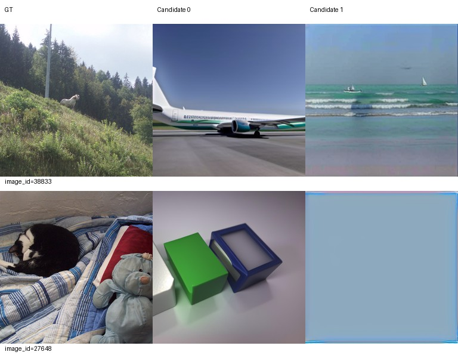

# Epoch 1：解码与恢复检查

首个真实epoch完成，训练耗时1256.95秒（约20分57秒），覆盖8500个独立训练image_id；Accelerate期末补齐4个样本，总处理8504个。每rank 1063个microbatch，532次真实optimizer update，无跳步。最后一个累积窗口只有1个microbatch，每rank batch4；按已固定Accelerate行为处理，没有丢弃图片。LR仍为1e-4。

完整checkpoint-1已保存，训练进程退出码0；独立解码评价退出码0。固定验证ID 38833、27648，每图2候选，推理导出与完整checkpoint生成结果逐像素一致。本次检查没有运行阶段性能选优。

已实际查看下方全部两图：林地中动物的GT被重建为飞机或海面；室内猫的GT被重建为方形物件或近乎单色平面，存在整类内容错误。此处只是epoch1运行检查，不能作为性能合格证据，也不能据此宣判方法失败或改变配置。

17:58:19已从checkpoint-1完整恢复，继续同一轨迹至epoch5。下一次正式反馈为固定100张验证图×2候选八项指标和固定图册。累计授权上限仍为20。
