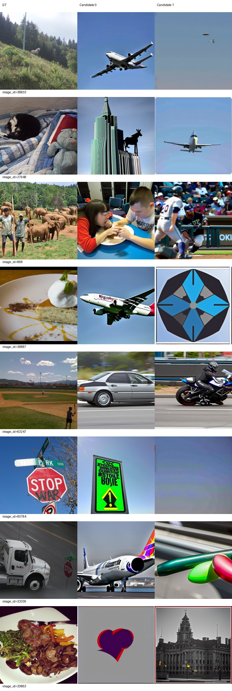
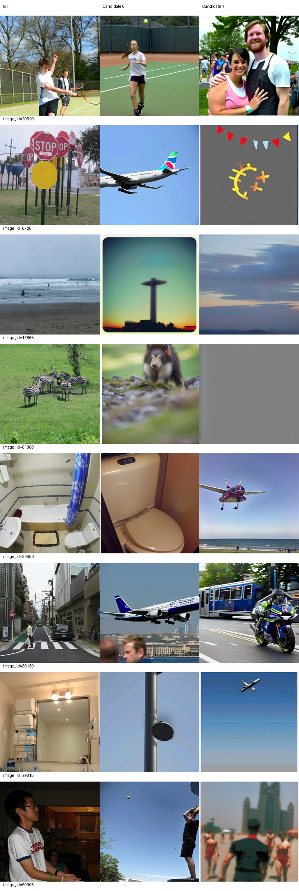
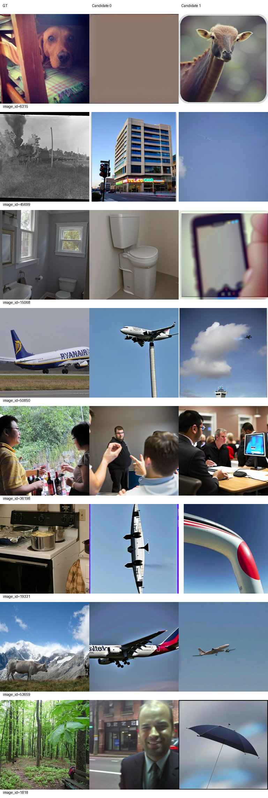
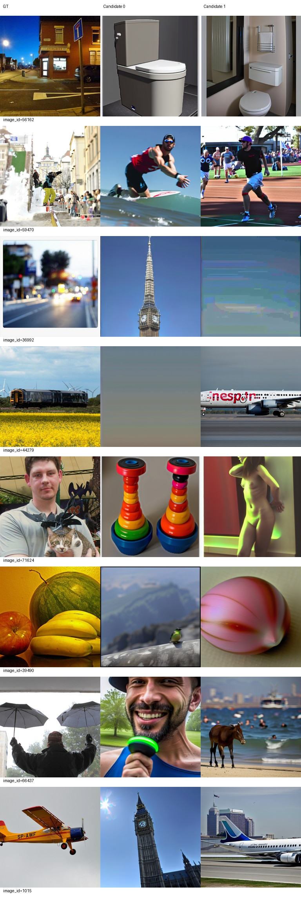
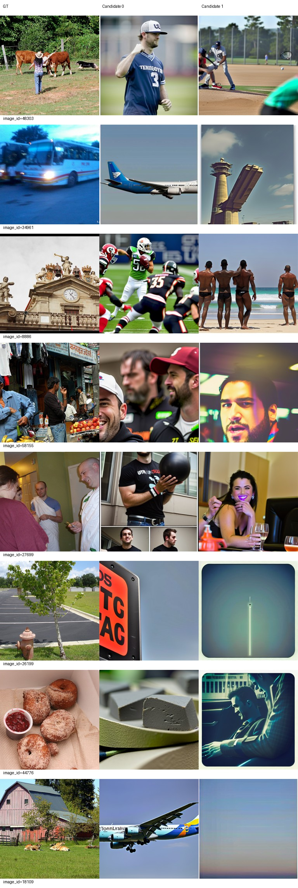
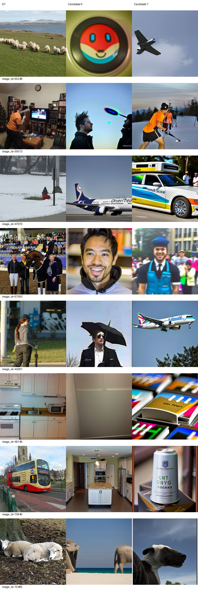

# Epoch 10

同一固定100张历史开发验证图，每图2候选分别评分后平均；没有候选选择。训练16图仅为辅助观察，二选一负例池不同，不与验证识别率直接相减。

| 集合 | PixCorr | SSIM | Alex(2) | Alex(5) | Incep | CLIP | Eff | SwAV | S |
|---|---|---|---|---|---|---|---|---|---|
| val100 | 0.00151 | 0.31741 | 56.70202 | 63.59091 | 59.94949 | 62.95960 | 0.94541 | 0.63783 | 62.16667 |
| train16 | 0.02449 | 0.25386 | 55.62500 | 65.83333 | 59.37500 | 58.33333 | 0.96242 | 0.67734 | 61.18056 |

相同100图相对前一阶段变化：PixCorr +0.00075；SSIM +0.02300；Alex(2) +0.76768；Alex(5) +0.09596；Incep +3.66667；CLIP +1.17677；Eff +0.00638；SwAV +0.01053。Eff/SwAV越低越好，其余越高越好。

图册按预先固定ID展示GT和两个候选，不按效果筛选。

当前按固定val100 S保留的best_so_far为epoch 10，仅为本阶段开发选择；所有里程碑完整状态均保留。科学设置未调整。

## 固定图册人工观察（2026-09-21）

已实际下载并查看全部4页验证图册（固定32图）及2页训练图册（固定16图），每图GT和两个候选均查看。整类、整场景错误仍突出：38833林地动物、33336卡车、53659山地牛仍出现飞机；56162夜间街道的两个候选都是卫生间。20520的候选0保留网球场景，34854和15068的候选0保留卫生间大类，但另一候选明显偏离。50850两候选仍含飞机，但位置、尺度和构图与GT不同；1015较第5轮失去两候选均为飞机的一致性。部分候选呈近乎纯色或抽象图案（如61868候选1、6315候选0、44279候选0）。因此不能把整体表现描述为只差细节，也不能由少数大类命中声称场景已稳定。

训练16图也没有稳定重建：48303牛群场景两候选均偏向棒球人物；70940公交车变成厨房或罐状物；15485羊变成象或牛。42991的候选1由第5轮的棒球人物变为飞机，局部变化并非一致改善。训练PixCorr=0.02449、SSIM=0.25386、CLIP=58.33333%；验证PixCorr=0.00151、SSIM=0.31741、CLIP=62.95960%。训练与验证两组均仍有较弱的目标对应，不能用16/100不同负例池的识别率差推断过拟合。

同一100图、同一候选种子比较：S从60.52020升至62.16667（+1.64646），Incep提高3.66667个百分点，CLIP提高1.17677个百分点，Alex(5)仅提高0.09596个百分点。PixCorr仍接近0；Eff和SwAV距离分别增加0.00638、0.01053，方向是变差。当前是部分指标上升、部分下降，图册也未呈现稳定的整体改观；未做显著性检验，不声称可靠提升或复现失败。

保留checkpoint-5和checkpoint-10完整状态及相应导出；按预定val100 S，best_so_far更新为epoch10。原导出、best副本、同服务器backup副本SHA256均为1b5988b8fc48dbe6c179ec8539fdf996fc414a8911b142b0fc08a905d17aafc1。backup是同服务器同文件系统第二份，不是异地备份。训练10轮累计5320次更新、85040实际处理样本；训练及eval-10退出码均为0。控制器已从完整checkpoint-10恢复至累计20轮。

建议继续既定设置完成20轮及500图/同100图评价后停止，再决定后续实验。当前不改学习率、精度、数据、候选策略或损失；没有启动50轮阶段。
