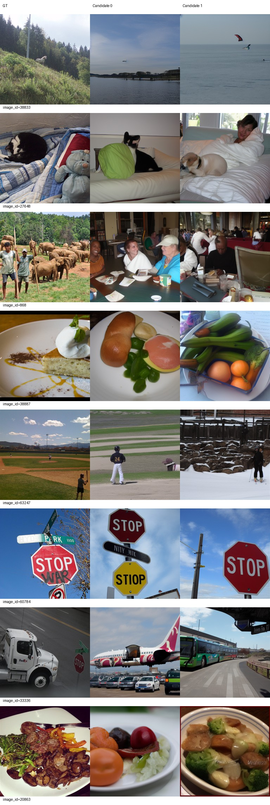
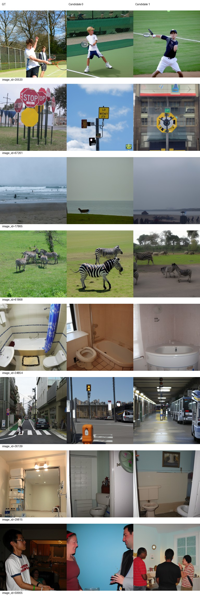
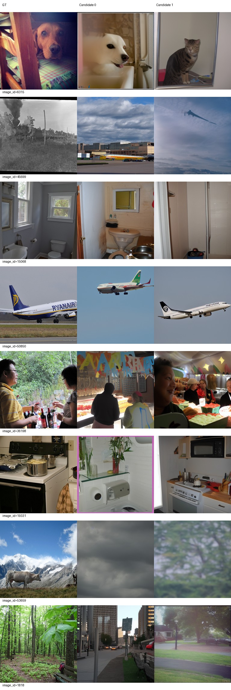
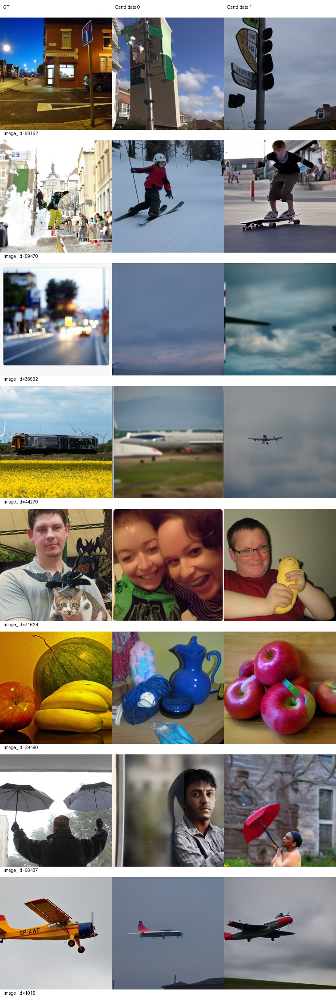
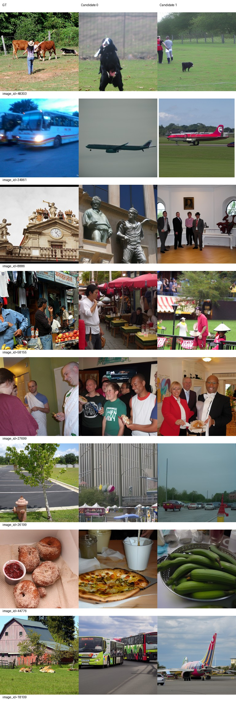
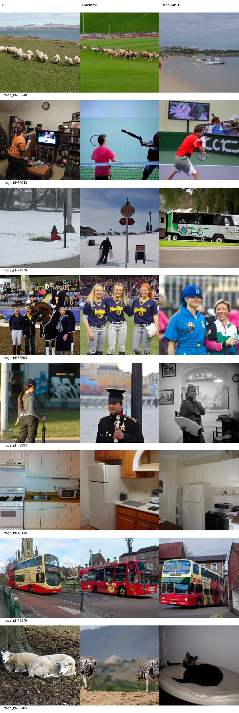

# Epoch 100

同一固定100张历史开发验证图，每图2候选分别评分后平均；没有候选选择。训练16图仅为辅助观察，二选一负例池不同，不与验证识别率直接相减。

| 集合 | PixCorr | SSIM | Alex(2) | Alex(5) | Incep | CLIP | Eff | SwAV | S |
|---|---|---|---|---|---|---|---|---|---|
| val100 | 0.05045 | 0.31269 | 71.72222 | 80.72727 | 82.66667 | 84.76768 | 0.79554 | 0.49189 | 82.72054 |
| val500 | 0.04861 | 0.30117 | 69.82525 | 80.54830 | 80.53928 | 82.52244 | 0.82359 | 0.50406 | 81.20334 |
| train16 | 0.09210 | 0.24984 | 74.58333 | 85.20833 | 85.00000 | 83.75000 | 0.81013 | 0.47901 | 84.65278 |

相同100图相对前一阶段变化：PixCorr -0.01138；SSIM -0.00052；Alex(2) +1.93939；Alex(5) -1.15657；Incep +0.00505；CLIP +0.64141；Eff -0.00322；SwAV +0.00308。Eff/SwAV越低越好，其余越高越好。

图册按预先固定ID展示GT和两个候选，不按效果筛选。

当前按固定val100 S保留的best_so_far为epoch 90，仅为本阶段开发选择；所有里程碑完整状态均保留。科学设置未调整。

已到本次授权上限100，训练和评价完成后停止，等待用户决定是否继续。

## 完整500图同条件比较

复用70补评和80既有结果，没有重新生成70/80图片。各候选独立对完整500图负例池评分，再平均；以下与固定100图成绩分开。Eff/SwAV越低越好，其余越高越好。

| Epoch / 差值 | PixCorr | SSIM | Alex(2) | Alex(5) | Incep | CLIP | Eff | SwAV | S |
|---|---|---|---|---|---|---|---|---|---|
| 70 | 0.04045 | 0.31239 | 66.95210 | 77.93086 | 79.17876 | 80.09379 | 0.84240 | 0.51988 | 79.06780 |
| 80 | 0.04391 | 0.32009 | 66.24449 | 78.42405 | 77.05872 | 79.52966 | 0.84169 | 0.52140 | 78.33747 |
| 100 | 0.04861 | 0.30117 | 69.82525 | 80.54830 | 80.53928 | 82.52244 | 0.82359 | 0.50406 | 81.20334 |
| 100减70 | +0.00816 | -0.01122 | +2.87315 | +2.61743 | +1.36052 | +2.42866 | -0.01881 | -0.01583 | +2.13554 |
| 100减80 | +0.00470 | -0.01892 | +3.58076 | +2.12425 | +3.48056 | +2.99279 | -0.01810 | -0.01735 | +2.86587 |

100轮相对70和80均为七项改善、SSIM下降，S分别提高2.13554和2.86587。这是同一训练轨迹在内部开发集上的描述性比较，不是独立测试或跨训练seed结论。未新增bootstrap、诊断或评阅项目。

## 固定图册AI审阅

审阅者：AI；实际查看本页全部4页验证图册和2页训练图册，覆盖原32验证图与16训练图的两个候选，没有筛图。以下是视觉判断，无法辨认时不强行分类。

验证图中，斑马61868、网球20520、浴室34854/29815/15068及飞机50850/1015的主要类别较稳定，具体形状、文字和空间关系仍不准确。相对90轮，63247候选0回到棒球、59470候选1回到滑板、39490候选1出现苹果、66437候选1出现持伞者；但27648候选1把猫变为人与狗，71624候选1未保留原猫主体，局部改善与退步并存。

整类失败依然明显：33336卡车的候选0变为机场飞机、候选1为公交；44279火车两个候选仍为飞机；6315狗的候选1仍为猫；38887蛋糕变为其他食物；53659两候选模糊，无法可靠确认主体。45699候选0的交通工具类别无法可靠判断，候选1呈飞机轮廓。不生成飞机也不等于目标类别正确，不能把这些误差归为细节问题。

训练16图仅辅助观察：49146两个候选均呈厨房，70940公交类别稳定；34961公交仍被生成为飞机，18109农场变为公交/飞机，15485羊变为斑马/猫，44776甜甜圈变为其他食物。训练16的绝对指标见上表，不能与500图识别率直接相减。整体仍有类别替换和场景不匹配，不支持“所有样本都随轮数改善”的说法。

## 最终状态与恢复资产

累计100个真实epoch、53200次optimizer更新、0次跳过更新；850400实际处理样本包含原有每轮尾部补齐，不改变8500唯一训练样本。训练05:45:34、评价06:39:00、控制器06:39:05正常退出，退出码均0（2026-09-23北京时间）。相关进程结束，GPU计算进程为空，STAGE5_COMPLETE已写入。

完整恢复状态保留于服务器 `/data1/matengyu/geyugong/neuroadapter-author-first/runs/subject01-author-fp32-seed42/checkpoint-100`，包含模型、AdamW、RNG、DataLoader相关状态及累计进度。1/5/10/20/30/40/49/50/59/60/70/79/80/90/100全部完整里程碑保留。当前已经完成授权上限，不执行任何下一阶段训练命令。

既定固定val100 S：90轮82.89057，100轮82.72054（下降0.17003），best仍为90轮，不按val500改选。可加载推理权重为 `runs/subject01-author-fp32-seed42/best_so_far/inference.pt`，明确对应epoch90/47880更新；原始导出 `runs/subject01-author-fp32-seed42/exports/epoch-90/inference.pt` 保留。SHA256：`b8422286f60712e3113174ac8f3d064411cb59ff5768feab01920a70fdfaa0c3`。CPU加载38个张量均有限，原导出、best及同服务器backup三份推理权重/metadata/parcel文件哈希一致；backup不是异地备份。

实际运行入口：`runtime/env/bin/python scripts/stage5.py --target 90`；发布90后执行 `runtime/env/bin/python scripts/stage5.py --target 100`。后一段从完整checkpoint90恢复，逐张量AdamW核对通过，LR1e-4；恢复审计见[stage5-resume-to-100](../stage5-resume-to-100.json)，完整命令与故障恢复约束见[COMMANDS](../../configs/COMMANDS.md)。推理导出不能代替完整checkpoint恢复训练。

逐epoch累计记录与退出事件、文件核验见[epoch-progress](epoch-progress.json)及[delivery-checks](delivery-checks.json)。[90轮指标和全部图册](../epoch-90/README.md)已先行发布。第五阶段完成，停止等待用户查看，不自动继续150/300轮。
