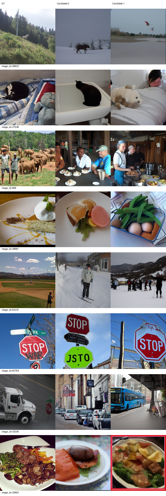
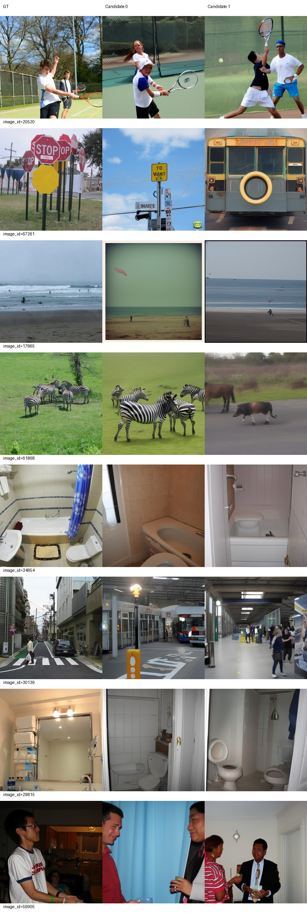
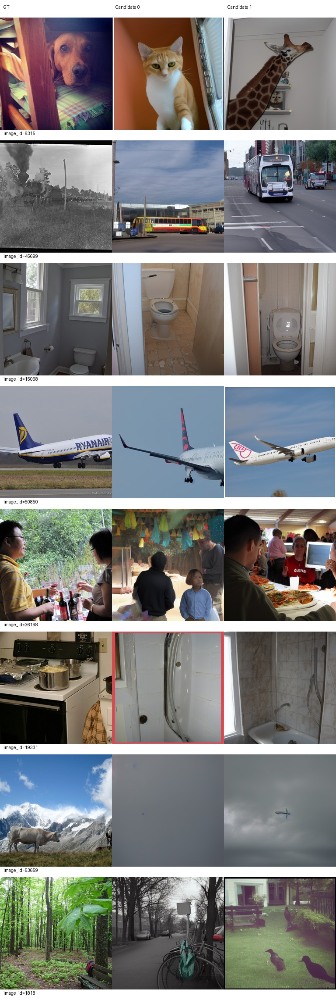
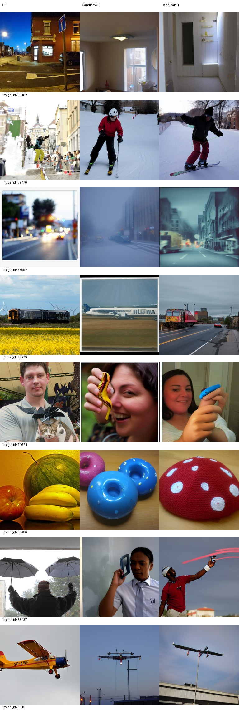
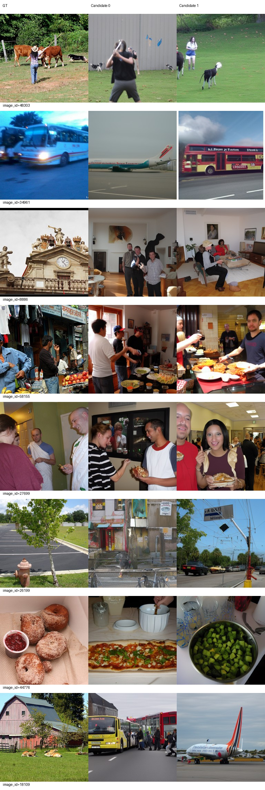
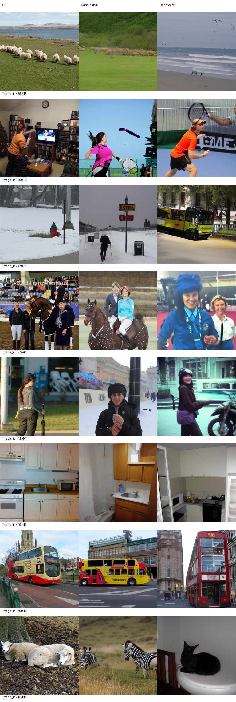

# Epoch 110

同一固定100张历史开发验证图，每图2候选分别评分后平均；没有候选选择。训练16图仅为辅助观察，二选一负例池不同，不与验证识别率直接相减。

| 集合 | PixCorr | SSIM | Alex(2) | Alex(5) | Incep | CLIP | Eff | SwAV | S |
|---|---|---|---|---|---|---|---|---|---|
| val100 | 0.04029 | 0.31786 | 69.16667 | 83.36869 | 81.61616 | 84.17677 | 0.81046 | 0.49392 | 83.05387 |
| train16 | 0.07718 | 0.24306 | 68.33333 | 81.87500 | 79.58333 | 84.37500 | 0.83631 | 0.48806 | 81.94444 |

相同100图相对前一阶段变化：PixCorr -0.01016；SSIM +0.00517；Alex(2) -2.55556；Alex(5) +2.64141；Incep -1.05051；CLIP -0.59091；Eff +0.01492；SwAV +0.00203。Eff/SwAV越低越好，其余越高越好。

图册按预先固定ID展示GT和两个候选，不按效果筛选。

当前按固定val100 S保留的best_so_far为epoch 110，仅为本阶段开发选择；所有里程碑完整状态均保留。科学设置未调整。

## AI审阅与停止决定

审阅者为AI，已实际查看全部4页验证图册和2页训练图册（原32验证图＋16训练图、全部两候选），并对照100轮既有图册；未新增评阅项目或选图。

相同val100上六项下降：PixCorr下降0.01016、Alex(2)下降2.55556个百分点、Incep下降1.05051个百分点、CLIP下降0.59091个百分点、Eff升高0.01492、SwAV升高0.00203（后两项越低越好）。SSIM与Alex(5)改善；S因仅平均Alex(5)/Incep/CLIP而仍提高0.33333，不能代替八项指标和图册判断。

多个先前较正确的候选出现明显整类退步：6315候选0从狗变成猫，候选1为长颈鹿；61868候选1从斑马变为牛；19331候选1从厨房炉灶变为浴室；59470候选1从滑板变为滑雪；39490候选1从水果变成红色编织物；66437候选1失去雨伞；67261候选1从交通标志变为公交正面。30139候选0也从街景转为室内车站。这些超出了纹理、形状等细节误差。

同时存在改善，不能概括为所有图都退步：36992两个候选回到街景；44279候选1出现轨道车辆，但候选0仍为飞机；17865回到海滩大场景，冲浪主体仍不准确。20520网球、60784停车标志和多张浴室图的主要类别仍相对稳定。38833候选0出现雪地马，但不是原草地场景；不再生成飞机不等于重建成功。

训练16仅辅助：34961候选1回到公交、57593候选0出现马与人；49146候选0由厨房退为浴室；18109仍为公交/飞机、15485仍为斑马/猫、44776仍为非目标食物。训练16的绝对指标见上表，不与100或500图识别率直接相减。

综合六项下降与多个明确的新增整类错误，AI判断触发用户授权的“多项明显退步并伴随输出明显恶化”停止条件。没有以单项小波动改参，也没有用S的小幅上升覆盖停止条件。停止在110轮，不启动120，不自行修改科学设置。此判断是内部开发集固定图册的AI审阅，不是人工盲评或独立测试结论。

## 已保存状态

完整checkpoint-110：110个真实epoch、58520次optimizer更新、LR1e-4、0次跳过更新，模型/AdamW/RNG/DataLoader相关状态均保留。训练2026-09-23 11:39:28、评价11:51:43、控制器11:51:51正常退出（北京时间），退出码均0；相关进程已结束、GPU计算进程为空。

服务器完整恢复路径：`/data1/matengyu/geyugong/neuroadapter-author-first/runs/subject01-author-fp32-seed42/checkpoint-110`。所有历史里程碑完整状态保留，包括90和100；120未运行，因此没有120指标，也不生成100/120比较或STAGE6_COMPLETE。

best仍严格按既定固定val100 S选取：110轮83.05387高于90轮82.89057与100轮82.72054，故当前best110；这与停止进一步训练并不矛盾。原90权重和历史导出保留。可加载推理权重：`runs/subject01-author-fp32-seed42/best_so_far/inference.pt`，原始导出为`exports/epoch-110/inference.pt`（运行目录内）。CPU加载38个张量均有限，原导出/best/同服务器backup的权重、metadata和parcel文件哈希一致；backup不是异地备份。

最佳权重SHA256：`e97f3560080f656980751d950efaf491e8720a1478b22321876565073c90e420`。详细核验与实际运行命令见[delivery-checks](delivery-checks.json)和[COMMANDS](../../configs/COMMANDS.md)。当前停止等待用户决定，未执行120入口。
