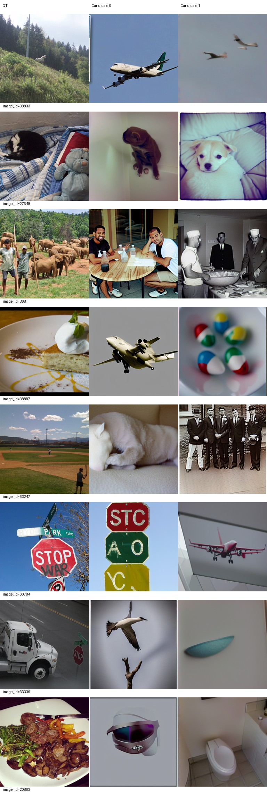
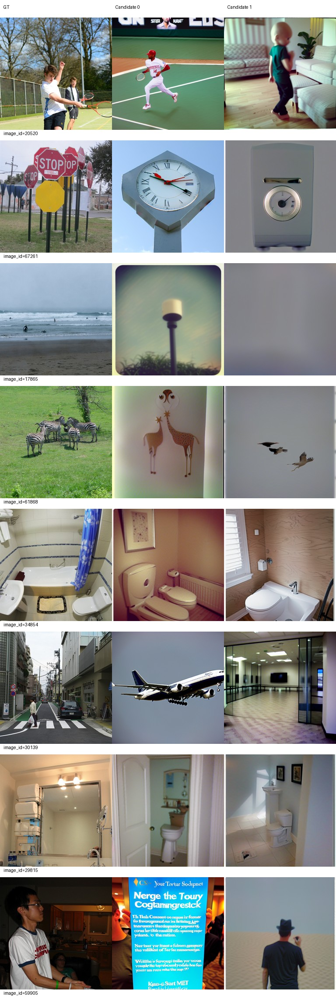
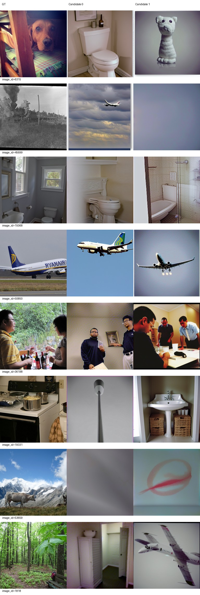
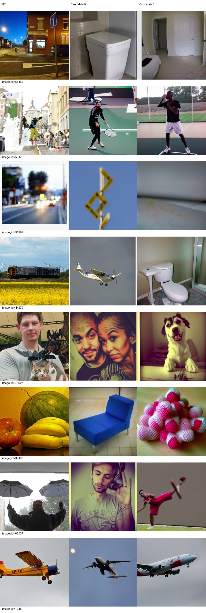
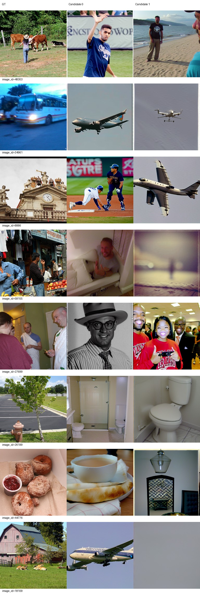
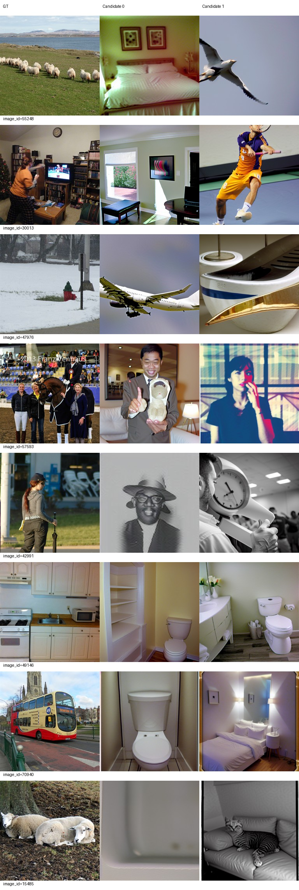

# Epoch 20

同一固定100张历史开发验证图，每图2候选分别评分后平均；没有候选选择。训练16图仅为辅助观察，二选一负例池不同，不与验证识别率直接相减。

| 集合 | PixCorr | SSIM | Alex(2) | Alex(5) | Incep | CLIP | Eff | SwAV | S |
|---|---|---|---|---|---|---|---|---|---|
| val100 | 0.01822 | 0.33232 | 59.51010 | 69.68182 | 63.97980 | 66.65657 | 0.92466 | 0.60150 | 66.77273 |
| train16 | -0.00334 | 0.27692 | 58.75000 | 63.12500 | 58.12500 | 66.25000 | 0.96184 | 0.64958 | 62.50000 |

全500图使用500图负例池，不能与100图识别率直接相减。

| 集合 | PixCorr | SSIM | Alex(2) | Alex(5) | Incep | CLIP | Eff | SwAV | S |
|---|---|---|---|---|---|---|---|---|---|
| val500 | 0.01933 | 0.31687 | 58.23727 | 67.01884 | 63.75571 | 66.82725 | 0.92449 | 0.60361 | 65.86727 |

相同100图相对前一阶段变化：PixCorr +0.01670；SSIM +0.01491；Alex(2) +2.80808；Alex(5) +6.09091；Incep +4.03030；CLIP +3.69697；Eff -0.02075；SwAV -0.03633。Eff/SwAV越低越好，其余越高越好。

图册按预先固定ID展示GT和两个候选，不按效果筛选。

当前按固定val100 S保留的best_so_far为epoch 20，仅为本阶段开发选择；所有里程碑完整状态均保留。科学设置未调整。

已到本次授权上限20，训练和评价完成后停止，等待用户决定是否继续。

## 最终人工观察与交付

已下载并逐页查看全部32验证图和16训练图的双候选图册，没有挑选样本。第20轮在部分场景上更稳定：34854、29815、15068的两个候选都呈卫生间场景；50850和1015两候选都含飞机。不过浴室布局、飞机机型和视角仍不同。27648由第10轮建筑/飞机转为宠物形象，但猫与狗混淆。多数其他图仍存在整类错误：38833林地动物仍生成飞机，67261路牌变成钟表，44279列车变成飞机/卫生间，53659牛与山景变成模糊或抽象图案。不能将这些问题仅归为细节不准。

训练16图也未稳定拟合：34961公交车两候选均为飞机，26199室外消防栓变成卫生间，49146厨房两候选均为卫生间；44776一个候选保持食物大类但内容不符。训练PixCorr=-0.00334、CLIP=66.25%，验证500图PixCorr=0.01933、CLIP=66.82725%；绝对像素对应仍弱。16/100/500的负例池不同，不能用识别率差值推断过拟合或泛化差距。

相同100图的S为5轮60.52020、10轮62.16667、20轮66.77273；20相对10增加4.60606，相对5增加6.25253。20相对10的八项指标均向好（Eff/SwAV下降，其余上升），但没有显著性检验，图册仍有大量整类错误。结论是这条20轮轨迹的监控指标改善，重建质量仍不足；不宣称达到论文水平，也不将20轮结果等同于作者完整训练结果。

累计20真实epoch，10640次更新、170080实际样本（每轮8500唯一图加4个DDP补齐），未用test1000反馈。完整checkpoint-1/5/10/20及所有阶段exports保留服务器；best_so_far按固定val100 S选择epoch20。原导出、best、backup的inference.pt/metadata.json/parcel_vertices.pt逐文件SHA一致。最佳权重SHA256：3c7436efff9d71d7ee806c888e83b41c9c9b30c88e317b6b7bcb9655f6105c1e。backup仅同服务器同文件系统副本，非异地备份。

训练于2026-09-21 23:03:39正常退出，评价于23:57:15正常退出，控制器23:57:20记录completed_stopped。最终独立重载两张固定验证图、各两候选：导出权重、完整checkpoint和原正式评价图逐像素完全一致，见reload_check.json。重载后已确认控制器、训练及评价进程结束，GPU计算进程为空。训练逐轮记录和阶段退出记录见training_epochs.json、stage_events.jsonl，核验汇总见delivery_checks.json，实际命令见../../configs/COMMANDS.md。

下一阶段建议：先针对飞机/卫生间反复出现与训练图未拟合，设计固定小样本的条件敏感性检查（真实/打乱/零脑输入的预先定义对照），区分条件信息利用不足与训练时长不足，再决定是否授权延长训练或单因素实验。本次未执行这些新增实验，未启动50轮；20轮授权已完成。
