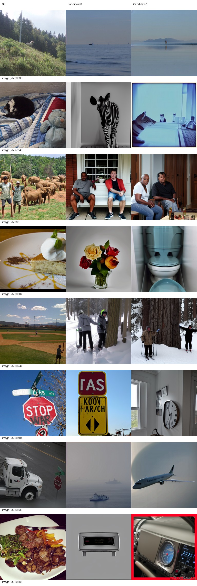
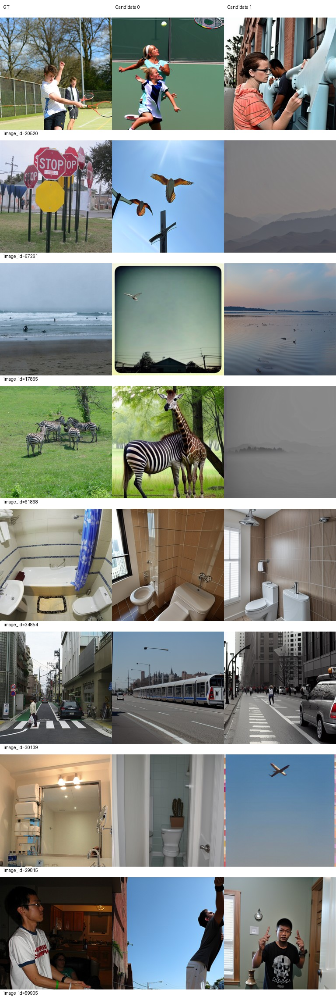
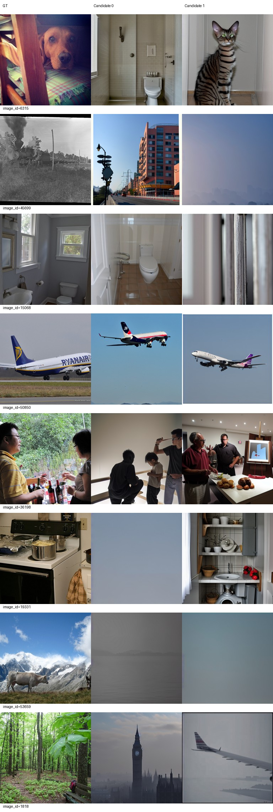
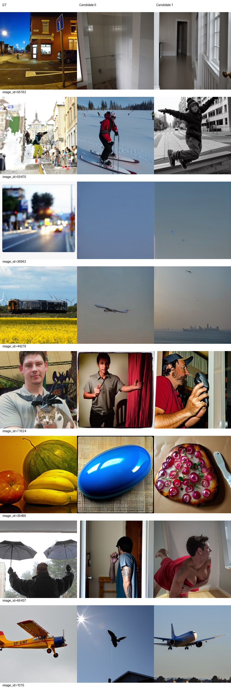
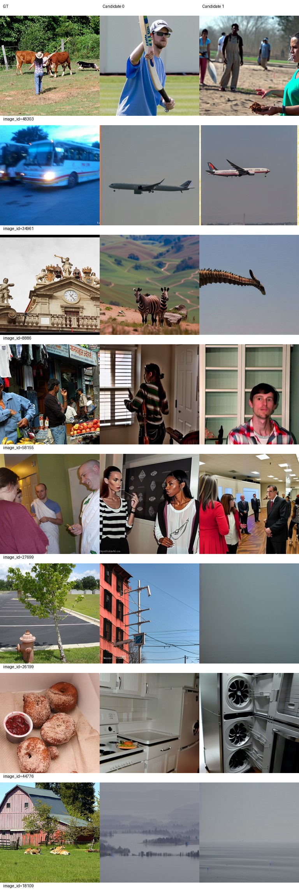
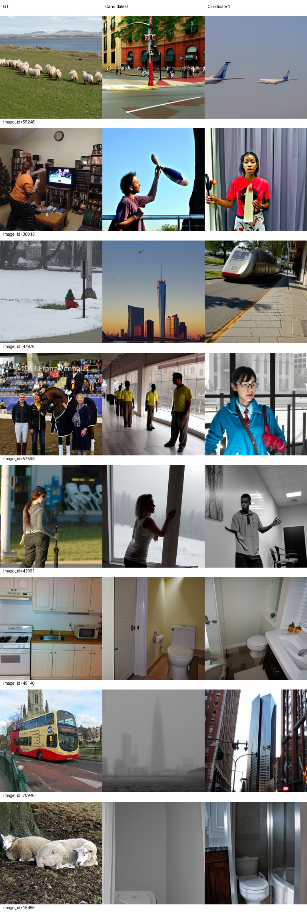

# Epoch 30

同一固定100张历史开发验证图，每图2候选分别评分后平均；没有候选选择。训练16图仅为辅助观察，二选一负例池不同，不与验证识别率直接相减。

| 集合 | PixCorr | SSIM | Alex(2) | Alex(5) | Incep | CLIP | Eff | SwAV | S |
|---|---|---|---|---|---|---|---|---|---|
| val100 | 0.02837 | 0.31571 | 60.50000 | 68.28788 | 66.33333 | 71.38384 | 0.90209 | 0.58328 | 68.66835 |
| train16 | 0.01289 | 0.26290 | 57.91667 | 72.70833 | 63.33333 | 66.25000 | 0.94935 | 0.61086 | 67.43056 |

相同100图相对前一阶段变化：PixCorr +0.01015；SSIM -0.01660；Alex(2) +0.98990；Alex(5) -1.39394；Incep +2.35354；CLIP +4.72727；Eff -0.02257；SwAV -0.01822。Eff/SwAV越低越好，其余越高越好。

图册按预先固定ID展示GT和两个候选，不按效果筛选。

当前按固定val100 S保留的best_so_far为epoch 30，仅为本阶段开发选择；所有里程碑完整状态均保留。科学设置未调整。

## AI审阅与阶段决定

审阅者为AI，已下载并实际逐页查看全部4页验证图册与2页训练图册（固定32验证、16训练，每图两个候选），不是真人审阅。

验证图中34854两候选仍为浴室，50850两候选仍为飞机，但器物布局、机型和姿态不对应；30139两候选均有城市道路，59905保留人物但动作场景不稳。类别稳定性并非全面改善：29815从上一阶段两张浴室变为浴室/飞机，1015出现鸟/客机；61868出现斑马与长颈鹿混合体/灰色远景。38833仍整类错误，本轮两张水面；38887蛋糕变花瓶/马桶，33336卡车变船/飞机，44279火车仍偏飞机。53659、36992及19331候选0等接近纯色或模糊背景。问题仍大量属于整类/场景错误，不能仅称细节不足。

训练图也未稳定拟合：34961公交两候选仍为飞机，49146厨房两候选仍为浴室，15485羊变为浴室；44776甜甜圈变厨房/机器。27699保留室内人群，但身份、人数、构图不一致。训练16图绝对PixCorr=0.01289、SSIM=0.26290、CLIP=66.25，不能据此声称训练重建良好，也不与500图识别率直接相减。

同一val100：S在5/10/20/30轮为60.52020/62.16667/66.77273/68.66835，本次+1.89562；Incep和CLIP上升，Eff/SwAV距离下降（改善），SSIM及Alex5下降。验证绝对PixCorr仍仅0.02837。尚不满足连续多指标退步并伴明显新增输出异常的停止条件；继续原配置累计40，再评价，不因单次波动调参。

30轮完整状态包含15960次更新、255120实际样本、零跳步，训练/评价退出码均0；1/5/10/20/30完整状态保留。当前best为checkpoint-30，仅按所有已完成节点的相同val100 S作开发选择，历史导出保留。原导出/best/backup三份权重、元数据及parcel文件哈希一致；backup仅同服务器副本。核验详见delivery_checks.json。
