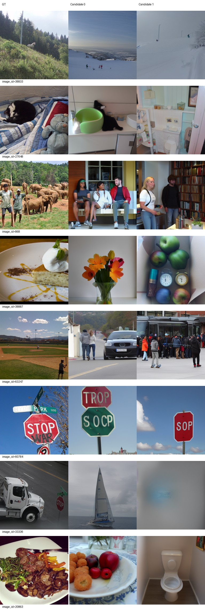
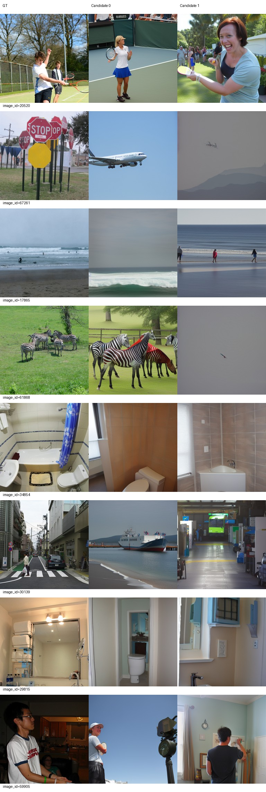
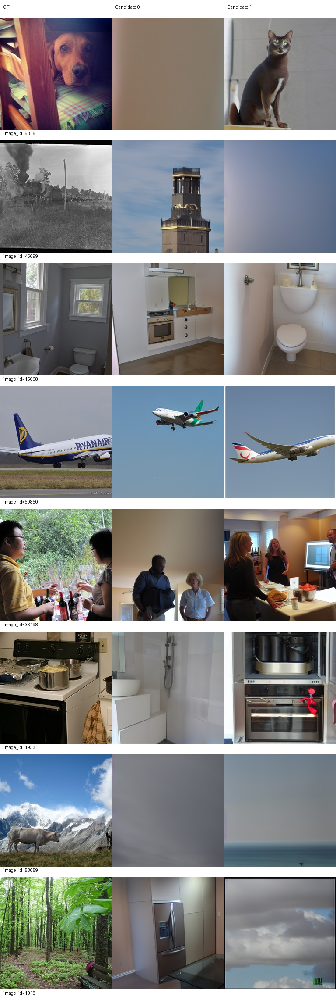
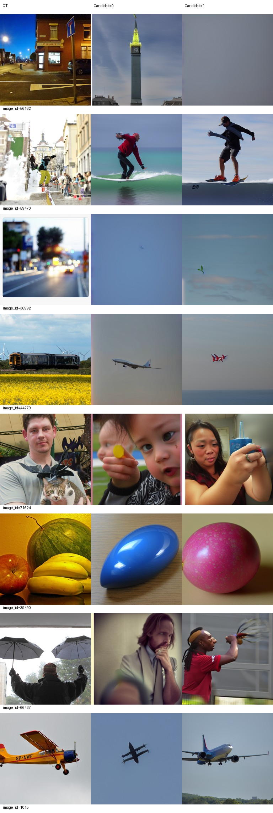
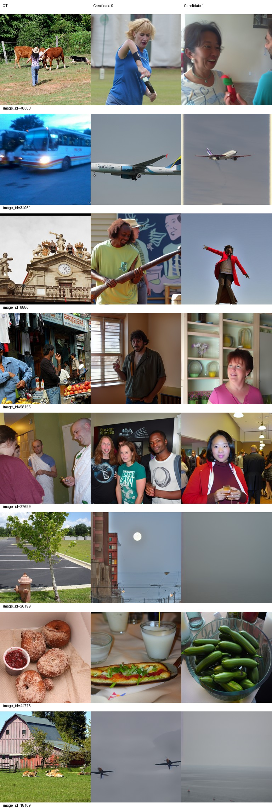
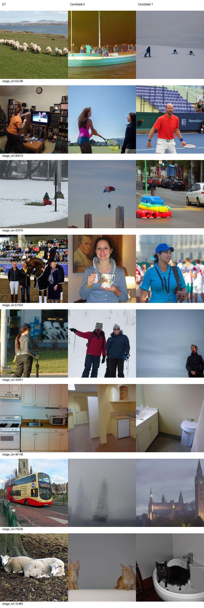

# Epoch 40

同一固定100张历史开发验证图，每图2候选分别评分后平均；没有候选选择。训练16图仅为辅助观察，二选一负例池不同，不与验证识别率直接相减。

| 集合 | PixCorr | SSIM | Alex(2) | Alex(5) | Incep | CLIP | Eff | SwAV | S |
|---|---|---|---|---|---|---|---|---|---|
| val100 | 0.03121 | 0.34510 | 63.00505 | 72.56061 | 69.38889 | 73.99495 | 0.88191 | 0.55540 | 71.98148 |
| train16 | 0.03151 | 0.28611 | 60.62500 | 75.62500 | 68.54167 | 71.25000 | 0.91690 | 0.58757 | 71.80556 |

相同100图相对前一阶段变化：PixCorr +0.00285；SSIM +0.02939；Alex(2) +2.50505；Alex(5) +4.27273；Incep +3.05556；CLIP +2.61111；Eff -0.02018；SwAV -0.02787。Eff/SwAV越低越好，其余越高越好。

图册按预先固定ID展示GT和两个候选，不按效果筛选。

当前按固定val100 S保留的best_so_far为epoch 40，仅为本阶段开发选择；所有里程碑完整状态均保留。科学设置未调整。

## AI审阅与阶段决定

审阅者为AI，已下载并实际逐页查看全部4页验证与2页训练图册（固定32验证/16训练，每图双候选），不是真人审阅，未按GT挑候选。

部分验证类别更稳定：60784两候选均为路牌（30轮为路牌/时钟），20520两张均含持拍人物，17865两张均为海滩海浪，29815重新两张为浴室，1015重新两张为飞机；34854浴室、50850飞机继续保持大类。细节仍不对应：路牌文字错误，飞机机型姿态不同，浴室布局不同。61868候选0由混合动物变为斑马群，但候选1仍是远景小飞机，说明双候选一致性不足。

并非每图改善：30139从两张街景变为船/室内通道；38833变为雪地而非林地动物，38887蛋糕仍为花/水果杂物，33336卡车为帆船/模糊物体，44279火车仍为飞机。6315候选0、45699候选1、53659和36992等仍近纯色或模糊背景。整类错误与局部失败持续存在，不能将指标提升解释为可靠逐图重建。

训练16图：44776从厨房/机器变为食物，但仍不是甜甜圈；27699保留室内人群。34961公交仍两张飞机，49146厨房仍偏卫浴，15485羊变为猫，70940公交变为船/建筑。训练绝对PixCorr=0.03151、SSIM=0.28611，仍不能称稳定拟合；小样本识别率仅辅助，不与500图识别率直接相减。

同一val100的S在5/10/20/30/40轮为60.52020/62.16667/66.77273/68.66835/71.98148，本次+3.31313。八项平均指标均朝改善方向变化，Eff/SwAV距离降低；但验证PixCorr仍仅0.03121。没有连续多指标退步，不触发停止条件，保持全部科学配置继续累计50轮，并完成全500及同100评价后停止。

40轮完整状态为21280次更新、340160实际样本、零跳步。训练05:40:37、评价05:52:53正常退出0，控制器已结束、GPU计算进程已清空。完整checkpoint1/5/10/20/30/40永久保留，历史导出保留。全部已完成节点中val100 S最高为40，best更新为checkpoint-40；导出/best/同服务器backup三份权重、元数据和parcel文件哈希一致（详见delivery_checks.json），backup不是异地备份。
