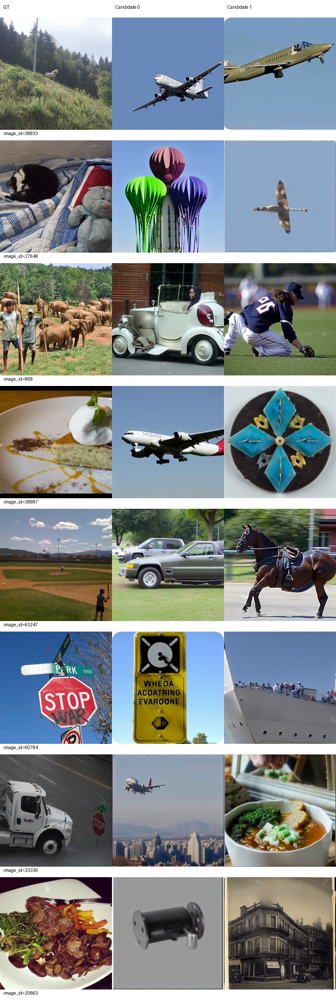
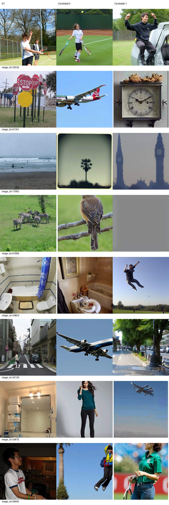
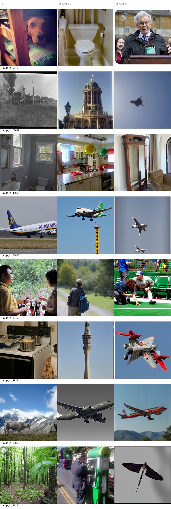
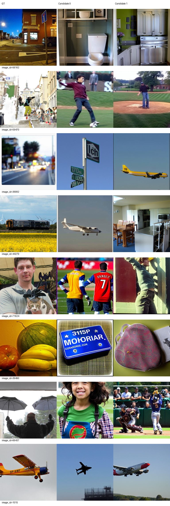
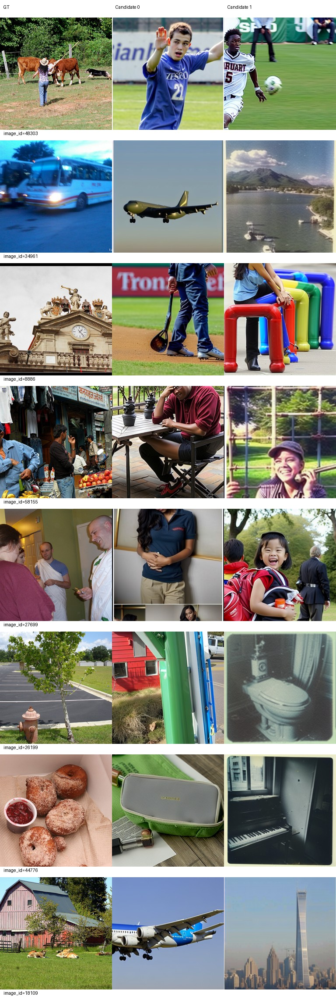
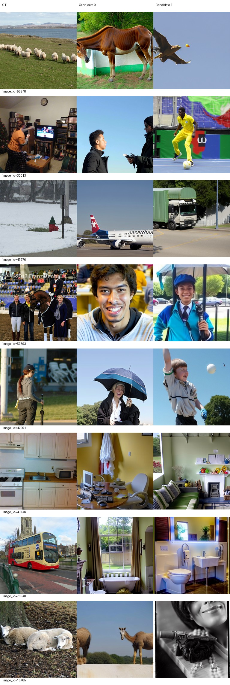

# Epoch 5

同一固定100张历史开发验证图，每图2候选分别评分后平均；没有候选选择。训练16图仅为辅助观察，二选一负例池不同，不与验证识别率直接相减。

| 集合 | PixCorr | SSIM | Alex(2) | Alex(5) | Incep | CLIP | Eff | SwAV | S |
|---|---|---|---|---|---|---|---|---|---|
| val100 | 0.00077 | 0.29440 | 55.93434 | 63.49495 | 56.28283 | 61.78283 | 0.93903 | 0.62730 | 60.52020 |
| train16 | 0.00882 | 0.22963 | 61.25000 | 67.29167 | 58.12500 | 60.00000 | 0.95109 | 0.63968 | 61.80556 |

图册按预先固定ID展示GT和两个候选，不按效果筛选。

当前按固定val100 S保留的best_so_far为epoch 5，仅为本阶段开发选择；所有里程碑完整状态均保留。科学设置未调整。

## 固定图册人工观察（2026-09-21）

已下载并逐张查看全部4页验证图册（固定32图）和2页训练图册（固定16图），每行同时查看GT与两个候选。当前图像常有自然照片外观，但与目标的类别、场景对应仍弱，主要问题包括整类或整场景替换，不能仅归为细节不准。验证图中飞机、运动人物、通用室内场景反复出现；例如GT动物、卡车或厨房器具也生成飞机。目标50850与1015的两候选均为飞机，但机型、尺度和布局不同；20520网球与34854浴室各有一个候选保持大类，另一个却换场景，说明候选间类别稳定性仍不足。没有按好坏筛图。

训练16图也有明显整类错误，例如公交车70940的两候选均为浴室；42991的一个候选保留棒球场景，另一候选偏离。训练集图册尚未呈现稳定拟合，验证集也尚未达到可靠重建。val100 PixCorr=0.00077、CLIP二选一识别率=61.78283%；train16 PixCorr=0.00882、CLIP=60.00000%。负例池大小不同，不据两组识别率差值判断泛化差距或过拟合。Eff、SwAV是距离，越低越好；其他六项越高越好。

这是首个固定100图的完整评分阶段，尚无可比较的阶段趋势；epoch1仅作两图工程核对，不能作为100图性能基线。保留完整checkpoint-5及epoch-5导出，当前best_so_far为epoch5（目前唯一参与选择的阶段），已核对原导出、best副本和backup副本的SHA256一致。backup只是同服务器同文件系统的第二份，不是异地备份。

建议按既定设置继续至epoch10并比较相同100图，再完成epoch20评价后停止。仅凭此早期结果不判定复现失败，也不调整学习率、精度、候选策略或训练目标。eval-5正常退出（0），控制器已从完整checkpoint-5恢复训练至累计10轮，未从零重训。
