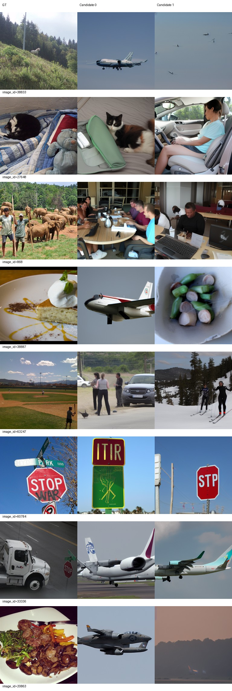
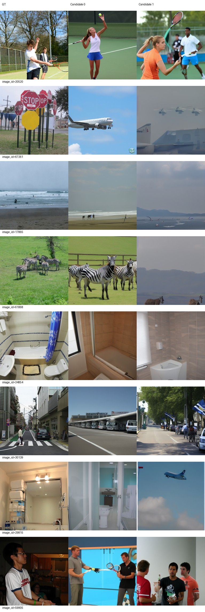
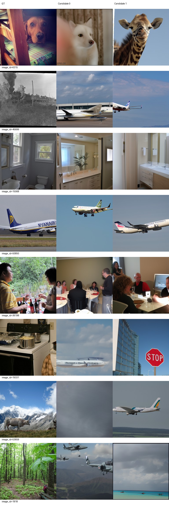
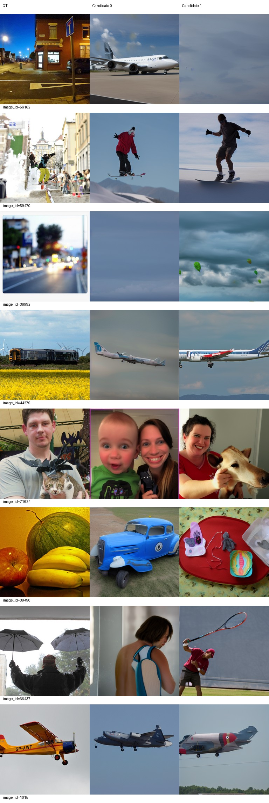
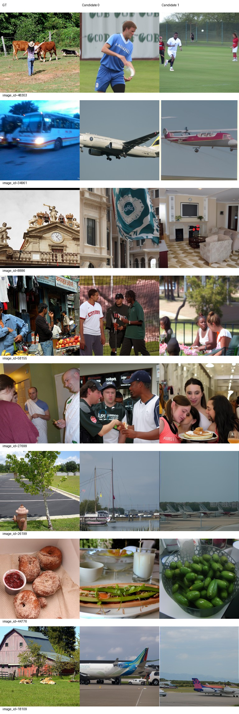
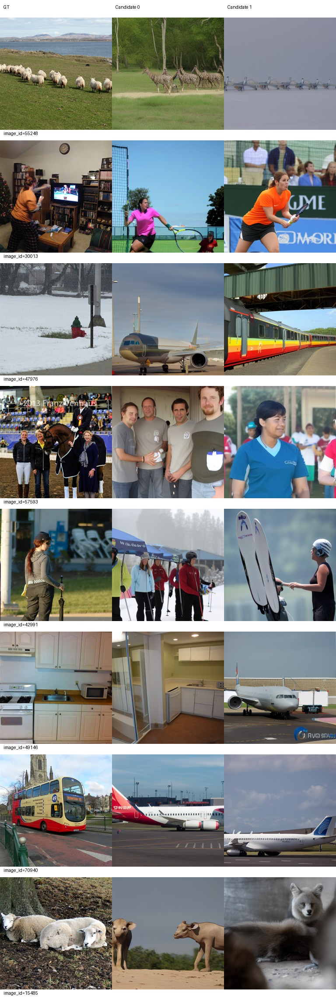

# Epoch 50

同一固定100张历史开发验证图，每图2候选分别评分后平均；没有候选选择。训练16图仅为辅助观察，二选一负例池不同，不与验证识别率直接相减。

| 集合 | PixCorr | SSIM | Alex(2) | Alex(5) | Incep | CLIP | Eff | SwAV | S |
|---|---|---|---|---|---|---|---|---|---|
| val100 | 0.02177 | 0.33629 | 65.98485 | 72.70202 | 71.57071 | 74.22222 | 0.86688 | 0.55149 | 72.83165 |
| train16 | 0.02766 | 0.25563 | 68.12500 | 77.70833 | 71.66667 | 71.87500 | 0.92746 | 0.58444 | 73.75000 |

相同100图相对前一阶段变化：PixCorr -0.00944；SSIM -0.00882；Alex(2) +2.97980；Alex(5) +0.14141；Incep +2.18182；CLIP +0.22727；Eff -0.01503；SwAV -0.00391。Eff/SwAV越低越好，其余越高越好。

图册按预先固定ID展示GT和两个候选，不按效果筛选。













当前按固定val100 S保留的best_so_far为epoch 50，仅为本阶段开发选择；所有里程碑完整状态均保留。科学设置未调整。

已到本次授权上限50，训练和评价完成后停止，等待用户决定是否继续。


## 全500验证结果

| 集合 | PixCorr | SSIM | Alex(2) | Alex(5) | Incep | CLIP | Eff | SwAV | S |
|---|---|---|---|---|---|---|---|---|---|
| val500 | 0.02662 | 0.32351 | 63.42265 | 72.11483 | 71.24168 | 72.85451 | 0.87818 | 0.55808 | 72.07034 |

同一500图与epoch20比较：S由65.86727至72.07034；这与上方100图趋势分别比较，不直接相减不同负例池的识别率。100图指标从同一批500图输出重新计算，没有额外生成或GT选候选。

## AI审阅与最终结论

审阅者为AI，实际下载查看全部6页固定图册（32验证与16训练，每图双候选），不是真人审阅。

验证20520两候选均为网球人物、60784均为路牌、34854和15068均为浴室，50850/1015均为飞机；61868两候选出现斑马，30139重新有道路/车站场景，36198保留室内围桌人群。但姿态、文字、人物、数量和布局仍不对应，29815又回到浴室/飞机两类分歧。

值得关注的失败：飞机输出在多个不相关输入中更集中。38833林地动物、33336卡车、67261路牌、45699蒸汽火车、44279列车均生成飞机；19331厨房锅变飞机/路牌，1818森林变飞机/海滩，20863食物变飞机/远景。这不是仅有细节不足。53659、36992、56162仍有模糊背景，39490水果变车/杂物。不能因S上升忽略这种类别偏置，也不能仅凭固定图册断言全500的偏置发生率。

训练图也存在同类问题：34961与70940公交、18109农舍都两候选飞机；26199消防栓为船/飞机，49146厨房为厨房/飞机。44776保留食物大类但不是甜甜圈，15485羊变牛/犬。训练16的PixCorr=0.02766、SSIM=0.25563，仍未稳定拟合；它只是小样本辅助观察，不与500图识别率直接相减。

相同val100 S在5/10/20/30/40/50轮为60.52020/62.16667/66.77273/68.66835/71.98148/72.83165。50相对40仅+0.85017，PixCorr和SSIM下降，四项识别率提高，Eff/SwAV距离改善（越低越好）。当前按预定规则best为50，仅为历史开发集选择，不代表每张图最好；40及所有历史导出都保留。没有连续多项指标退步，但存在新增明显类别偏置，下一阶段建议先围绕已保存输出核查其范围及成因，再决定训练方案；本次不启动新诊断、实验或继续训练，不自动降LR。

## 交付核验与命令

同一轨迹累计50真实epoch、26600次更新、425200实际样本，零跳步；各epoch的8500唯一/8504实际样本与尾部累积保持原策略。完整checkpoint1/5/10/20/30/40/50含模型、AdamW、双rank随机状态与自定义恢复状态，永久保留；另有原滚动策略的checkpoint49。完整进度见training_epochs.json。

训练于2026-09-22 08:34:51退出0，独立评价09:28:24退出0，控制器09:28:30正常完成并停止。最终重载命令退出0，检查时所有训练、评价、重载进程退出，GPU无计算进程。详见delivery_checks.json。

当前最佳完整状态：`runs/subject01-author-fp32-seed42/checkpoint-50`。推理权重：`runs/subject01-author-fp32-seed42/best_so_far/inference.pt`，SHA256：`94efedfb49382a0c6f0ba8edd349b5ec8cc70509dab20be50f740bd9f9556e93`。元数据epoch50/26600更新正确；原导出、best、backup的权重/metadata/parcel哈希分别一致。固定两张验证图×双候选的导出重载、完整checkpoint重载与原500图输出逐像素一致，见reload_check.json。backup仅为同服务器第二份，非异地备份。

实际工作目录：`/data1/matengyu/geyugong/neuroadapter-author-first`；全部Python使用现有runtime。

```bash
# 已执行的各节点，完成后不重复运行：
runtime/env/bin/python scripts/stage2.py --target 30
runtime/env/bin/python scripts/stage2.py --target 40
runtime/env/bin/python scripts/stage2.py --target 50
# 本阶段实际完整恢复命令（历史记录；当前已完成，不再执行）：
runtime/env/bin/python scripts/run_train.py --stage2 --target 50 --resume runs/subject01-author-fp32-seed42/checkpoint-40
# 独立评价实际入口：
runtime/env/bin/python scripts/evaluate_stage.py --run runs/subject01-author-fp32-seed42 --epoch 50
```

若未来另获授权继续，恢复起点应为完整checkpoint-50，不能用inference.pt新建AdamW；当前入口明确上限50，不提供或执行越界训练。完整运行/退出事件保存在delivery_checks.json，恢复审计见../stage2-resume-to-30.json、../stage2-resume-to-40.json和../stage2-resume-to-50.json。30/40报告已分别发布，本次发布50完整指标与全部固定图册；权重、数据、密钥不上传GitHub。
