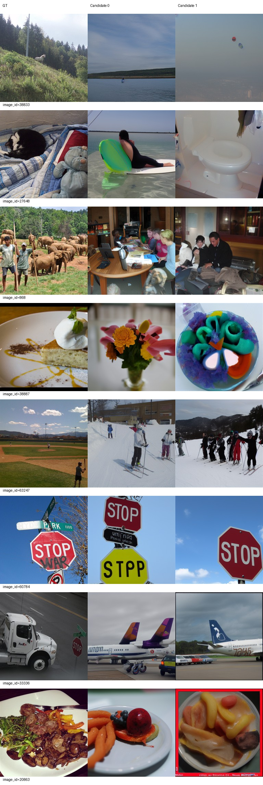
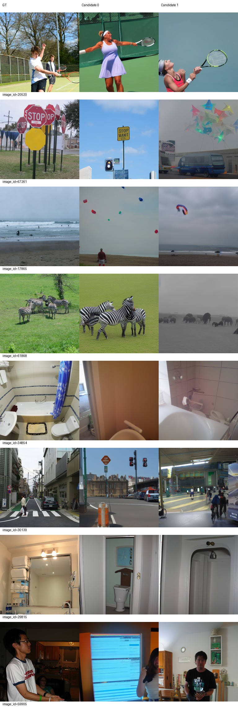
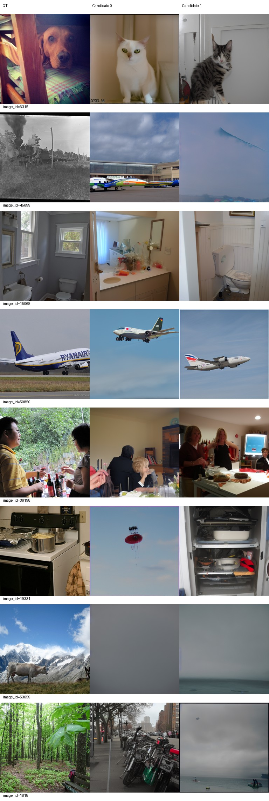
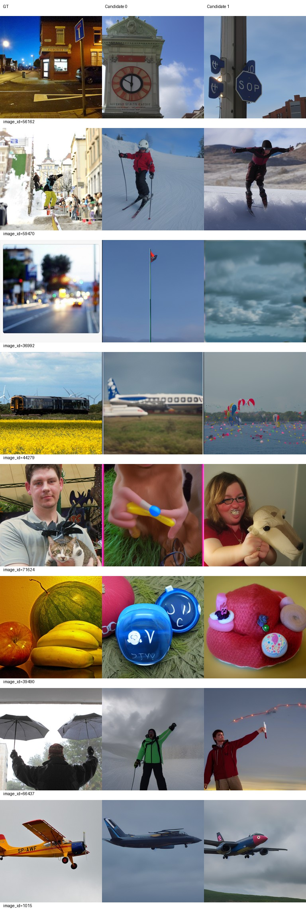
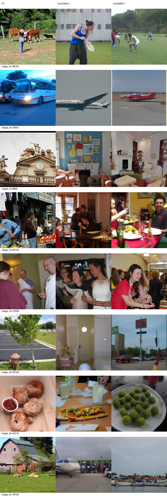
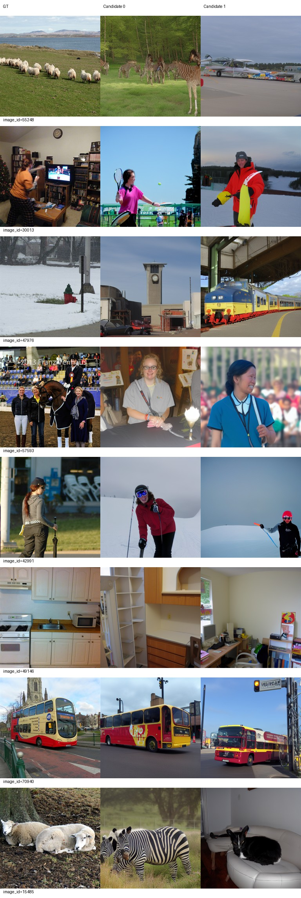

# Epoch 60

同一固定100张历史开发验证图，每图2候选分别评分后平均；没有候选选择。训练16图仅为辅助观察，二选一负例池不同，不与验证识别率直接相减。

| 集合 | PixCorr | SSIM | Alex(2) | Alex(5) | Incep | CLIP | Eff | SwAV | S |
|---|---|---|---|---|---|---|---|---|---|
| val100 | 0.03897 | 0.33369 | 64.93939 | 78.27778 | 76.40909 | 81.31313 | 0.84505 | 0.51426 | 78.66667 |
| train16 | 0.07918 | 0.26838 | 62.29167 | 75.20833 | 73.95833 | 75.20833 | 0.90943 | 0.53438 | 74.79167 |

相同100图相对前一阶段变化：PixCorr +0.01719；SSIM -0.00260；Alex(2) -1.04545；Alex(5) +5.57576；Incep +4.83838；CLIP +7.09091；Eff -0.02183；SwAV -0.03724。Eff/SwAV越低越好，其余越高越好。

图册按预先固定ID展示GT和两个候选，不按效果筛选。

当前按固定val100 S保留的best_so_far为epoch 60，仅为本阶段开发选择；所有里程碑完整状态均保留。科学设置未调整。

已到本次授权上限60，训练和评价完成后停止，等待用户决定是否继续。

## 40/50/60同条件比较与AI图册观察

| epoch | PixCorr | SSIM | Alex(2) | Alex(5) | Incep | CLIP | Eff | SwAV | S |
|---|---|---|---|---|---|---|---|---|---|
| 40 | 0.03121 | 0.34510 | 63.00505 | 72.56061 | 69.38889 | 73.99495 | 0.88191 | 0.55540 | 71.98148 |
| 50 | 0.02177 | 0.33629 | 65.98485 | 72.70202 | 71.57071 | 74.22222 | 0.86688 | 0.55149 | 72.83165 |
| 60 | 0.03897 | 0.33369 | 64.93939 | 78.27778 | 76.40909 | 81.31313 | 0.84505 | 0.51426 | 78.66667 |

三个节点使用相同100图、相同逐图随机过程和两个独立候选。Eff/SwAV越低越好，其余越高越好。60轮相对50轮S增加5.83502，Alex5、Incep、CLIP、Eff、SwAV及PixCorr改善，SSIM和Alex2小幅下降；不能概括为所有指标都改善。未将100图与500图识别率直接相减，也未用训练16图识别率与验证集作差。

审阅者：AI。已实际下载查看60轮全部6页图册，并结合此前实际查看的40/50全部图册完成[144行逐图观察表](../stage3/category-observations.md)（[CSV](../stage3/category-observations.csv)），每轮32验证+16训练、两个候选，无挑图。类别无法确认时保留无法判断，此表不作为新选优分数。

- 类别与场景：路牌60784、网球20520、浴室15068、飞机50850/1015仍较稳定；城市30139恢复街道/车站场景，食物20863从50轮飞机/远景转为两个盘装食物。训练公交车70940由50轮飞机转为两个公交车。即使大类相近，人物姿态、物体数量、空间布局和具体食物仍常与GT不符。
- 飞机偏向仍存在，但并非所有图都趋向飞机：卡车33336两个候选仍为飞机；蒸汽火车45699候选0、列车44279候选0仍为飞机。训练公交车34961两个候选、农舍18109候选0、羊群55248候选1也为飞机。与50轮相比，部分路牌/食物/公交车恢复对应大类；这些固定图册现象不能外推为全验证集偏向发生率。
- 整类错误仍突出：猫27648生成水上运动人物/马桶；棒球场63247生成滑雪人群；狗6315两个候选变猫；水果39490变圆形物品/帽子；滑板59470变雪地运动。山地牛53659仍近纯色/模糊水面，不能强行分类；45699候选1天空轮廓也无法判断。
- 训练16仅作辅助：PixCorr=0.07918、SSIM=0.26838、S=74.79167，仍有羊15485生成斑马/狗、棒球42991生成滑雪人物等整类错误。验证100的PixCorr=0.03897、SSIM=0.33369、CLIP识别率81.31313并不表示81%的图语义正确；该识别指标与逐图类别标注不同。当前重建的逐图可靠性仍不足。

## 完成、保存与停止

累计60真实epoch、31920次optimizer更新、510240个实际样本处理（含原策略每轮4个补齐样本）、0次跳过更新。科学配置不变。训练于2026-09-22 12:39:08 +08退出0；独立评价于12:51:22退出0；控制器12:51:30写入completed_stopped和STAGE3_COMPLETE后已退出。控制器未单独持久化shell退出码，因此不把推断写作实测退出码。核查控制器/启动器/训练rank/评价PID均不存在，GPU计算进程为空。

完整checkpoint 1/5/10/20/30/40/49/50/60均保留，另有滚动59。best_so_far按已完成5/10/20/30/40/50/60的固定val100 S最大值选择60（78.66667），不是默认最后节点。epoch60原始导出、best及同服务器backup三份inference.pt、metadata.json、parcel_vertices.pt哈希一致；metadata为60轮/31920更新。inference SHA256：`07ae391ddd0d2d8759f001a927e80c3df50fe7f9919779c7d33087248c18a198`。backup为同服务器副本，非异地备份。检查结果见[delivery-checks.json](../stage3/delivery-checks.json)。

实际入口：`runtime/env/bin/python scripts/stage3.py --target 60`，完整恢复起点为`runs/subject01-author-fp32-seed42/checkpoint-50`，恢复审计见[stage3-resume-to-60.json](../stage3-resume-to-60.json)。[运行与恢复命令](../../configs/COMMANDS.md)中的恢复命令仅记录本次已执行路径；60已经完成，不应重跑。完整60可供将来经用户授权的后续阶段恢复，当前入口不允许继续更高轮数。

本次仅评价val100，没有额外全500评价。已正常停止，等待用户查看；不自动75/100/300，不降低LR，不另开实验。建议先查看逐图类别表和失败案例再决定下一步，本次未执行新方案。
