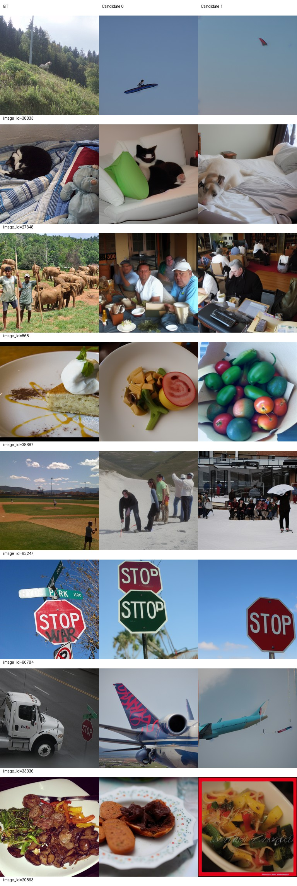
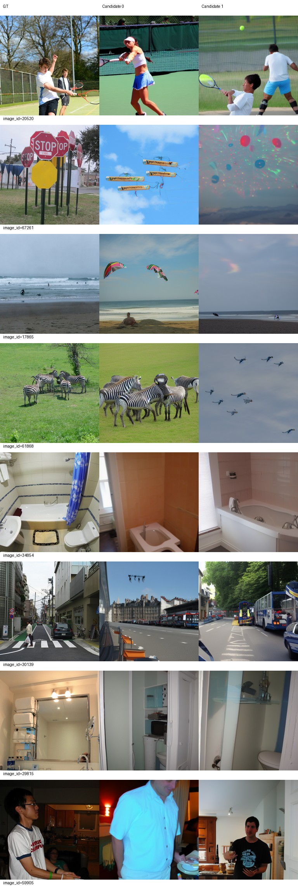
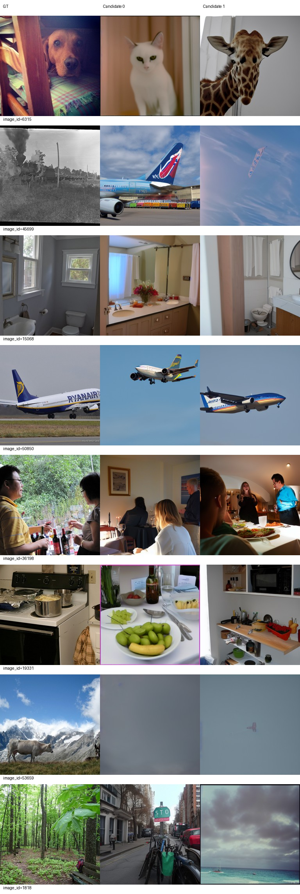
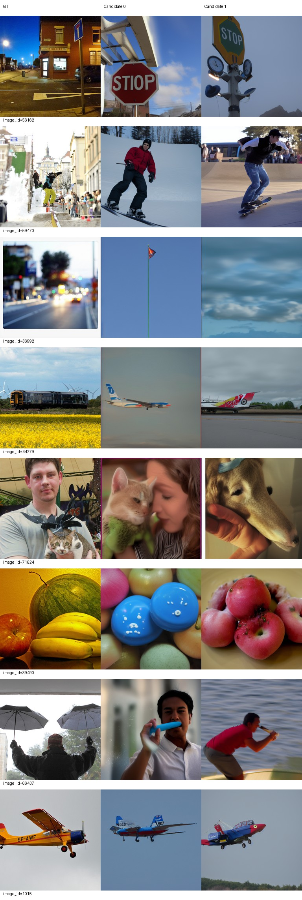
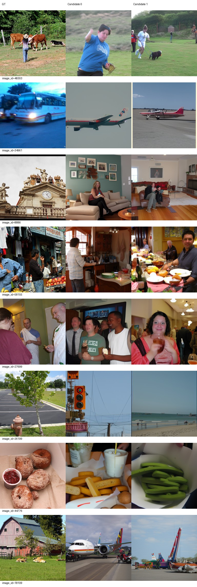
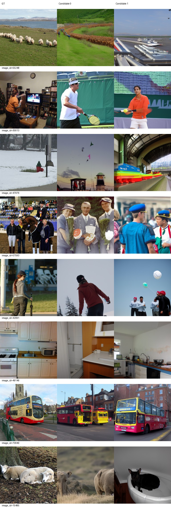

# Epoch 70

同一固定100张历史开发验证图，每图2候选分别评分后平均；没有候选选择。训练16图仅为辅助观察，二选一负例池不同，不与验证识别率直接相减。

| 集合 | PixCorr | SSIM | Alex(2) | Alex(5) | Incep | CLIP | Eff | SwAV | S |
|---|---|---|---|---|---|---|---|---|---|
| val100 | 0.04722 | 0.32646 | 69.57576 | 79.89899 | 81.82828 | 80.09596 | 0.82078 | 0.51228 | 80.60774 |
| train16 | 0.07397 | 0.26105 | 65.62500 | 80.41667 | 84.79167 | 77.91667 | 0.87359 | 0.52496 | 81.04167 |

相同100图相对前一阶段变化：PixCorr +0.00825；SSIM -0.00722；Alex(2) +4.63636；Alex(5) +1.62121；Incep +5.41919；CLIP -1.21717；Eff -0.02426；SwAV -0.00197。Eff/SwAV越低越好，其余越高越好。

图册按预先固定ID展示GT和两个候选，不按效果筛选。

当前按固定val100 S保留的best_so_far为epoch 70，仅为本阶段开发选择；所有里程碑完整状态均保留。科学设置未调整。

## 同100图趋势与AI观察

| epoch | PixCorr | SSIM | Alex2 | Alex5 | Incep | CLIP | Eff↓ | SwAV↓ | S |
|---|---|---|---|---|---|---|---|---|---|
| 40 | 0.03121 | 0.34510 | 63.00505 | 72.56061 | 69.38889 | 73.99495 | 0.88191 | 0.55540 | 71.98148 |
| 50 | 0.02177 | 0.33629 | 65.98485 | 72.70202 | 71.57071 | 74.22222 | 0.86688 | 0.55149 | 72.83165 |
| 60 | 0.03897 | 0.33369 | 64.93939 | 78.27778 | 76.40909 | 81.31313 | 0.84505 | 0.51426 | 78.66667 |
| 70 | 0.04722 | 0.32646 | 69.57576 | 79.89899 | 81.82828 | 80.09596 | 0.82078 | 0.51228 | 80.60774 |

审阅者为AI，实际下载查看全部6页固定图册。新增70轮48行到[逐图观察表](../stage3/category-observations.md)（[CSV](../stage3/category-observations.csv)），共192行，40/50/60原144行标签逐字段核对未改。新增“目标类别正确”与“非飞机GT生成飞机”两项独立记录；历史行新列留未评估。“是”仅指主要类别，不能代表细节准确；复合目标部分匹配及无法判断均明确写出，不用此表选优。

70相对60的S增加1.94108，六项指标改善，SSIM和CLIP下降。总体不符合多指标退步并伴明显整体输出恶化的停止条件，发布本节点后按原配置从完整checkpoint70继续80，不改LR或其他参数。

- 类别/场景较稳定：60784路牌、20520网球、34854/29815/15068浴室、30139城市街道、50850/1015飞机，以及训练70940公交车。猫27648候选0、滑板59470候选1、人物与猫71624候选0、水果39490候选1比60轮更接近目标类别。但另一候选仍可能错误，姿态、数量、视角与布局也常不匹配。
- 飞机偏向仍明显：33336卡车和44279列车两个候选、45699蒸汽火车候选0继续生成飞机；训练34961公交车两个候选、18109农舍两个候选、55248羊群候选1也为飞机。61868候选1的天空飞行轮廓无法可靠区分鸟或飞机，53659模糊主体无法判断，不强行标注。
- 不生成飞机不等于重建成功：6315狗变猫/长颈鹿，63247棒球场变雪地人物，1818森林变街道/海滩，39490候选0仍是彩色物品。53659仍模糊近纯色。部分候选进步与局部退步同时存在，不能把识别率当作逐图类别正确率。
- 训练16辅助观察：PixCorr0.07397、SSIM0.26105、S81.04167，仍有公交车变飞机、钟楼变客厅、游戏人物变网球人物等整类错误；没有用其识别率与val100或val500作差。验证100的PixCorr0.04722、SSIM0.32646说明低层一致性仍有限。本节点没有全500评价，不能把这里的100图成绩称为全500成绩。

## 保存与退出

70真实epoch、37240次更新、0跳过更新。训练17:36:23退出0、独立评价17:48:38退出0、控制器17:48:46记录completed_stopped/exit_code0；对应进程已结束，GPU计算进程为空。checkpoint1/5/10/20/30/40/49/50/59/60/70模型、AdamW、RNG和自定义状态均存在。best按已完成固定val100 S最大选择70，原始导出/best/同服务器backup三份文件哈希一致（backup非异地）。SHA256：`4bd899b63e5412971ca0b85e576cdb1998e131656b2a1fbcefeb1bfe01673004`。核查见[delivery-checks.json](delivery-checks.json)。

发布后下一条命令：`runtime/env/bin/python scripts/stage4.py --target 80`，完整恢复路径`runs/subject01-author-fp32-seed42/checkpoint-70`，沿用模型/AdamW/RNG/loader/累计进度。80完成500图评价并从同批输出重算原100图后停止，不自动100/300。

## 完整500图补评（评价任务，无新增训练）

已复用原100图并仅补400图。完整500图S=79.06780；与80的同条件差值及配对区间见[独立比较报告](../epoch-70-vs-80-val500/README.md)。原val100结果和best选择规则不变。
