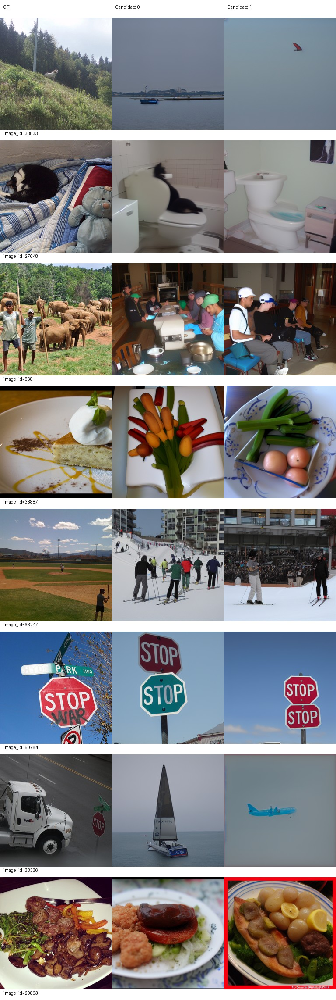
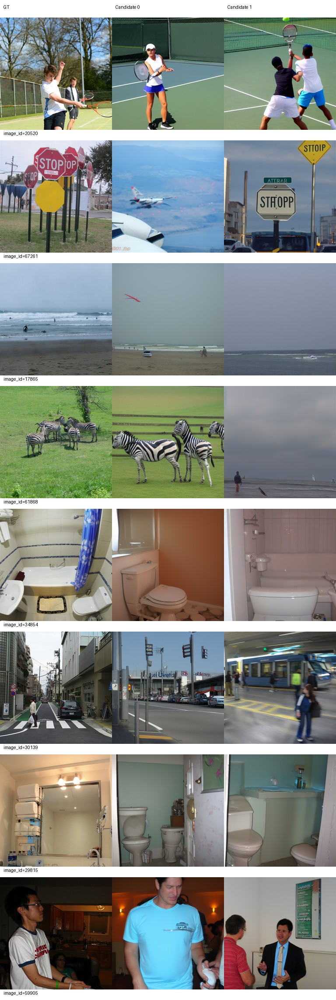
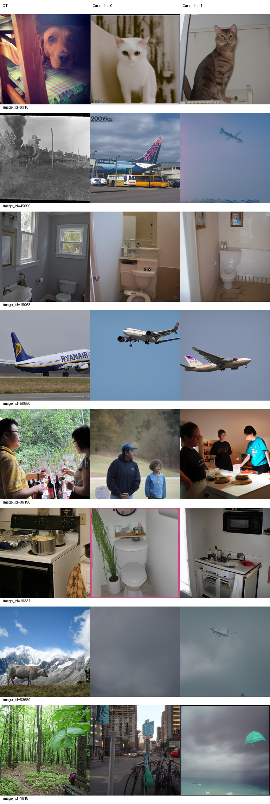
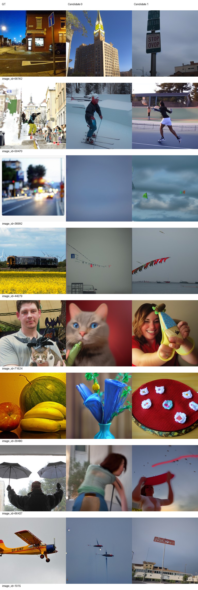
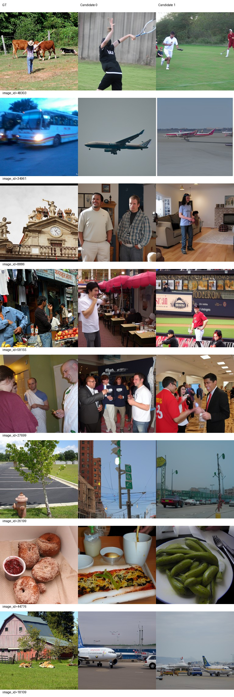
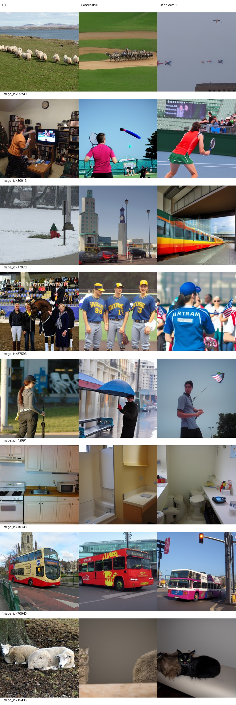

# Epoch 80

同一固定100张历史开发验证图，每图2候选分别评分后平均；没有候选选择。训练16图仅为辅助观察，二选一负例池不同，不与验证识别率直接相减。

| 集合 | PixCorr | SSIM | Alex(2) | Alex(5) | Incep | CLIP | Eff | SwAV | S |
|---|---|---|---|---|---|---|---|---|---|
| val100 | 0.05079 | 0.33522 | 68.89394 | 79.22222 | 76.96465 | 80.30808 | 0.83387 | 0.51784 | 78.83165 |
| val500 | 0.04391 | 0.32009 | 66.24449 | 78.42405 | 77.05872 | 79.52966 | 0.84169 | 0.52140 | 78.33747 |
| train16 | 0.06229 | 0.25637 | 65.20833 | 78.75000 | 78.54167 | 82.70833 | 0.88335 | 0.53064 | 80.00000 |

相同100图相对前一阶段变化：PixCorr +0.00358；SSIM +0.00876；Alex(2) -0.68182；Alex(5) -0.67677；Incep -4.86364；CLIP +0.21212；Eff +0.01309；SwAV +0.00556。Eff/SwAV越低越好，其余越高越好。

图册按预先固定ID展示GT和两个候选，不按效果筛选。

当前按固定val100 S保留的best_so_far为epoch 70，仅为本阶段开发选择；所有里程碑完整状态均保留。科学设置未调整。

已到本次授权上限80，训练和评价完成后停止，等待用户决定是否继续。

## AI图册反馈与停止

审阅者为AI，已实际逐页查看全部4页验证图册和2页训练图册（32验证+16训练，每图两候选），不是人工盲评。全部48行已追加至[类别观察表](../stage3/category-observations.md)，共240行，历史192行标签逐字段保持不变。目标类别正确与非飞机GT生成飞机分别记录；无法判断没有强行分类，表不参与选优。

路牌60784、网球20520、浴室34854/29815/15068、飞机50850、训练公交70940仍有主要类别一致的输出，但文字、人物数量、布局和物体细节并不准确。斑马61868候选0恢复斑马，候选1仍为海滩；猫27648候选0是猫与马桶，候选1只有浴室，双候选稳定性不足。

明确失败：狗6315两候选均为猫；滑板59470变为滑雪/网球；水果39490变为装饰物；厨房49146两候选均为浴室。相对70轮，59470候选1丢失滑板、39490候选1丢失水果、1015候选1丢失飞机类别。44279由飞机替代变为旗串/海面，33336候选0变为帆船，都仍是整类错误，不能算重建成功。45699两候选、53659候选1、训练34961/18109两候选仍以飞机为主体；67261候选0也出现飞机。模糊36992候选0、53659候选0，以及55248候选1的飞行物种类无法可靠判断。

训练16图也有大量整类错误（公交34961→飞机、钟楼8886→室内人物、羊15485候选1→猫），不能声称训练已稳定拟合。train16八指标见上表，仅作绝对表现辅助，不与500图识别率直接相减。

固定100图相对70轮五项指标变差（Alex2/Alex5/Incep及Eff/SwAV），三项改善；S下降1.77609。图册同时存在具体类别丢失及长期错误，80轮不能宣称优于70轮。已按授权上限正常停止，不尝试改参补救或继续训练。全500图相对50轮七项改善、SSIM略降；这与70到80固定100退步并不矛盾，比较对象和负例池不同。

## 同条件纵向指标

以下100图始终使用同一monitor100清单、同样两个候选及随机过程；80的100指标从同批500输出重新评分，没有额外生成100图。候选分别对完整N图评分再平均，不按GT选图。Eff/SwAV越低越好，其余越高越好。

### val100

| epoch | PixCorr | SSIM | Alex(2) | Alex(5) | Incep | CLIP | Eff | SwAV | S |
|---|---|---|---|---|---|---|---|---|---|
| 5 | 0.00077 | 0.29440 | 55.93434 | 63.49495 | 56.28283 | 61.78283 | 0.93903 | 0.62730 | 60.52020 |
| 10 | 0.00151 | 0.31741 | 56.70202 | 63.59091 | 59.94949 | 62.95960 | 0.94541 | 0.63783 | 62.16667 |
| 20 | 0.01822 | 0.33232 | 59.51010 | 69.68182 | 63.97980 | 66.65657 | 0.92466 | 0.60150 | 66.77273 |
| 30 | 0.02837 | 0.31571 | 60.50000 | 68.28788 | 66.33333 | 71.38384 | 0.90209 | 0.58328 | 68.66835 |
| 40 | 0.03121 | 0.34510 | 63.00505 | 72.56061 | 69.38889 | 73.99495 | 0.88191 | 0.55540 | 71.98148 |
| 50 | 0.02177 | 0.33629 | 65.98485 | 72.70202 | 71.57071 | 74.22222 | 0.86688 | 0.55149 | 72.83165 |
| 60 | 0.03897 | 0.33369 | 64.93939 | 78.27778 | 76.40909 | 81.31313 | 0.84505 | 0.51426 | 78.66667 |
| 70 | 0.04722 | 0.32646 | 69.57576 | 79.89899 | 81.82828 | 80.09596 | 0.82078 | 0.51228 | 80.60774 |
| 80 | 0.05079 | 0.33522 | 68.89394 | 79.22222 | 76.96465 | 80.30808 | 0.83387 | 0.51784 | 78.83165 |

### val500

| epoch | PixCorr | SSIM | Alex(2) | Alex(5) | Incep | CLIP | Eff | SwAV | S |
|---|---|---|---|---|---|---|---|---|---|
| 20 | 0.01933 | 0.31687 | 58.23727 | 67.01884 | 63.75571 | 66.82725 | 0.92449 | 0.60361 | 65.86727 |
| 50 | 0.02662 | 0.32351 | 63.42265 | 72.11483 | 71.24168 | 72.85451 | 0.87818 | 0.55808 | 72.07034 |
| 80 | 0.04391 | 0.32009 | 66.24449 | 78.42405 | 77.05872 | 79.52966 | 0.84169 | 0.52140 | 78.33747 |

## 完整状态、最佳权重及退出核验

累计80真实epoch、42560次optimizer更新、680320个实际样本计数（每轮8500唯一图+4补齐），跳步0，LR1e-4。1至80轮日志连续核对通过；[逐轮记录](epoch-progress.json)、[交付核验](delivery-checks.json)保存具体证据。70结果已在提交2a92a2e发布，之后才于17:53:45完整恢复70→80，38项AdamW状态逐tensor精确一致、loader及Accelerate完整恢复通过，见[恢复审计](../stage4-resume-to-80.json)。

训练于20:20:57退出0；评价于21:15:21退出0；控制器于21:15:29记录completed_stopped、退出0。以上时间均2026-09-22北京时间。STAGE4_COMPLETE已写入，控制器/训练/评价进程均已结束，两张GPU无计算进程。

best_so_far仍是checkpoint-70（37240更新），固定val100 S=80.60774410774411，为所有已完成5/10/20/30/40/50/60/70/80节点最高，仅属开发集选择。原epoch70导出、best_so_far及同服务器backup的inference.pt、metadata.json、parcel_vertices.pt逐文件哈希一致；backup不是异地备份。最佳推理权重SHA256：`4bd899b63e5412971ca0b85e576cdb1998e131656b2a1fbcefeb1bfe01673004`。

服务器根目录：`/data1/matengyu/geyugong/neuroadapter-author-first`。
最新完整恢复路径：`runs/subject01-author-fp32-seed42/checkpoint-80`（含模型、AdamW、RNG、DataLoader及累计进度）；最佳完整状态：同run的`checkpoint-70`。永久里程碑1/5/10/20/30/40/49/50/59/60/70/80的完整文件均存在，历史exports保留。推理导出不用于重建优化器继续训练。

实际运行入口：`runtime/env/bin/python scripts/stage4.py --target 80`。该次训练子命令：`runtime/env/bin/python scripts/run_train.py --stage4 --target 80 --resume runs/subject01-author-fp32-seed42/checkpoint-70`。此为已执行命令记录，不应重复运行已完成节点。完整命令及阶段边界见[COMMANDS](../../configs/COMMANDS.md)；当前入口不授权超过80，未来如需继续应另获用户授权并从完整checkpoint-80恢复。没有启动100/300、没有更改LR或其他科学设置。

下一步仅等待用户查看70/80图册、类别表和最佳70权重；是否扩展训练或调整方案由用户决定，本次不执行新实验。
