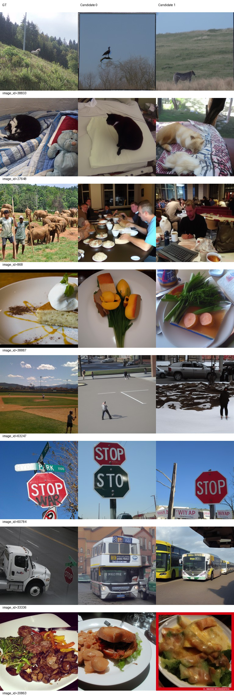
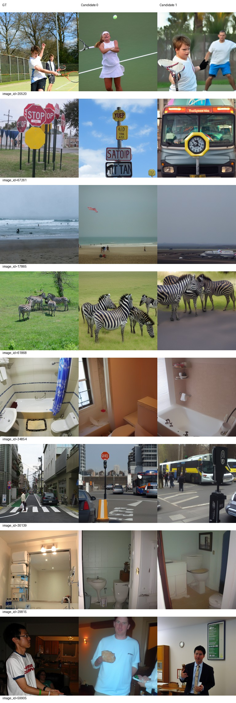
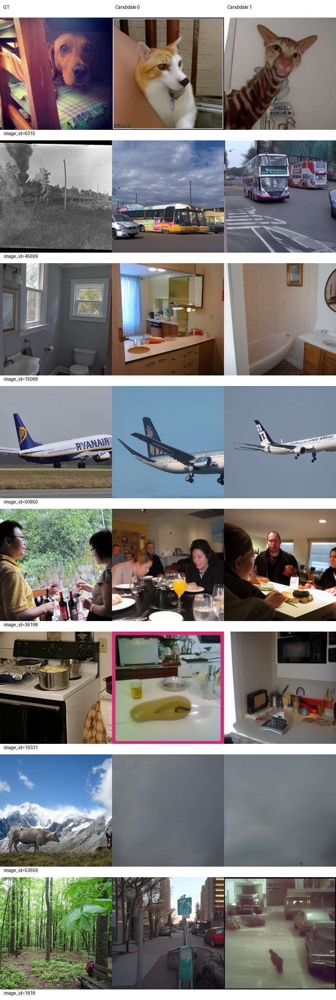
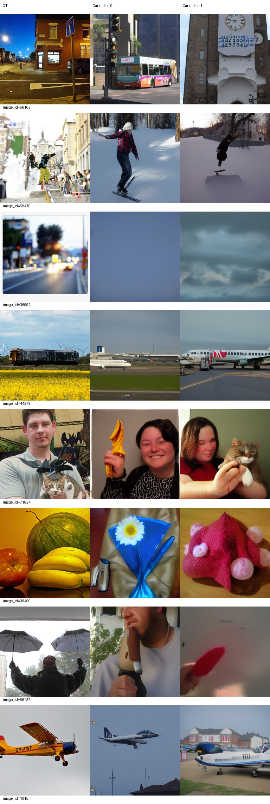
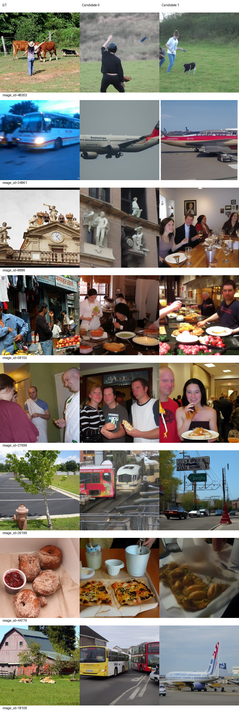
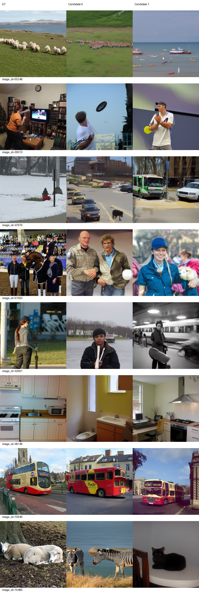

# Epoch 90

同一固定100张历史开发验证图，每图2候选分别评分后平均；没有候选选择。训练16图仅为辅助观察，二选一负例池不同，不与验证识别率直接相减。

| 集合 | PixCorr | SSIM | Alex(2) | Alex(5) | Incep | CLIP | Eff | SwAV | S |
|---|---|---|---|---|---|---|---|---|---|
| val100 | 0.06183 | 0.31321 | 69.78283 | 81.88384 | 82.66162 | 84.12626 | 0.79876 | 0.48880 | 82.89057 |
| train16 | 0.09300 | 0.24749 | 72.50000 | 82.91667 | 81.45833 | 83.54167 | 0.86644 | 0.50203 | 82.63889 |

相同100图相对前一阶段变化：PixCorr +0.01104；SSIM -0.02201；Alex(2) +0.88889；Alex(5) +2.66162；Incep +5.69697；CLIP +3.81818；Eff -0.03511；SwAV -0.02904。Eff/SwAV越低越好，其余越高越好。

图册按预先固定ID展示GT和两个候选，不按效果筛选。

当前按固定val100 S保留的best_so_far为epoch 90，仅为本阶段开发选择；所有里程碑完整状态均保留。科学设置未调整。

## AI图册反馈与继续决定

审阅者为AI，已实际查看全部4页验证+2页训练图册，不是真人或人工盲评。固定100图相对80轮七项指标改善，只有SSIM下降0.02201；S从78.83165升至82.89057，较70轮80.60774也更高。不能据此称所有图重建正确。

斑马61868两候选均回到斑马，猫27648候选1从浴室变为猫，人物与猫71624候选1恢复复合目标；1015候选1恢复飞机，厨房49146候选1恢复厨房。路牌60784、网球20520、浴室34854/29815、飞机50850和训练公交70940保持大类对应，但文字、物体布局、数量、形状及身份细节仍不准确。

局部退步和长期失败仍在：17865候选1由海面变为机场飞机，44279两候选又成为飞机；33336卡车和45699火车变为公交，虽然部分不再生成飞机，依然是类别错误。6315候选1仍为猫；39490水果仍变为装饰物；53659两候选及36992候选0主体无法判断。训练34961公交两候选仍为飞机、18109农舍变公交/飞机、15485羊变斑马/猫。训练16图指标见上表，仍未稳定拟合，不能与验证100/500识别率直接相减。

整体未出现多项指标明显退步并伴随明显输出恶化，未触发用户停止条件。先发布90报告及全部图册，再从完整checkpoint90按原配置继续累计100；不改LR或科学设置，不追加诊断/类别大表。100全500与已完成70/80全500分别比较，不重复生成历史图片。

## 完整状态与退出证据

90真实epoch、47880更新、跳步0。2026-09-23北京时间01:41:05训练退出0，01:53:51评价退出0，01:53:56控制器completed_stopped退出0；相关进程均结束、GPU计算进程为空。所有历史永久checkpoint完整文件核验存在，包括70和80。详见[交付核验](delivery-checks.json)。

best_so_far按全部已完成固定val100 S选择为90，仅开发选择，不采用val500选优。epoch90导出/best/同服务器backup三份inference、metadata、parcel文件哈希一致；backup不是异地备份。

最佳推理权重SHA256：`b8422286f60712e3113174ac8f3d064411cb59ff5768feab01920a70fdfaa0c3`。完整恢复路径：`/data1/matengyu/geyugong/neuroadapter-author-first/runs/subject01-author-fp32-seed42/checkpoint-90`。下一节点命令：`runtime/env/bin/python scripts/stage5.py --target 100`，仅在本报告发布及GPU可用确认后执行。
