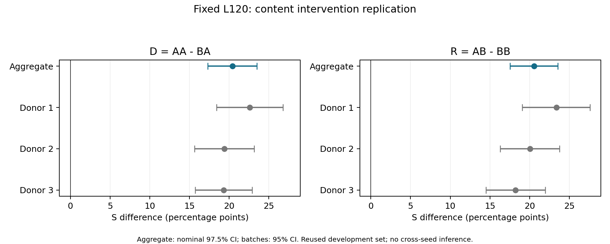

# 固定L120证据收束与跨seed复核方案

状态：本轮仅整理既有证据和冻结待启动方案；没有新训练、生成、重新评分或自动任务。服务器当前正式权重只有seed42主线及其L支线；smoke目录不是第二个独立训练seed。读取时GPU计算进程为空。此前暂停与PROVEN_INFEASIBLE结论保留。

图直接读取既有comparison.json，未重算统计。聚合97.5%与单批95%名义区间不能混为相同置信水平。底层数据见[CSV](primary-effects.csv)，可导出[PDF](primary-effects.pdf)。

## 当前能说什么

固定L120下，HL位置的内容换走与补回对目标相关语义指标及CLIP内容方向有一致的平均作用，在新100目标及三批供体中重复出现。聚合D=20.423120（97.5%区间17.290636～23.490509），R=20.546577（17.533649～23.537640）。这不是重建质量改善实验，也不是人脑因果或功能专一性证据。

D的SSIM点估计为负且区间跨零；25/34个目标的D/R在供体间发生符号变化。AA本身有整类错误，AB仍低于AA，补回不完全、混合内容和无法判断的案例均保留。所有八项、候选趋势和负面结果见[原报告](../hl-content-replication-l120/README.md)，[24页AI审阅](../hl-content-replication-l120/AI_REVIEW.md)和[全部目标图册](../hl-content-replication-l120/ALL_TARGETS.md)。本轮未新增图像标签或重新宣称审阅。

完整五环证据链见[既有证据汇总](../hl-content-replication-l120/EVIDENCE_SUMMARY.md)：整脑对应性→HL遮蔽先导→严格匹配不可行→单供体内容干预→新目标三供体复核。各自评价池和区间单独解释，不合并成总效应。右半球空间匹配PROVEN_INFEASIBLE没有被内容干预解决。

## 下一步决策

优先检验当前现象能否在一个预先指定的新训练seed复现。完整方案见[PLAN](PLAN.md)，配置及旧文件哈希见[protocol-proposal.json](protocol-proposal.json)。seed43属于新初始化/新训练随机流；从seed42 checkpoint改seed只会产生共享训练历史的分支，不能满足该问题。

此方案尚非可执行入口，未修改训练器或删除旧run_id/LR保护。待新增计算预算确认后，复用作者循环增加独立显式入口并验证；不提供一个现在会误运行旧主线的命令。
