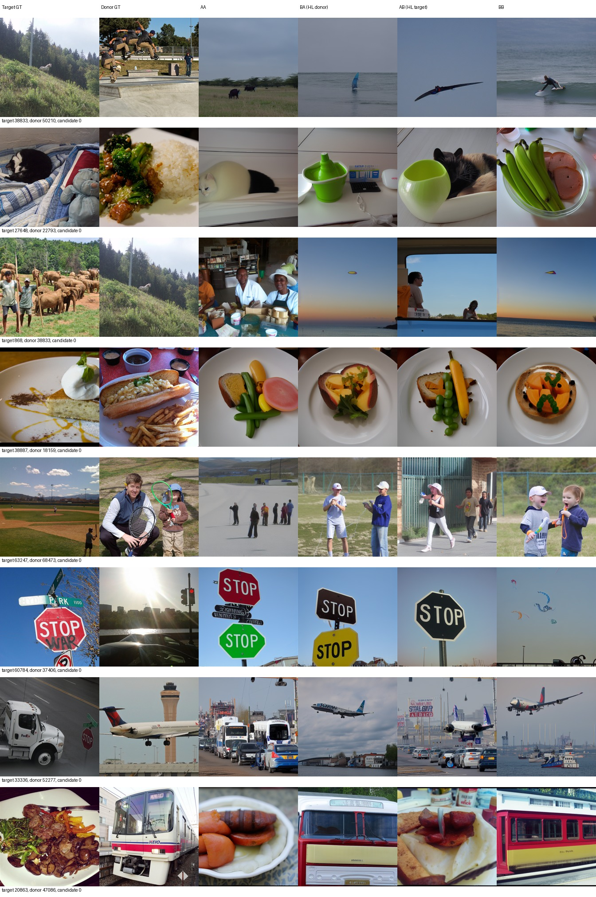
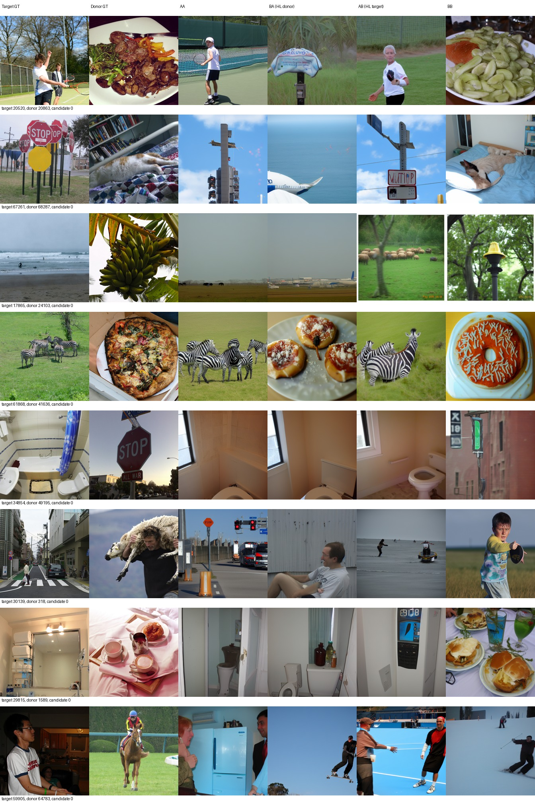
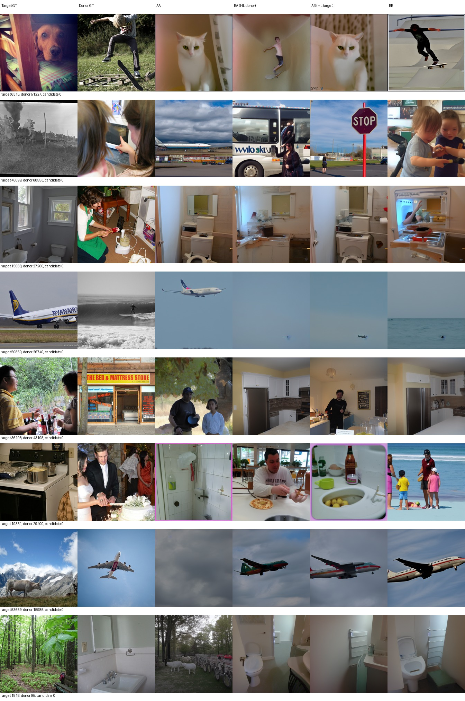
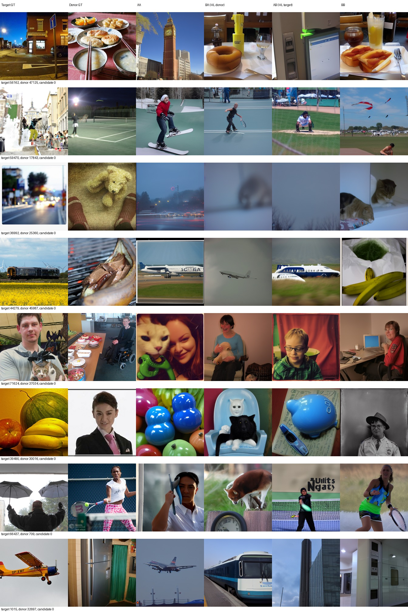
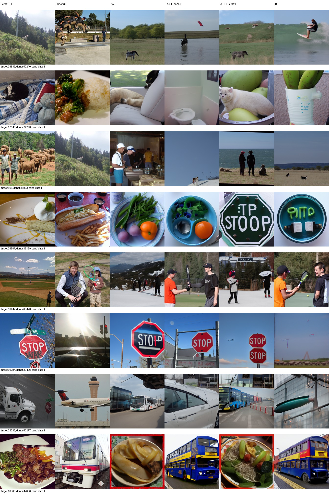
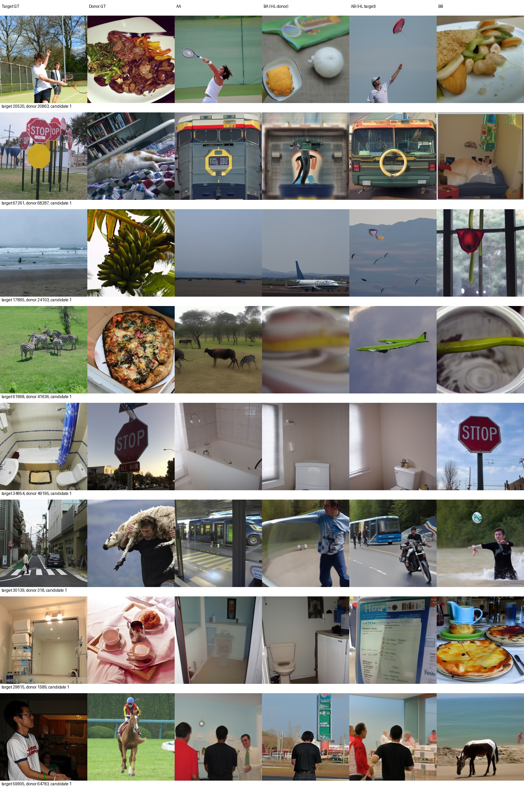
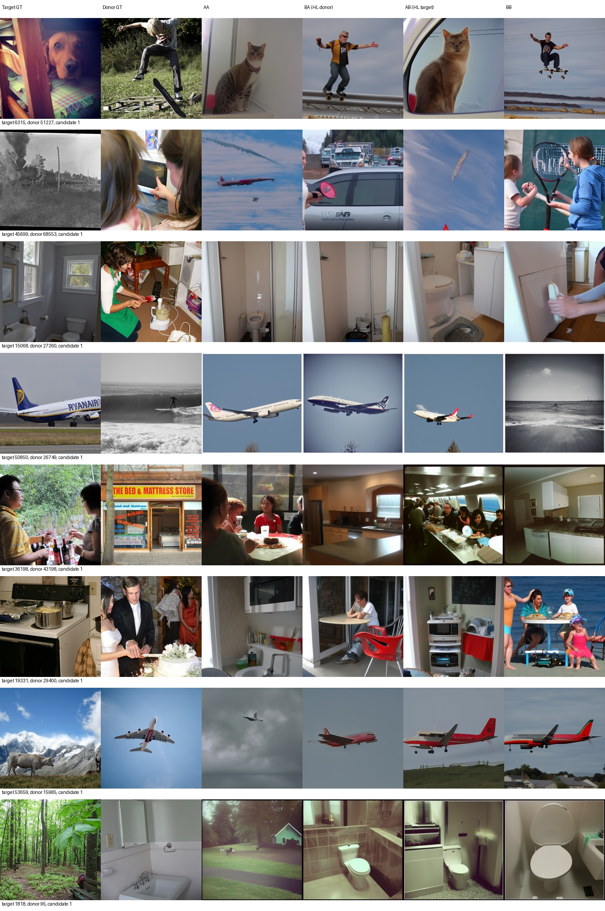
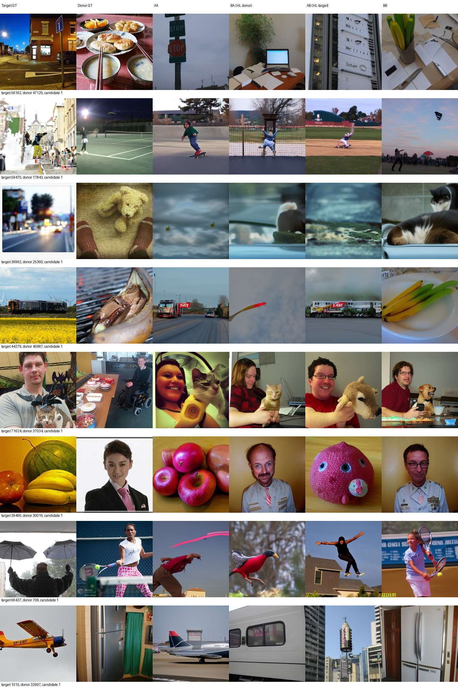

# L120固定HL位置：内容替换与补回

## 结论

在本次固定L120、固定供体映射、原100个反复使用的开发目标上，两个预定主效应均为正：

- 换走HL内容：**D=23.821549个百分点**，97.5%名义区间 **[19.335017, 28.341814]**。
- 补回目标HL内容：**R=22.082492个百分点**，97.5%名义区间 **[16.877083, 27.119529]**。

原八项指标的均值及各自辅助95%区间均与D的损失、R的改善方向一致；Eff/SwAV需按低为好理解。辅助区间未作八指标多重比较校正。CLIP方向量也一致：q_AA−q_BA=0.156194，95%区间[0.135077,0.177867]；q_AB−q_BB=0.149126，95%区间[0.125544,0.172948]。不只是目标cosine下降：换走时供体cosine平均升高0.069398；补回时目标cosine升高0.063657、供体cosine降低0.085469。

因此可说：**在这两个固定背景下，所选HL通路的图片特异内容影响模型对目标的读出，平均方向与目标/供体内容来源相符。** 不能说每图都恢复，或HL单独足以准确重建。AB的S=70.429293仍低于AA的84.656566，且图册包含整类错误、混合物体和补回失败。D−R=1.739057，辅助95%区间[-3.437710,6.946128]，不能据此确认背景交互，更不能解释为生物脑区协同。

这不是原空间匹配问题的解决方案；跨样本拼接不保证处于训练分布。结果仅为已选择模型、固定映射及内部开发集上的探索性模型干预描述，不是人脑因果、功能专一性、独立测试或跨供体稳健性证据。原先导结论与PROVEN_INFEASIBLE记录均保持不变。

本轮固定L120和原78个HL位置，使用原100目标及既有500图映射对应的供体。零训练、零调参；AA/BB复用，BA/AB新增。此实验不解决原严格空间匹配不可行问题。

第一位是HL的来源，第二位是其余122行的来源。A为目标，B为供体；所有生成随机流始终由目标ID及候选序号派生。U不是LL，重叠token22和143仍属HL。

## 原100图评价池的八项指标

|指标|AA|BA|AB|BB|方向|
|---|---:|---:|---:|---:|---|
|PixCorr|0.062161|0.018001|0.037558|-0.005052|高为好|
|SSIM|0.316083|0.303471|0.314321|0.293857|高为好|
|Alex(2)|72.414141|59.500000|60.333333|46.762626|高为好|
|Alex(5)|83.474747|61.116162|70.318182|46.792929|高为好|
|Incep|85.712121|60.813131|68.202020|48.616162|高为好|
|CLIP|84.782828|60.575758|72.767677|49.631313|高为好|
|Eff|0.792083|0.929148|0.885677|0.968751|低为好|
|SwAV|0.492430|0.589355|0.557264|0.645687|低为好|
|S|84.656566|60.835017|70.429293|48.346801|高为好|

两候选分别在完整100目标GT池评分后平均；没有拼成200图负例池，没有与500图混算。S仍为Alex(5)、Inception、CLIP识别率的均值。

## 两个预定主效应及辅助指标

D=AA−BA：换走HL内容造成的目标对应损失。R=AB−BB：补回HL内容造成的目标对应增益。以下保留原差值符号，Eff/SwAV的方向与识别率相反。

|指标|D|区间|R|区间|名义水平|
|---|---:|---|---:|---|---|
|PixCorr|0.044159|[0.019181, 0.070034]|0.042610|[0.017521, 0.069185]|95%|
|SSIM|0.012612|[0.003390, 0.022212]|0.020464|[0.009417, 0.032111]|95%|
|Alex(2)|12.914141|[7.823106, 18.166919]|13.570707|[8.979798, 18.116288]|95%|
|Alex(5)|22.358586|[17.232197, 27.590909]|23.525253|[17.924116, 29.075884]|95%|
|Incep|24.898990|[20.211995, 29.570833]|19.585859|[12.807955, 26.277904]|95%|
|CLIP|24.207071|[18.212121, 30.171717]|23.136364|[17.631187, 28.636364]|95%|
|Eff|-0.137065|[-0.170476, -0.105098]|-0.083075|[-0.105867, -0.060922]|95%|
|SwAV|-0.096925|[-0.119151, -0.076077]|-0.088423|[-0.107590, -0.069888]|95%|
|S|23.821549|[19.335017, 28.341814]|22.082492|[16.877083, 27.119529]|97.5%|
|cos_target|0.086797|[0.067779, 0.106446]|0.063657|[0.048509, 0.079208]|95%|
|cos_donor|-0.069398|[-0.084179, -0.054576]|-0.085469|[-0.102363, -0.068647]|95%|
|q|0.156194|[0.135077, 0.177867]|0.149126|[0.125544, 0.172948]|95%|

只有D/R的S是并列主终点，各使用97.5%名义百分位区间；其他指标和方向量为95%辅助描述。每图先平均两候选，所有条件共用每次抽中的100行，10000次重采样、seed2026092407，负例池不重建。

## CLIP辅助方向量

q=cos(输出,目标GT)−cos(输出,供体GT)。使用作者冻结CLIP及原预处理；它不是官方CLIP识别率，不参与生成和选图。

|条件|目标cosine|供体cosine|q|
|---|---:|---:|---:|
|AA|0.639832|0.507067|0.132765|
|BA|0.553035|0.576465|-0.023429|
|AB|0.584046|0.533665|0.050381|
|BB|0.520389|0.619134|-0.098745|

## 固定图册与AI审阅

原32张图，目标GT、供体GT、四条件、两个候选全部展示。

### 候选0，第1页

### 候选0，第2页

### 候选0，第3页

### 候选0，第4页

### 候选1，第1页

### 候选1，第2页

### 候选1，第3页

### 候选1，第4页

# AI图册审阅（非盲）

审阅者为AI，已实际查看候选0/1各4页，共8页；覆盖原32个目标、各自供体GT及AA/BA/AB/BB的全部256个候选展示。没有据结果换样本或挑选候选。以下例子用于说明整体图册中的改善、退步和不确定，并非新增分类评分表。

## 与内容来源变化一致的例子

- **20863（食物→供体轨道车辆）**：两个候选中，AA/AB都是食物，BA/BB转成公交或轨道车辆。这支持粗类别随来源变化，但目标的具体菜品、份量、布局没有恢复，车辆也不精确等于供体列车。
- **20520（网球→供体食物）**：AA保留持拍人物；BA候选1成为食物，候选0是难以归类的物体；AB恢复运动人物，候选1重新出现持拍动作，候选0更像棒球。说明部分语义回归，不是两个候选都准确复原。
- **6315（狗→供体滑板人物）**：BA/BB两个候选均为滑板人物，AA/AB均为猫。这里内容来源确实改变了粗类别，但把狗重建成猫的错误仍在，不能写成目标重建成功。
- **36198（人物交谈→供体店面）**：BA/BB主要呈现无人厨房/台面，AB重新出现人物活动，尤其候选1为多人室内场景。但背景仍不忠实，供体店面也未被精确重建。

## 补回失败、局部退步及混合痕迹

- **61868（斑马→供体披萨）**：候选0从BA食物经AB回到斑马；候选1的AB却成为绿色飞机。两个候选明显不一致，不能仅展示候选0宣称恢复。
- **1818（树林→供体卫生间）**：AA是户外树木场景，BA和AB两个候选都保留卫生间/厨房式室内结构；补回HL没有恢复树林。
- **1015（飞机→供体冰箱）**：AA为飞机，BA变成列车，AB变成建筑/标牌，BB为冰箱。BA的退步不是精确复制供体类别，AB也没有回到飞机。
- **27648（猫→供体食物）**：AB恢复猫，但猫与巨大的绿色碗/果实混合，呈现不自然的联合内容，不能据来自真实脑输入就宣称拼接在训练分布内。
- **53659（山地牛→供体飞机）**：BA/AB/BB两个候选大多仍是飞机；AB没有找回目标动物，AA本身也没有清楚恢复牛。
- **39490（水果→供体人像）**：BA候选1成为人像，但AB是玩具/储蓄罐样物，而不是正确水果；候选0的混合输出更难归类。
- **38887（两端均为食物）**：多数候选仍为食物，但AB候选1出现STOP标牌样物。不能把共同的食物主题当作可靠的方向性转移证据。

## 未明显发生类别转移及不确定

- **34854（卫生间→供体STOP标牌）**：BA两个候选仍为卫生间，AB也为卫生间；说明换走HL不保证每个样本都丢失目标类别。
- **60784（STOP标牌→供体交通灯街景）**：AA/BA/AB均保留STOP元素，而BB偏天空/风筝；两端本身具有街景关联，无法仅靠看图判定细粒度信息属于谁。
- **50850（飞机→供体冲浪）**：候选1中BA仍为飞机，AB也为飞机；候选0的远小物体不够清楚，不能强行分类为成功转移。
- **36992（失焦街景→供体玩具熊）**：混合条件多为模糊、低辨识度画面；不能用缺乏可辨类别证明方向正确。
- 人物/运动/室内等相近类别的目标—供体组合，以及原AA本身错误的例子，均限制了肉眼方向判读。仍存在飞机、公交、标牌等整类错误，结构、文字、动物种类与场景细节也不稳定。

## 总体判断

图册与平均指标共同支持固定HL内容通路对目标读出的影响，但不是逐图充分恢复，也不是所有变化都朝供体精确类别移动。AB的平均语义表现仍低于AA；无论正向例子还是失败例子，都不能推出人脑因果、HL功能专一性、模型已修复或原严格空间匹配问题得到解决。

## 解释边界

固定的同一组token位置使集合大小、parcel身份等保持不变，但不保证跨样本混合token的联合分布在训练分布内。D/R不能解释为78个HL与122个U的单位重要性排名，也不能解释成人脑因果、功能专一性或原HL额外损失由标签本身造成。

这是一份固定供体映射；目标与供体在行间可能相关，且L120与这些开发图已被反复分析。区间只是本条件下的探索性描述，不保证独立样本覆盖，不校正历史选择，不代表跨供体、跨seed或标准test结论。D−R仅背景交互的辅助描述，不能升格为生物协同证据。

## 可复核证据

- [冻结方案](PLAN.md)、[协议](protocol.json)、[模型锁定](model_lock.json)、[HL及补集](hl-indices.json)、[100行供体映射](target-donor-map.json)。
- [AA/BB复用来源](reference-manifest.json)、[最多8张逐像素复现](noninterference.json)、[真实E行来源审计](content-audits.json)。
- [原始汇总与区间](comparison.json)、[逐图四条件及配对差值](paired-four-conditions.csv)、[每候选CLIP两个cosine与q](clip-direction-candidates.csv)。
- [BA候选0](BA/val100/candidate-0.csv)、[BA候选1](BA/val100/candidate-1.csv)、[AB候选0](AB/val100/candidate-0.csv)、[AB候选1](AB/val100/candidate-1.csv)。
- 原参考指标：[AA](../lr-half-to120/val100/metrics.json)、[BB](../brain-correspondence-l120/permuted/val100/metrics.json)。
- [实际预算与关键输入不变检查](completion.json)。命令：runtime/env/bin/python scripts/hl_content_interchange.py；逐阶段命令、退出码及最终GPU核验见[delivery-checks.json](delivery-checks.json)。

原IBBI/ROI先导及严格匹配PROVEN_INFEASIBLE报告保持原样；本轮无后续训练或追加实验。

## 实际退出与停止状态

运行代码提交c282585；12条阶段/子进程退出记录均为0，控制器controller_complete=0。BA/AB共400张正式图，AA/BB检查8张，未超预算。309项锁定关键输入SHA复核一致；训练仍为L140/74480，新增更新0。最终无本实验控制器或decoder进程，GPU计算进程为空。全部8页已完成AI非盲审阅；到此停止，不追加实验。

[命令、退出码、脚本SHA与最终GPU记录](delivery-checks.json)
