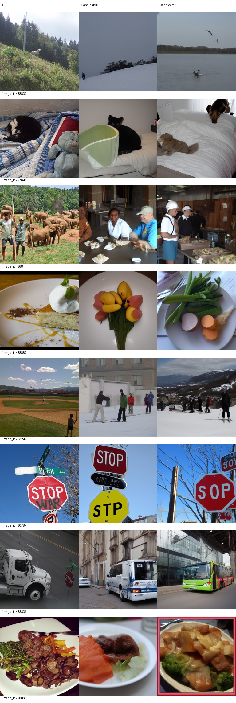
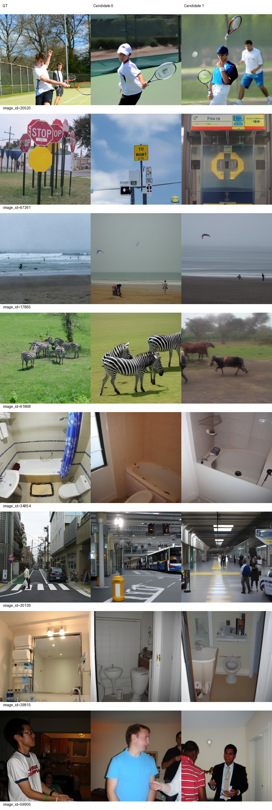
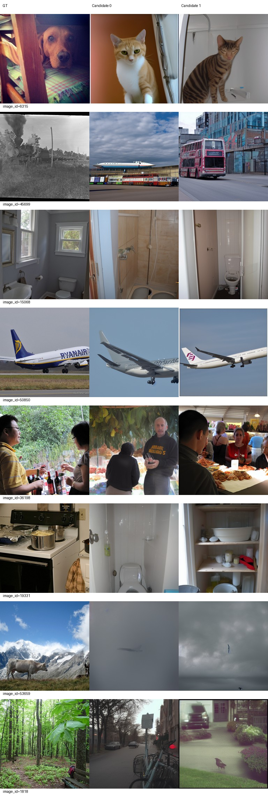
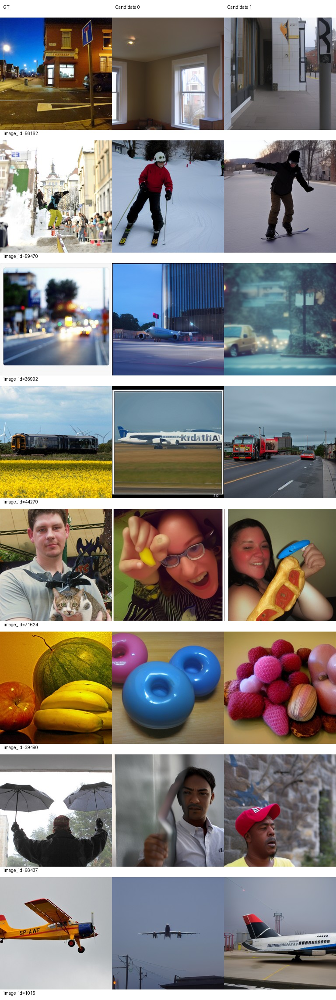
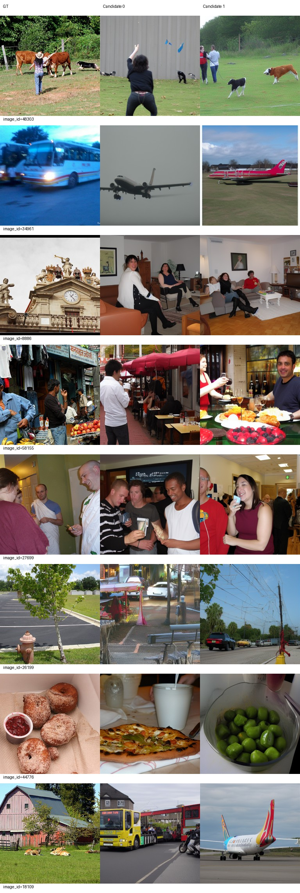
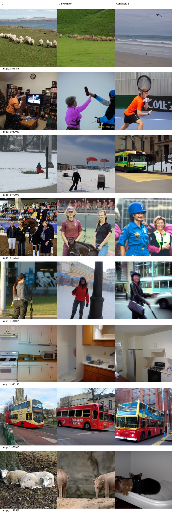

# 同起点完整AdamW半学习率：最终结果

**结论：L的S点估计同时高于B0和H，但L−H的97.5%区间跨零，尚未确认半学习率相对原学习率有额外收益，不能宣布已修好；这也不等于证明无效。** L−B0的区间仅略高于零，证据边界较窄。固定图册仍有整类错误和内容退步。

B0为原主线100轮（不更新）；H为原主线110轮、LR1e-4；L从与H相同的完整checkpoint100/53200恢复，加载模型、AdamW、双rank RNG、DataLoader和进度后，仅LR改为5e-5。L新增10个真实epoch、5320次更新，到110/58520，0次跳过更新；105仅保存未评分调参。十轮实际样本顺序哈希全部与H一致。其余科学配置均继承主线。详见[开训前计划](PLAN.md)、[配置](../../configs/lr-half-from100.json)、[训练核验](training-complete.json)。

## 完整500图（主要比较）

原500内部验证ID、每图两候选、candidate batch1、原ID派生完整随机过程、50步CFG4、原精度/backend，无选择、GT不进入生成。B0复用500；H原100不改，只新增400图800候选；L生成500。每候选分别在完整500负例池评分后平均，不拼接100/400识别率、不合并1000独立观测。Eff/SwAV越低越好，其余越高越好。

| 对象 | PixCorr | SSIM | Alex(2) | Alex(5) | Incep | CLIP | Eff | SwAV | S |
|---|---|---|---|---|---|---|---|---|---|
| B0 | 0.04861 | 0.30117 | 69.82525 | 80.54830 | 80.53928 | 82.52244 | 0.82359 | 0.50406 | 81.20334 |
| H | 0.04480 | 0.30543 | 68.00020 | 80.57134 | 81.17575 | 83.69339 | 0.82545 | 0.50590 | 81.81349 |
| L | 0.05085 | 0.30703 | 68.84729 | 81.03387 | 81.87796 | 84.26172 | 0.81687 | 0.49994 | 82.39118 |

图像内先平均两个候选，再进行10000次配对bootstrap，NumPy default_rng seed20260923。两个主要S比较分别采用97.5%百分位区间（1.25%～98.75%），辅助八指标95%区间为探索性结果。固定完整500负例池下的逐图分数用于重采样，不重新定义识别负例池。

| 比较 | S差值（百分点） | 97.5%区间 | 判断 |
|---|---|---|---|
| L−B0 | +1.18784 | [+0.01674, +2.38385] | 略高于零 |
| L−H | +0.57769 | [-0.33656, +1.49490] | 跨零，未确认 |

L相对B0的八指标点估计中七项改善、Alex(2)下降；相对H八项点估计均向好。辅助95%区间：L−B0的SSIM和CLIP支持改善；L−H的PixCorr、Eff、SwAV支持改善，其余辅助指标区间跨零。不能把这些辅助发现替代预先固定的两个主要S比较。

| 对比 | 指标 | 差值 | 辅助95%区间 |
|---|---|---|---|
| L−B0 | PixCorr | +0.00224 | [-0.00397, +0.00832] |
| L−B0 | SSIM | +0.00586 | [+0.00326, +0.00847] |
| L−B0 | Alex(2) | -0.97796 | [-2.58658, +0.64515] |
| L−B0 | Alex(5) | +0.48557 | [-0.92467, +1.92269] |
| L−B0 | Incep | +1.33868 | [-0.34975, +2.99620] |
| L−B0 | CLIP | +1.73928 | [+0.25751, +3.25632] |
| L−B0 | Eff | -0.00672 | [-0.01518, +0.00174] |
| L−B0 | SwAV | -0.00412 | [-0.00996, +0.00165] |
| L−H | PixCorr | +0.00605 | [+0.00183, +0.01033] |
| L−H | SSIM | +0.00160 | [-0.00029, +0.00354] |
| L−H | Alex(2) | +0.84709 | [-0.29182, +1.96477] |
| L−H | Alex(5) | +0.46253 | [-0.68940, +1.57538] |
| L−H | Incep | +0.70220 | [-0.54994, +1.94831] |
| L−H | CLIP | +0.56834 | [-0.74514, +1.93528] |
| L−H | Eff | -0.00858 | [-0.01441, -0.00283] |
| L−H | SwAV | -0.00596 | [-0.00999, -0.00194] |

这是反复使用的内部开发集、单条训练轨迹上的探索性结果，不是独立测试或跨训练seed结论。没有追加LR/seed或临时改成功指标。

## 固定100图监控（单独报告）

| 对象 | PixCorr | SSIM | Alex(2) | Alex(5) | Incep | CLIP | Eff | SwAV | S |
|---|---|---|---|---|---|---|---|---|---|
| B0 | 0.05045 | 0.31269 | 71.72222 | 80.72727 | 82.66667 | 84.76768 | 0.79554 | 0.49189 | 82.72054 |
| H | 0.04029 | 0.31786 | 69.16667 | 83.36869 | 81.61616 | 84.17677 | 0.81046 | 0.49392 | 83.05387 |
| L | 0.05318 | 0.31655 | 70.85354 | 84.63636 | 83.10606 | 84.97475 | 0.79720 | 0.48776 | 84.23906 |

100图与500图负例池不同，不横向相减。L的val100 S更高也不触发主线best替换。主线best仍是原H110，原110暂停记录保留。

## 全部固定图册与AI审阅

审阅者：AI，实际查看L全部6页（原32验证＋16训练，全部两个候选），并对照本任务先前已完整查看的[B0图册](../epoch-100/README.md)与[H图册](../epoch-110/README.md)。无人工盲评，无挑选候选或新增类别大表。

较稳定或局部改善：20520网球、60784停车标志、34854/29815浴室、50850/1015飞机和训练70940公交仍能保持主要类别。17865保留海滩场景，但没有准确恢复冲浪活动。训练48303候选1较H更明确出现牛，57593候选0保留马与人；49146候选1保留厨房。识别大类不等于细节、位置和关系正确。

关键退步和持续失败：B0中6315候选0为狗，L两候选均为猫；61868候选1与H一样仍将斑马变为牛；B0中59470候选1为滑板，L仍为雪地滑雪；39490候选1从B0的水果变为编织物；19331失去B0候选1的炉灶场景，L候选0为卫生间、候选1为餐具架；66437仍未恢复B0候选1的雨伞。36992候选0比H重新出现机场飞机，候选1仍有街景；44279候选0仍为飞机，候选1的道路车辆也不能当作正确恢复GT火车。53659主体模糊，无法可靠识别，不能强行算正确。

训练16辅助图同样并非一致改善：34961候选1在H已为公交，L又变为飞机；18109农场仍变成公交/飞机；15485羊被生成象/猫；44776甜甜圈仍为其他食物；49146候选0仍为浴室。L训练16绝对指标见[train16](L/train16/metrics.json)，不与500图识别率直接相减。由此不能将S提高解释为整类错误已经修复。

## 权重、完整状态与退出

L推理权重位于服务器：
`/data1/matengyu/geyugong/neuroadapter-author-first/runs/subject01-author-fp32-seed42-lr5e-5-from100/exports/epoch-110/inference.pt`

SHA256：`f9881c2897e1844db3b237c39e4b6f6309c85441d0629a2bdcc1c1a396be34f9`。CPU加载38个张量均有限，metadata核对为L110/58520。相邻metadata.json、parcel_vertices.pt一并保留。完整恢复点为同一L运行目录下的`checkpoint-105`与`checkpoint-110`，包含模型、AdamW（实际LR5e-5）、双rank RNG和DataLoader/进度。推理权重不能代替完整状态恢复。

来源：原主线checkpoint-100；源导出记录commit `ddbac421b0a06e4dc3360dece3cf2afd8429dcdd`；分支实现270410d，零更新工程修复e412adf。两rank恢复前后精确核验见[rank0](branch-resume-100-rank0.json)、[rank1](branch-resume-100-rank1.json)。源checkpoint、主线best、暂停记录哈希与实验前一致，90/100/110历史报告未改。未将L提升为主线模型。

实际命令：`runtime/env/bin/python scripts/lr_half_train.py`；完整退出后`runtime/env/bin/python scripts/lr_half_evaluate.py`。首次开训前HDF5句柄复制错误退出1、0次更新；修复后正式训练退出0。六个评价子阶段全部退出0，最终EVALUATION_COMPLETE存在，训练/评价控制器及子进程均已退出，GPU计算进程为空。顶层shell未单独持久化控制器退出码，不把“PID已退出”伪称为独立捕获的shell exit0。详细命令/PID/核验见[delivery-checks](delivery-checks.json)。

本实验完成并停止，不延长、不启动另一个LR或seed、不恢复主线120。所有checkpoint与完整生成输出留在服务器，线上只发布报告和固定图册，不推送数据或权重。

数据入口：[B0原500](../epoch-100/val500/metrics.json)、[H500](H/val500/metrics.json)、[L500](L/val500/metrics.json)、[完整比较](comparison.json)、[逐图L−B0](paired-L-minus-B0.csv)、[逐图L−H](paired-L-minus-H.csv)、[H来源清单](H-full500-manifest.json)。各H/L目录均包含两份候选CSV和metrics中的完整ID清单。
