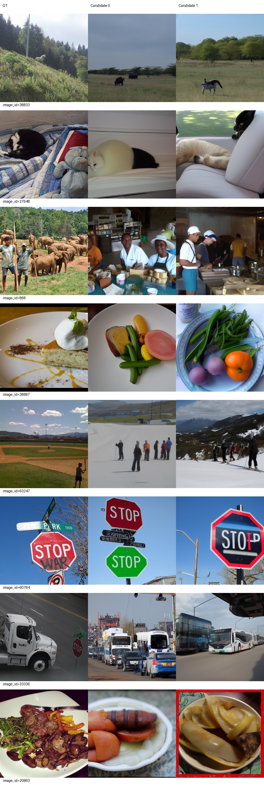
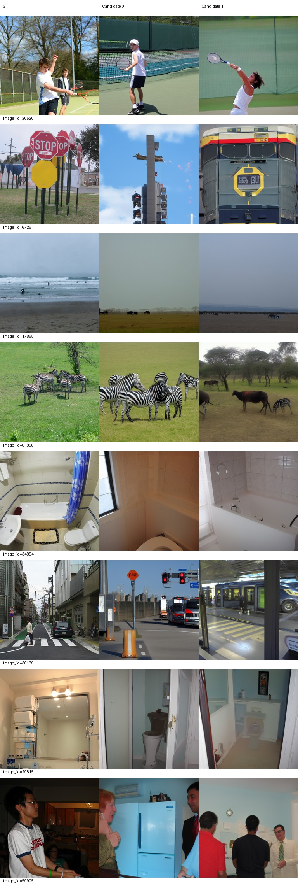
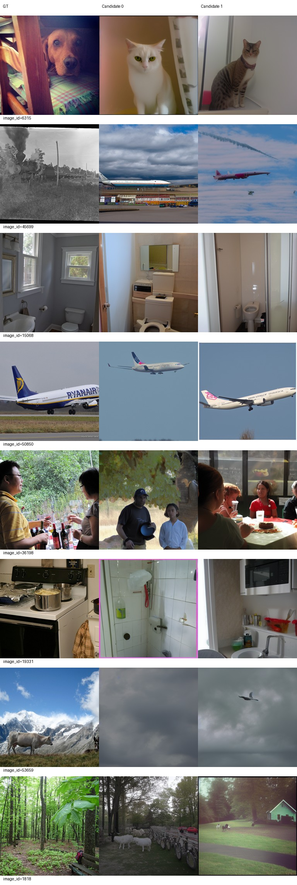
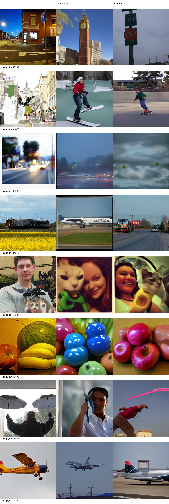
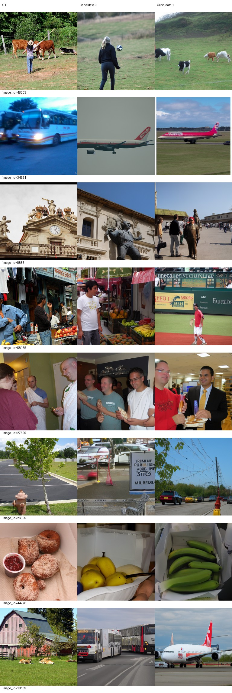
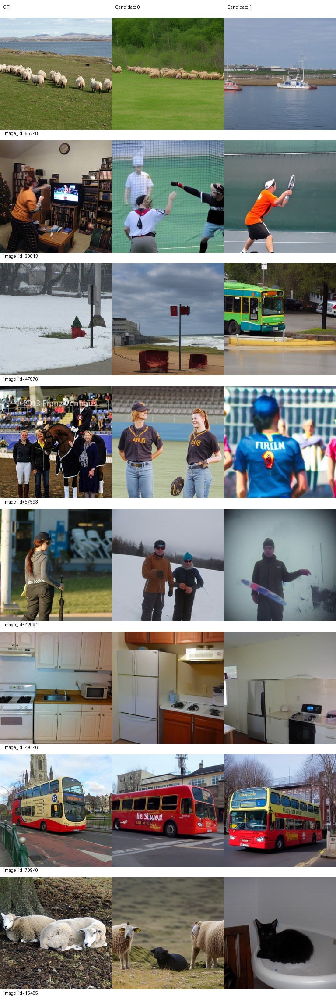

# L110→L120有限续训结果

已完成并停止。L自身完整110/58520恢复，固定LR5e-5新增10真实epoch、5320更新，达到120/63840，零跳过更新。双rank模型、AdamW38项、RNG、DataLoader恢复审计通过；其他科学配置保持不变。115仅保存未中途评价调参。

结论：500图S从82.39118升至82.81904（+0.42786百分点），六项指标点估计改善，但CLIP下降1.51042百分点、SSIM下降0.00137；这是有取舍的小幅均值提升，不能说全面优于L110。100图S提高0.41751，但Alex5、CLIP、SSIM和SwAV方向退步。未新增显著性检验，不声称统计确认收益。L110完整保留，不自动提升L120或修改主线best。

原B0/H/L110实验报告和通过标准不变。H无111至120同预算对照，L120与H110的任何差异不能证明同预算学习率优势。反复使用的内部开发集，不是独立测试；未触碰标准test。

## 同条件指标

两个固定候选分别在完整评价池评分后平均，candidate batch1、原ID派生完整随机输入、50步、CFG4、FP32/backend不变，无选图、GT不参与生成。500与100分别纵向比较，monitor100来自同一批输出；历史图未重复生成。Eff/SwAV越低越好，其余越高越好。

### val500

|指标|L110|L120|L120−L110|
|---|---:|---:|---:|
|PixCorr|0.050849|0.053867|+0.003018|
|SSIM|0.307031|0.305663|-0.001368|
|Alex(2)|68.847295|70.644489|+1.797194|
|Alex(5)|81.033868|82.156313|+1.122445|
|Incep|81.877956|83.549499|+1.671543|
|CLIP|84.261723|82.751303|-1.510421|
|Eff|0.816873|0.816281|-0.000592|
|SwAV|0.499939|0.496760|-0.003179|
|S|82.391182|82.819038|+0.427856|

### val100

|指标|L110|L120|L120−L110|
|---|---:|---:|---:|
|PixCorr|0.053182|0.062161|+0.008979|
|SSIM|0.316551|0.316083|-0.000468|
|Alex(2)|70.853535|72.414141|+1.560606|
|Alex(5)|84.636364|83.474747|-1.161616|
|Incep|83.106061|85.712121|+2.606061|
|CLIP|84.974747|84.782828|-0.191919|
|Eff|0.797200|0.792083|-0.005117|
|SwAV|0.487757|0.492430|+0.004673|
|S|84.239057|84.656566|+0.417508|

### 固定训练16（仅辅助）

|指标|L110|L120|
|---|---:|---:|
|PixCorr|0.091854|0.086752|
|SSIM|0.254927|0.260981|
|Alex(2)|73.125000|72.083333|
|Alex(5)|87.916667|81.458333|
|Incep|81.250000|83.333333|
|CLIP|87.708333|80.416667|
|Eff|0.794877|0.792006|
|SwAV|0.471359|0.490698|
|S|85.625000|81.736111|

训练16负例池不同，不能与验证识别率直接相减，也不能外推训练全集表现。

## AI图册审阅

审阅者为AI，实际查看L120全部6页及L110全部6页，非人工盲评；不筛样本、不选候选。以下只举例解释完整图册中的变化，不构成新选优分数。

较稳定：20520网球、60784停止标志、50850/1015飞机、70940训练公交保持大类，但人物姿态、文字、机型和布局不精确。浴室类通常可辨，29815仍偏马桶而未还原镜子布局，34854候选0从浴缸偏向马桶，说明大类稳定不等于细节正确。

改善：71624两候选从单纯人物/物件变为人物与猫，更接近GT主体组合；39490候选1从针织物变为苹果，水果大类更近，但种类仍错；59470候选1恢复滑板而不是滑雪；36992候选0从飞机场景变为道路车辆。训练8886候选0出现建筑雕塑，49146候选0恢复炉灶厨房，15485候选0从象变为羊。

退步与持续错误：17865两候选从海滩转为草原动物；45699候选1从公交变飞机，GT为蒸汽列车，两者均错误，飞机偏向仍存在；36992候选1丢失道路成为云状模糊图；6315狗仍被生成猫，868象群仍被生成室内餐饮人物，44279列车仍为飞机/公路车辆，53659山地牛主体缺失，66437未还原撑伞场景。训练57593候选0从人物与马转为棒球人物，42991由街边人物转为雪地滑雪，47976候选0丢失雪景；34961公交仍是飞机，18109农舍仍是公交/飞机，44776甜甜圈仍变水果。训练样本也有整类错误，不能称已解决内容偏差。

[L110完整历史报告及图册](../lr-half-from100/README.md)。本页下方完整展示原32验证+16训练图，包含两个候选。

## 权重、完整恢复与退出

L120可加载推理权重：`/data1/matengyu/geyugong/neuroadapter-author-first/runs/subject01-author-fp32-seed42-lr5e-5-from100/exports/epoch-120/inference.pt`，配套同目录metadata.json及parcel_vertices.pt。

SHA256：`bed56671f4e48ccf031e41c1daa36d473a4e325e94e3264aa1b21e08080fd798`。实际CPU加载38张量，全部有限，epoch120/63840元数据和SHA一致；原生成评价也已成功使用该导出。

完整状态：`/data1/matengyu/geyugong/neuroadapter-author-first/runs/subject01-author-fp32-seed42-lr5e-5-from100/checkpoint-120`（120/63840，LR5e-5），保留`checkpoint-115`（115/61180）和历史105/110。模型、AdamW、双rank RNG、loader状态文件均可读取。完整路径供以后显式授权恢复使用，本次无后续训练命令。

执行命令：`runtime/env/bin/python scripts/lr_half_continue.py`；实际训练子命令为`runtime/env/bin/python scripts/run_train.py --branch-lr-half --target 120 --resume /data1/matengyu/geyugong/neuroadapter-author-first/runs/subject01-author-fp32-seed42-lr5e-5-from100/checkpoint-110`。独立评价通过同控制器的`--phase generate`和`--phase score`调用。不要重复执行已完成节点。

训练、生成、评分退出码均0；控制器记录controller_complete exit0，相关PID均退出，GPU计算进程为空。源主线、best及原实验58个受保护文件哈希保持不变。无新学习率、无新支线、未继续150/300。

审计见[delivery-checks.json](delivery-checks.json)、双rank恢复记录、[配置](../../configs/lr-half-to120.json)、[完整差值](comparison.json)；逐候选CSV分别位于val500/val100/train16。原始日志位于服务器logs/lr-half-to120-events.jsonl及对应训练/评价日志。代码8972ade；报告经服务器git bundle同步至本地及私有GitHub，不上传权重、数据或密钥。
