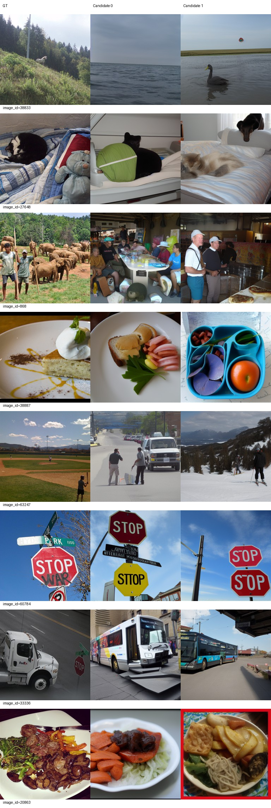
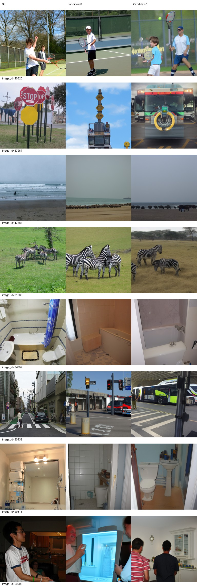
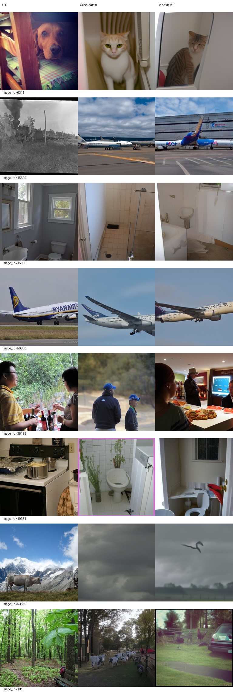
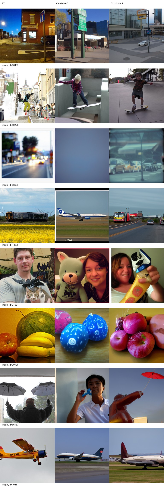
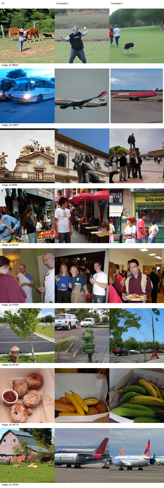
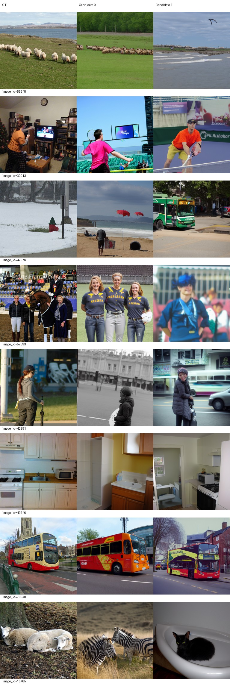

# L130中间节点反馈

完成120→130新增10真实epoch、5320更新，累计130/69160，固定LR5e-5。训练/生成/评分及控制器退出0，进程退出、GPU计算任务为空，完整AdamW/RNG/loader状态与可加载导出已核验。

固定100图S=84.18855，比L120下降0.46801。六项点估计改善，SSIM下降0.00545、Inception下降2.42929百分点；S也略低于L110。不能称130全面更好。本节点只有100图评价，不是500图结果。两个候选分别完整池评分后平均，无选图；batch1、原ID随机、50步、CFG4。Eff/SwAV低为好。训练16仅辅助，不能与100图识别率直接相减。

## 同100图八指标

|指标|L110|L120|L130|L130−L120|
|---|---:|---:|---:|---:|
|PixCorr|0.053182|0.062161|0.072132|+0.009971|
|SSIM|0.316551|0.316083|0.310636|-0.005447|
|Alex(2)|70.853535|72.414141|73.353535|+0.939394|
|Alex(5)|84.636364|83.474747|84.338384|+0.863636|
|Incep|83.106061|85.712121|83.282828|-2.429293|
|CLIP|84.974747|84.782828|84.944444|+0.161616|
|Eff|0.797200|0.792083|0.787764|-0.004319|
|SwAV|0.487757|0.492430|0.483410|-0.009020|
|S|84.239057|84.656566|84.188552|-0.468013|

## 固定训练16（辅助）

|指标|均值|
|---|---:|
|PixCorr|0.089230|
|SSIM|0.251309|
|Alex(2)|72.916667|
|Alex(5)|87.708333|
|Incep|87.500000|
|CLIP|85.208333|
|Eff|0.787770|
|SwAV|0.476262|
|S|86.805556|

## AI审阅及继续决定

审阅者为AI，实际查看全部4页验证及2页训练图册，与L120固定图册比较，不是人工盲评，不新增选优分数。

改善：59470两候选均为滑板，候选0从滑雪恢复目标大类；61868候选1从牛/斑马混合变为斑马；56162从钟楼/停止标志变为街角建筑道路，更接近场景；36992候选1从云状模糊变为车辆街道。训练26199候选0出现消防栓，42991候选1回到街边人物，8886保留建筑雕塑。

退步：71624人物与猫变成玩偶或手持物件，38833从草地动物变海面/水鸟，36992候选0从道路变成难辨的蓝色模糊图；训练15485候选0羊变斑马，18109候选0公交进一步变成飞机（两者都不符合农舍GT），48303候选1牛主体丢失。持续整类错误包括6315狗→猫、868象群→室内聚餐、45699列车→飞机、44279列车→飞机/道路车辆、17865海滩→动物、训练34961公交→飞机；19331厨房进一步偏向卫生间。飞机偏向未消失，不把不生成飞机等同成功。

20520网球、60784停止标志、50850/1015飞机、70940公交大类仍较稳定，但文字、姿态、数量和布局不准确。绝对表现仍有大量整类错误，训练固定样本同样未全部重建成功。

判断：未出现数值/恢复故障，六项改善而非多项全面明显退步；图册有局部明显退步也有恢复，未见总体明显恶化。未满足用户规定的联合停止条件。先发布本报告，再保持原配置继续140；不调参、不提升主线best、不覆盖L110/L120。没有同预算H130对照，不作学习率优势结论。

## 权重与恢复

推理权重：`/data1/matengyu/geyugong/neuroadapter-author-first/runs/subject01-author-fp32-seed42-lr5e-5-from100/exports/epoch-130/inference.pt`，同目录metadata.json及parcel_vertices.pt配套。

SHA256：`d672f344d2e49836c0aa8e4c7eff6bfd6fcd0c5c5749eafa4701731103c6656e`。

完整状态：`/data1/matengyu/geyugong/neuroadapter-author-first/runs/subject01-author-fp32-seed42-lr5e-5-from100/checkpoint-130`，130/69160、LR5e-5；历史L110/L120和主线best未变，保护哈希全部通过。可加载38张量均有限。实际状态与退出事件见[delivery-checks.json](delivery-checks.json)。

运行：`runtime/env/bin/python scripts/lr_half_continue.py --target 130`；训练子命令从L checkpoint-120完整恢复。下一节点只在本报告上线后执行`runtime/env/bin/python scripts/lr_half_continue.py --target 140`。日志为logs/lr-half-to130-events.jsonl及train/generate/score对应日志。
