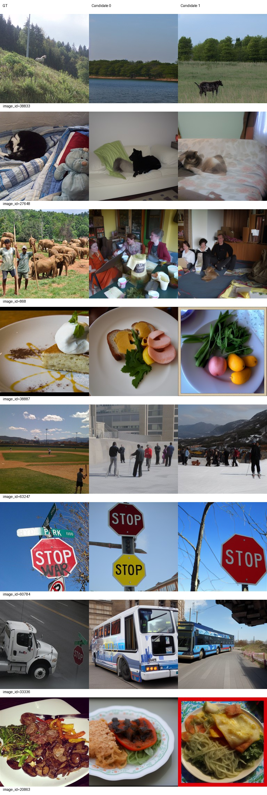
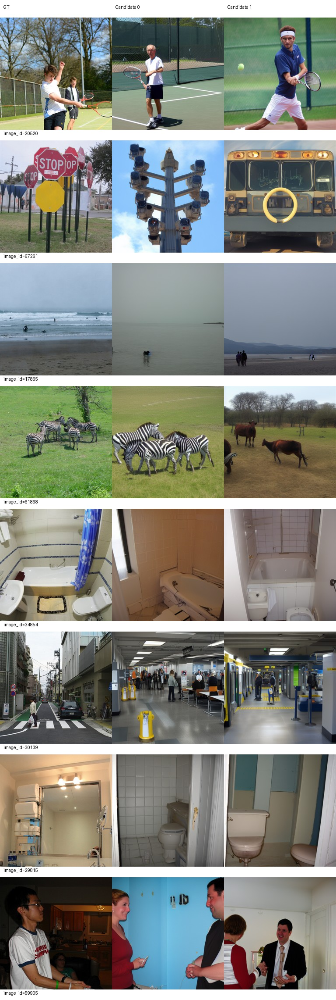
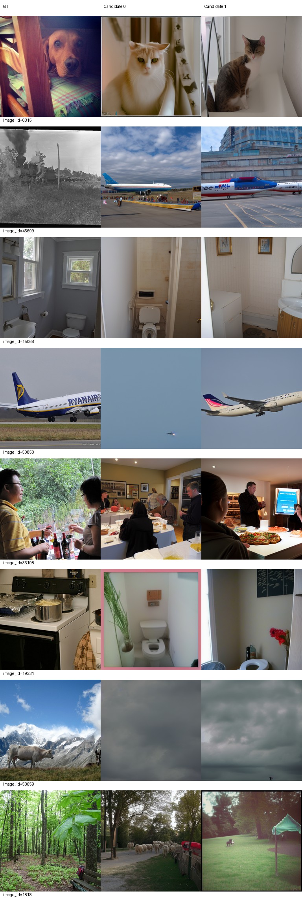
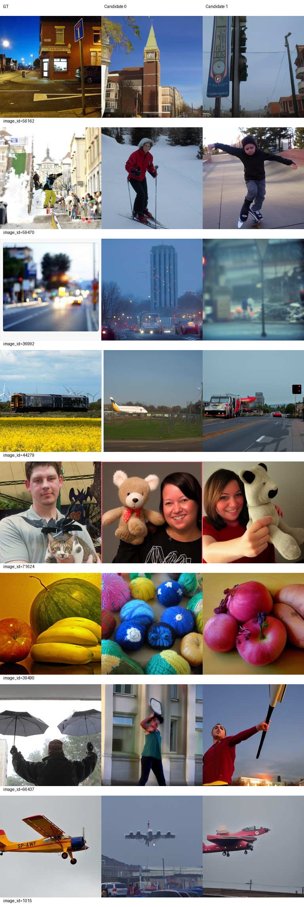
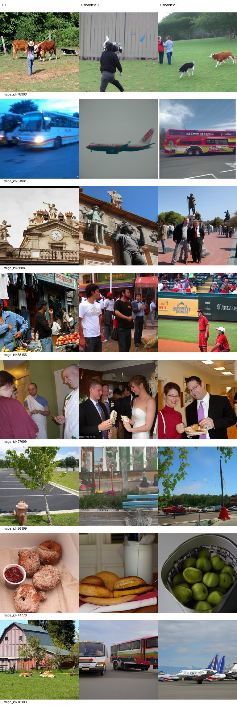
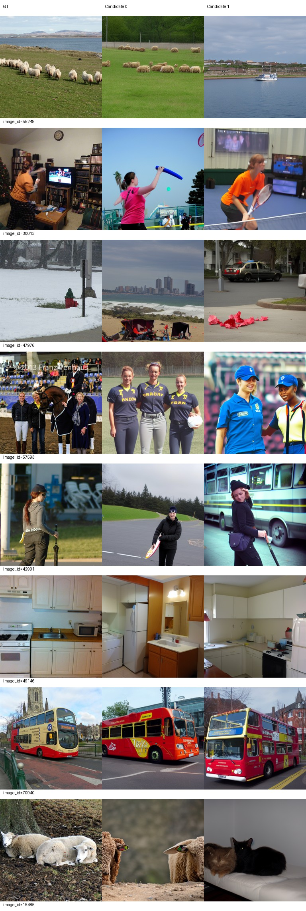

# L140最终交付：累计140轮后停止

L140完成74480次累计更新；本段从L130完整状态恢复，新增真实131–140轮、5320次更新，跳过更新0，AdamW LR始终5e-5。训练、独立生成、评分、控制器均exit 0，相关进程已退出，核验时GPU无计算进程。主线与全部历史结果保持不动。

全500图S=83.102004，较L110 +0.710822、较L120 +0.282966；这只是重复使用的内部开发集点估计，有指标取舍，不宣称统计显著或全面改善。固定100图S=83.580808，较L130 -0.607744、较L120 -1.075758。不默认140最好，不自动提升为正式模型。没有同预算H140对照，不能解释为学习率优势。

## 同条件指标

每图两个固定候选，各自对完整评价池评分后平均；candidate batch=1，原image-ID随机过程、50步、CFG4。500图与100图分开，历史输出直接复用。Eff/SwAV越低越好，其余越高越好。

### val500

|指标|L110|L120|L140|
|---|---:|---:|---:|
|PixCorr|0.050849|0.053867|0.059320|
|SSIM|0.307031|0.305663|0.300105|
|Alex(2)|68.847295|70.644489|70.591583|
|Alex(5)|81.033868|82.156313|82.035070|
|Incep|81.877956|83.549499|82.451703|
|CLIP|84.261723|82.751303|84.819238|
|Eff|0.816873|0.816281|0.811747|
|SwAV|0.499939|0.496760|0.491819|
|S|82.391182|82.819038|83.102004|

|L140差值|L110|L120|
|---|---:|---:|
|PixCorr|+0.008471|+0.005453|
|SSIM|-0.006926|-0.005558|
|Alex(2)|+1.744289|-0.052906|
|Alex(5)|+1.001202|-0.121242|
|Incep|+0.573747|-1.097796|
|CLIP|+0.557515|+2.067936|
|Eff|-0.005126|-0.004534|
|SwAV|-0.008119|-0.004940|
|S|+0.710822|+0.282966|

### val100

|指标|L110|L120|L130|L140|
|---|---:|---:|---:|---:|
|PixCorr|0.053182|0.062161|0.072132|0.070339|
|SSIM|0.316551|0.316083|0.310636|0.310318|
|Alex(2)|70.853535|72.414141|73.353535|71.348485|
|Alex(5)|84.636364|83.474747|84.338384|82.853535|
|Incep|83.106061|85.712121|83.282828|82.641414|
|CLIP|84.974747|84.782828|84.944444|85.247475|
|Eff|0.797200|0.792083|0.787764|0.796199|
|SwAV|0.487757|0.492430|0.483410|0.492071|
|S|84.239057|84.656566|84.188552|83.580808|

|L140差值|L110|L120|L130|
|---|---:|---:|---:|
|PixCorr|+0.017157|+0.008178|-0.001793|
|SSIM|-0.006233|-0.005765|-0.000318|
|Alex(2)|+0.494949|-1.065657|-2.005051|
|Alex(5)|-1.782828|-0.621212|-1.484848|
|Incep|-0.464646|-3.070707|-0.641414|
|CLIP|+0.272727|+0.464646|+0.303030|
|Eff|-0.001001|+0.004116|+0.008435|
|SwAV|+0.004314|-0.000359|+0.008661|
|S|-0.658249|-1.075758|-0.607744|

全500相对L120：CLIP提高2.067936，PixCorr、Eff、SwAV改善；SSIM下降0.005558，Alex(2)/Alex(5)分别下降0.052906/0.121242，Inception下降1.097796。相对L110则除SSIM外七项改善。固定100相对L130只有CLIP改善，其余七项退步，不能用全500的小幅S提升掩盖这一结果。历史L120相对L110的全500 CLIP下降1.510421仍保留，L140此次回升不改写旧结论。

## 固定图册：AI审阅

审阅者为AI，实际查看全部4页验证图册和2页训练图册，包含原32验证、16训练及全部候选；非人工盲评。训练16仅辅助观察，不能与验证集直接比较识别率。

改善：相对L120/L130，17865重新出现海滩/海水而非草地动物；36992两个候选均回到城市街道，较此前蓝色或云状模糊更接近道路场景。训练34961候选1恢复公交车而非飞机，48303候选1出现牛与草地。

退步与取舍：61868候选1从L130斑马退为马；59470候选0从L130滑板退为滑雪；50850候选0飞机缩为远处小点，主体尺度明显错误。71624继续把人与猫变成人抱玩偶，比L120的猫退步；39490候选0仍是毛线球，候选1为苹果而非完整水果组合。训练26199候选0未保留L130的消防栓，15485候选1将羊生成为猫，57593马与人仍变成运动员。

持续失败：6315狗→猫，868象群→室内人群，45699火车→飞机，19331厨房→卫生间，53659牛与山→云海，18109农舍→公交/飞机。网球20520、停车牌60784和公交70940的大类相对稳定，但姿态、数量、文字和空间布局并不忠实。绝对重建仍存在大量整类错误，不能仅凭S把细节或语义保真说成已解决。

训练16辅助指标：`{"PixCorr": 0.07783390859585138, "SSIM": 0.25046480839255275, "Alex(2)": 72.5, "Alex(5)": 88.33333333333333, "Incep": 85.83333333333333, "CLIP": 92.08333333333333, "Eff": 0.763700579098362, "SwAV": 0.4649347825136064}`；S=88.75。

## 权重、完整恢复与退出证据

服务器根：`/data1/matengyu/geyugong/neuroadapter-author-first`。以下路径相对于服务器根；权重不推送GitHub。

- L130推理权重：`runs/subject01-author-fp32-seed42-lr5e-5-from100/exports/epoch-130/inference.pt`；配套metadata.json及parcel_vertices.pt。SHA256：`d672f344d2e49836c0aa8e4c7eff6bfd6fcd0c5c5749eafa4701731103c6656e`。
- L130完整恢复点：`runs/subject01-author-fp32-seed42-lr5e-5-from100/checkpoint-130`，保留模型、AdamW、双rank RNG、DataLoader及累计进度。
- L140推理权重：`runs/subject01-author-fp32-seed42-lr5e-5-from100/exports/epoch-140/inference.pt`；配套metadata.json及parcel_vertices.pt。SHA256：`33b9eb9fc254ec8bbc43e115292ee112ee61261166508fc1251d4c82f1655522`。
- L140完整恢复点：`runs/subject01-author-fp32-seed42-lr5e-5-from100/checkpoint-140`，保留模型、AdamW、双rank RNG、DataLoader及累计进度。

L140导出38个tensor可在CPU加载且全部有限，metadata身份140/74480与SHA一致；完整checkpoint全部bin/pkl可读、AdamW38项LR5e-5；L110/120/130/140 COMPLETE均存在。100个受保护文件SHA不变，包括原主线best、源状态及历史报告。双rank实际恢复源为L130，source_run100只记录最初来源。详见[核验记录](delivery-checks.json)、[rank0恢复审计](branch-resume-130-rank0.json)、[rank1恢复审计](branch-resume-130-rank1.json)。

实际运行命令：`runtime/env/bin/python scripts/lr_half_continue.py --target 140`，训练子命令带`--resume runs/subject01-author-fp32-seed42-lr5e-5-from100/checkpoint-130`。完整命令及退出码见核验记录events。L140是最新可恢复状态，但当前授权已结束；未启动任何更高目标。

[L130先行发布及图册](../epoch-130/README.md)；[完整比较JSON](comparison.json)。主线best、L110/L120及原始报告均不覆盖；此次评价交付后停止，不继续150/300。
