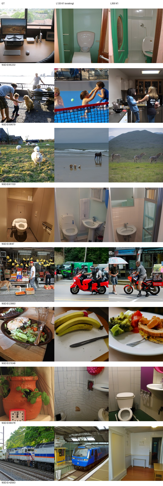
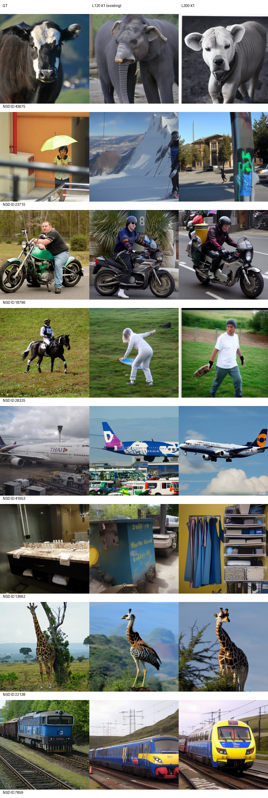
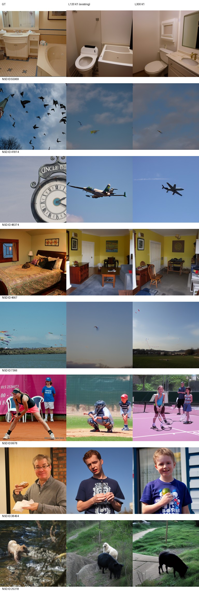

# L140到L300低学习率续训：最终交付

训练300轮/159600更新完成；按固定val500规则选L300。独立标准982 K1生成exit0，评分首次因隔离入口模块搜索路径缺失而exit1，修复PYTHONPATH后仅恢复评分exit0；未重新生成、未改变指标。失败日志与恢复审计保留。

同982、K1、不选候选，原全982负例池八指标：

|指标|旧L120|新L300|方向|
|---|---:|---:|---|
|PixCorr|0.07161030|0.09310765|高更好|
|SSIM|0.30650427|0.29336350|高更好|
|Alex(2)|72.39007538|76.62605804|高更好|
|Alex(5)|83.44274411|87.05932057|高更好|
|Incep|81.47220821|83.06883744|高更好|
|CLIP|83.44398978|86.60683329|高更好|
|Eff|0.80470084|0.77727863|低更好|
|SwAV|0.48823282|0.46396174|低更好|

七项改善，SSIM下降。不能据此声称所有图像改善、统计显著或达到论文质量。固定图册仍见主体替换与个别退化。该结果不用于再次选择checkpoint或调参；旧best和旧基线表未修改。

模型：runs/subject01-author-fp32-seed42-lr5e-5-from100/exports/epoch-300/inference.pt；SHA256：91111867b35471f3f63d85c9223584912863023ea5204a10272a453e585461d5。完整训练状态、各里程碑SHA见training-final-audit.json。[固定验证选择](VALIDATION_SELECTION_ZH.md)、[测试图册实际AI非盲审阅](AI_REVIEW_TEST982_ZH.md)、test982/generation-audit.json的982文件SHA、final-protection-audit.json均保留。

协议：原完整脑解码模型，50步/CFG4/seed42/FP32/candidatebatch1，第一候选；沿用基线原生uint8输出与原NSD425真图、原resize和冻结指标。验证集反复用于开发、标准测试已有历史查看，不能称独立盲测或原论文LR精确复现。到此停止，不自动加训或新增实验。

