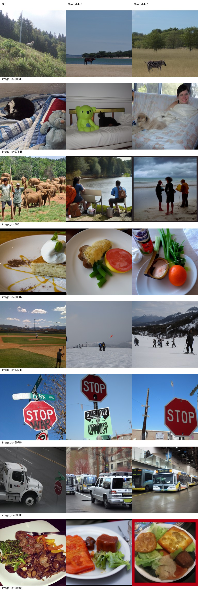
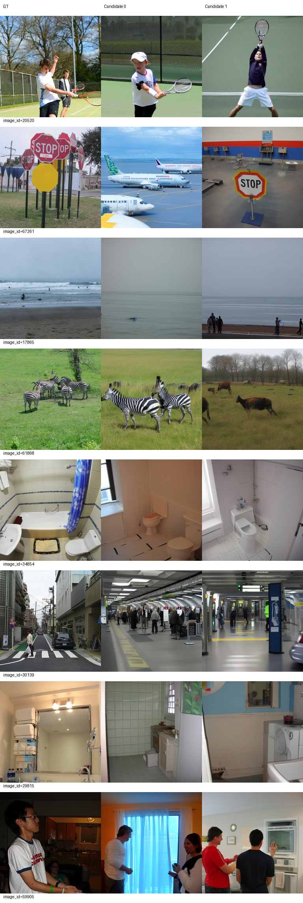
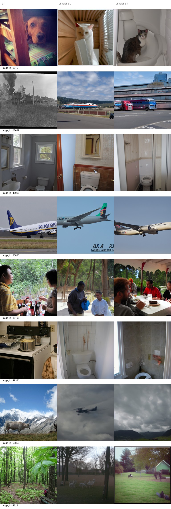
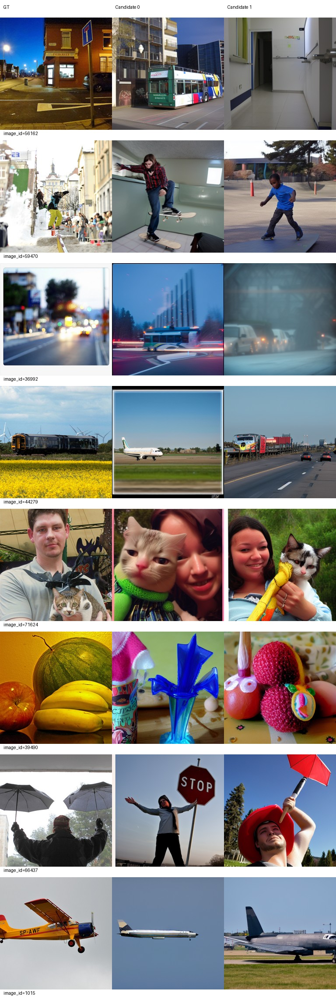
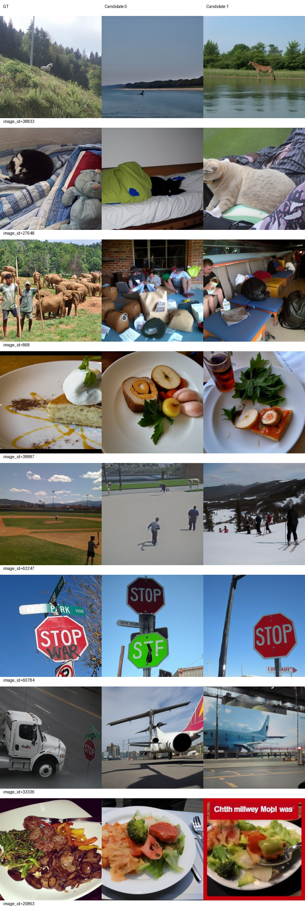
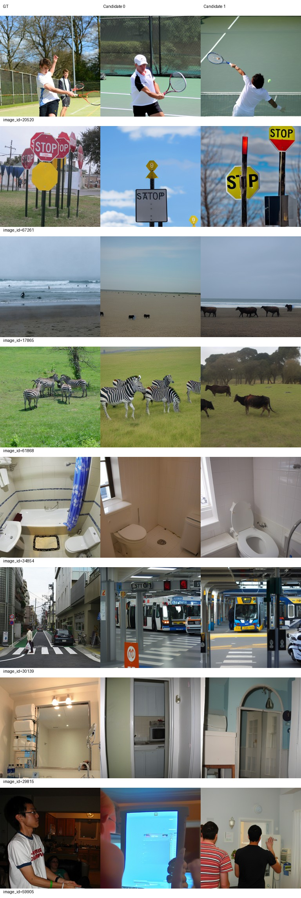
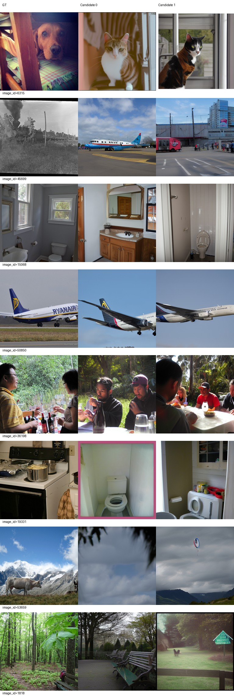
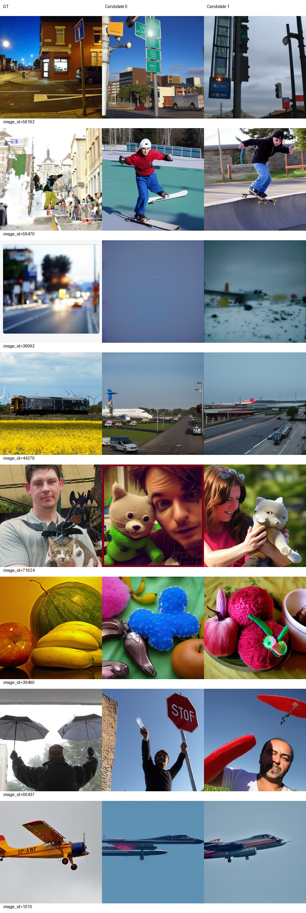

# L200 / L250 完整验证阶段结果

L300仍在生成，未最终选优或启动新标准测试。每组固定val500、两候选不选图，各候选全500负例池评价后平均。50步/CFG4/seed42/candidate batch1，原八指标。

|轮次|PixCorr|SSIM|Alex(2)|Alex(5)|Incep|CLIP|Eff|SwAV|S|
|---|---|---|---|---|---|---|---|---|---|
|120|0.05386741|0.30566328|70.64448898|82.15631263|83.54949900|82.75130261|0.81628075|0.49675988|82.81903808|
|200|0.05974597|0.29834687|72.08116232|83.82444890|84.03947896|84.67635271|0.80240531|0.48223087|84.18009352|
|250|0.06079541|0.29713345|72.67294589|83.89759519|83.32404810|85.92344689|0.79842654|0.48220045|84.38169673|

前六项越高越好，Eff/SwAV距离越低越好。L120引用已有同协议结果，不重跑。两个新阶段生成和评分均exit0；各目录generation-audit.json记录输出审计。训练与权重SHA见[训练完成记录](TRAINING_COMPLETE_ZH.md)及training-final-audit.json。

[实际AI非盲审阅](AI_REVIEW_200_250_ZH.md)。仍有明显主体替换和场景失败，指标提高不是显著性检验。验证集反复使用，历史test已查看，不声称独立盲测或论文学习率精确复现。旧best和旧基线保持不变。

## L200 固定32图全部两候选

## L250 固定32图全部两候选

