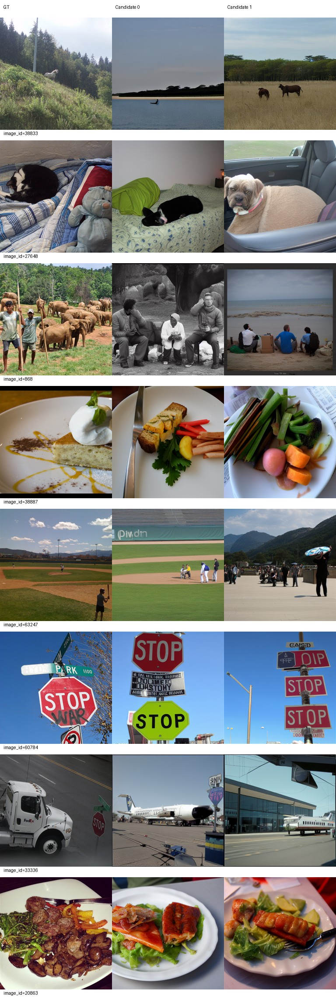
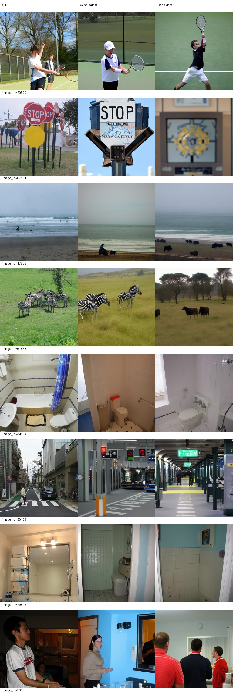
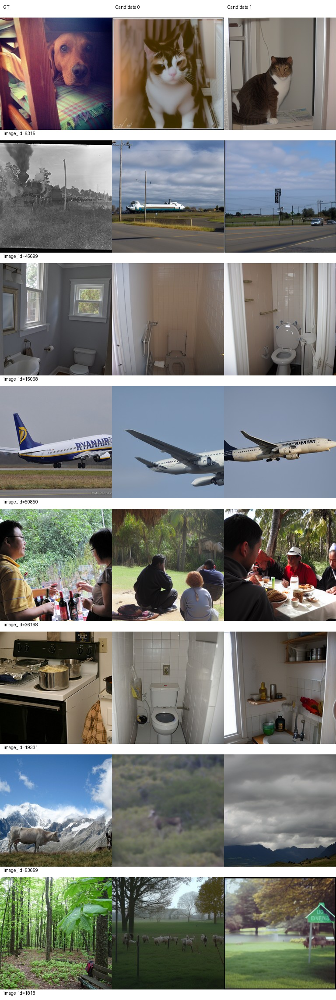
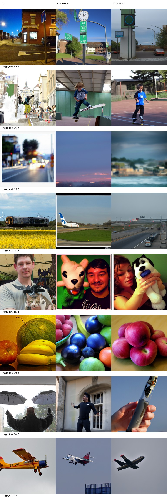

# L140至L300续训：验证完成与固定选优

三阶段生成和评分均exit0，旧报告保护通过。按预定规则选中L300，S=85.55110220，比L120高约2.7321个百分点；这不是显著性检验。尚无新标准测试分数，不以test重新选优或调参。

|轮次|PixCorr|SSIM|Alex(2)|Alex(5)|Incep|CLIP|Eff|SwAV|S|
|---|---|---|---|---|---|---|---|---|---|
|120|0.05386741|0.30566328|70.64448898|82.15631263|83.54949900|82.75130261|0.81628075|0.49675988|82.81903808|
|200|0.05974597|0.29834687|72.08116232|83.82444890|84.03947896|84.67635271|0.80240531|0.48223087|84.18009352|
|250|0.06079541|0.29713345|72.67294589|83.89759519|83.32404810|85.92344689|0.79842654|0.48220045|84.38169673|
|300|0.07511175|0.29275432|74.44649299|86.04288577|84.60741483|86.00300601|0.78879077|0.47410948|85.55110220|

前六项越高越好，Eff/SwAV越低越好。L120直接引用旧结果；所有新模型均固定val500、每图两候选、各候选全500池后平均、50步/CFG4/seed42/FP32/candidatebatch1。完整权重路径SHA见selection.json与training-final-audit.json；旧best不变。

[200/250图册及全部指标](VALIDATION_200_250_ZH.md)；[300实际非盲审阅](AI_REVIEW_300_ZH.md)。低LR轨迹延长不等同论文LR复现；验证集反复用于开发，历史test已查看，非独立盲测。

