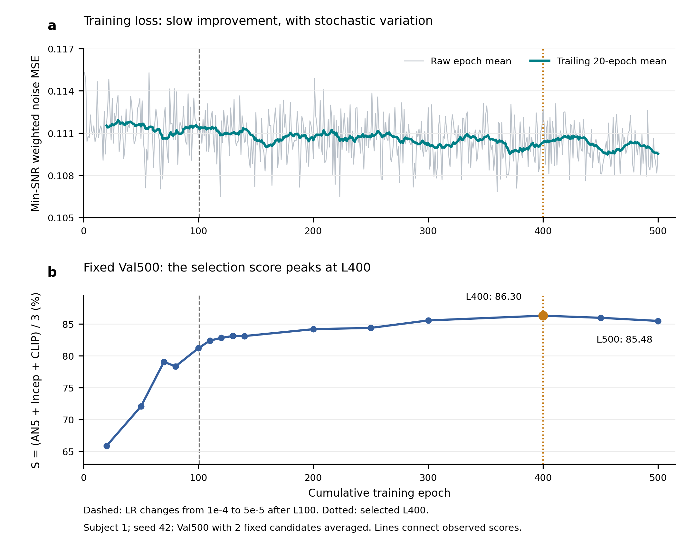

# NeuroAdapter 连续1–500轮：训练损失与效果诊断

本次只分析已有日志、已有验证评分和已有对照，新增训练更新、生成图片、模型评价均为0。模型是Subject1、seed42的作者路线；epoch1–100使用LR1e-4，epoch101–500使用5e-5，最终500轮/266000更新/0 skipped，原选中权重L400和best均未修改。

## 现在已有的结论

1. **有完整500轮训练loss，但没有完整逐step/梯度历史。** 使用逐epoch `mean_loss`，不是控制台最后一个microbatch的 `avg_train_loss`。原高LR文件取1–100；其101–110属于高LR对照，明确排除；再接低LR101–500。500轮无缺失、loss全部有限、更新计数均为epoch×532、每轮8500唯一样本加4条DDP补齐、500个采样顺序SHA不同。已记录epoch loss未见发散，累计0 skipped。最初续训有过loader deepcopy启动错误并修复；这不等于整条训练从未发生工程故障。

2. **后期继续压低训练loss，没有带来持续的验证改善。** L351–400均值0.11006888，L451–500为0.10986184，仅下降0.188%。而相同val500的S由L400的86.29826降到L450的85.96426、L500的85.47735，L400→500下降0.82091个百分点。支持暂停单纯堆轮数；尚不能据此证明过拟合或统计显著退化。

3. **这个loss不是图像忠实度。** 代码目标是 `mean(min(SNR,5)/SNR × noise_MSE)`（实现含数值epsilon），训练latent采样、扩散噪声、时间步与token dropout均随机。没有直接PixCorr、SSIM、CLIP或图像像素重建项。loss约0.11不能当作“只错11%”。早期val S从L20的65.87提高到L100的81.20，训练平均loss却变化很小，已经说明总loss是重建质量的粗指标。仅凭下降1–2%不能断言没学到。

4. **有学习脑信号的证据，问题不是已证实的“完全忽略fMRI”。** 既有L120同500图、同种子和同解码参数对照：正确脑输入S=82.81904，打乱为49.32258，差33.49646个百分点；八项方向均支持正确对应。500个供体一一置换、无自配，真实输入SHA已核对。这个证据只覆盖该L120与内部开发池；不能假装L400/500也跑过相同对照，也不能把“有输入依赖”等同于布局与细节已经正确。

## 曲线和原始数据

图a浅灰为全部500个真实epoch均值；青色为**向后20轮移动平均**，第一点在epoch20，不补齐、不外推。loss轴为0.105–0.117局部范围，实际差值应读刻度。图b为15个已经完成且ID顺序完全相同的val500检查点；连接线只帮助看趋势，未评估轮次没有新增分数。虚线表示100轮后降低LR，点线表示原选中L400。

val500每图2个固定候选、50步、CFG4、seed42、candidate batch1；两个候选各自在全500负例池评分后平均，未挑图。AN2/AN5/Incep/CLIP与S为百分数标度的两两识别指标，不是500类top1准确率。模型只有一条seed42训练轨迹，图中不制造置信区间或显著性；验证集被反复用于开发。

- [完整500轮loss与更新记录](training_epochs.csv)：包含epoch、loss、耗时、LR、样本数、顺序SHA与来源。
- [全部15个验证点、完整八指标及S](validation_metrics.csv)。
- [固定区间loss均值](loss_windows.csv)、[既有L120输入打乱对照](existing_l120_brain_control.csv)。
- [可编辑PDF](training_vs_validation.pdf)、[SVG](training_vs_validation.svg)、[作图和核验代码](build_diagnostics.py)、[输入SHA与核验记录](audit.json)。

## 统一口径的完整验证表

所有行均同val500、同K2协议。loss列统一使用截至该轮的20轮均值，不是验证loss。

|轮次|末20轮loss均值|PixCorr ↑|SSIM ↑|AN2 ↑|AN5 ↑|Incep ↑|CLIP ↑|Eff ↓|SwAV ↓|S ↑|
|---|---:|---:|---:|---:|---:|---:|---:|---:|---:|---:|
|20|0.111533|0.01933|0.31687|58.23727|67.01884|63.75571|66.82725|0.92449|0.60361|65.86727|
|50|0.111476|0.02662|0.32351|63.42265|72.11483|71.24168|72.85451|0.87818|0.55808|72.07034|
|70|0.110641|0.04045|0.31239|66.95210|77.93086|79.17876|80.09379|0.84240|0.51988|79.06780|
|80|0.110931|0.04391|0.32009|66.24449|78.42405|77.05872|79.52966|0.84169|0.52140|78.33747|
|100|0.111422|0.04861|0.30117|69.82525|80.54830|80.53928|82.52244|0.82359|0.50406|81.20334|
|110|0.111369|0.05085|0.30703|68.84729|81.03387|81.87796|84.26172|0.81687|0.49994|82.39118|
|120|0.110902|0.05387|0.30566|70.64449|82.15631|83.54950|82.75130|0.81628|0.49676|82.81904|
|130|0.111004|0.05949|0.29974|71.29078|82.48717|82.58317|84.26713|0.81117|0.48982|83.11249|
|140|0.111274|0.05932|0.30011|70.59158|82.03507|82.45170|84.81924|0.81175|0.49182|83.10200|
|200|0.110495|0.05975|0.29835|72.08116|83.82445|84.03948|84.67635|0.80241|0.48223|84.18009|
|250|0.110702|0.06080|0.29713|72.67295|83.89760|83.32405|85.92345|0.79843|0.48220|84.38170|
|300|0.110280|0.07511|0.29275|74.44649|86.04289|84.60741|86.00301|0.78879|0.47411|85.55110|
|400|0.110332|0.07745|0.27592|75.57435|86.48277|85.01403|87.39800|0.78664|0.46442|86.29826|
|450|0.109824|0.07451|0.28451|75.31563|86.19539|84.97876|86.71864|0.78164|0.46361|85.96426|
|500|0.109526|0.07254|0.28320|75.50842|86.70040|84.76814|84.96353|0.78738|0.46678|85.47735|

L400→500各指标并非全部变差：AN5从86.48277到86.70040，SSIM从0.27592到0.28320；但CLIP从87.39800降至84.96353，PixCorr也下降。综合S下降有具体组成，不能只报一个分数，也不能声称“所有指标恶化”。

## 差效果具体体现在哪里

标准982 K1的L400为PixCorr 0.09638、SSIM 0.27739、AN2 78.06605、AN5 88.05751、Incep 85.07851、CLIP 86.39870、Eff 0.77114、SwAV 0.45502。已有MindEye1同982 K1的PixCorr为0.36503、AN2 96.55533、CLIP 94.30763；L400在像素对应及这些特征指标都有差距。Brain-Diffuser的PixCorr/SSIM更高，但Incep/CLIP更低，提示不同方法有不同权衡。这里描述性能模式，不把模型间差异当成某模块的因果归因。

L300→L400同982结果中PixCorr仅0.09311→0.09638、SSIM反而0.29336→0.27739；S选优不包含PixCorr和SSIM，因此它没有保证结构/像素指标同时提升。**现有证据更符合“学到了部分语义条件，但位置、姿态、细节恢复仍弱；后期续训未带来持续提升，出现平台迹象”这一描述。** 这仅覆盖现有固定路线和观察区间，不是证明网络能力有绝对上限。

以上同982对照读取已经校正并核验的主表，并补入已核对ID hash、K1和冻结指标SHA的L300原结果，汇总在[既有982对照数据](existing_test982_context.csv)。没有混入原100k的50图best8或MindEye best16。epoch100不等于100k更新。先前ImageNet检索浮点越界触发/255是另一个已经修正的评分问题；L400已有实际输入范围核验通过，不能用那次baseline错误解释L400性能。

## 哪些原因已检查，哪些仍不能定论

|问题|当前证据|判断边界|
|训练中断、NaN、跳更新导致没训练到位|500轮/266000更新/0skipped、完整恢复审计和有限loss|不支持这一解释；不等于优化已最优|
|训练与推理误用了不同parcel/输入处理|同dataset按ID平均重复，推理strict加载与parcel顶点断言|此次代码审阅未发现可认定的错配，不等于所有科学选择已最优|
|模型完全不看脑输入|L120同池输入置乱使S下降33.49646pp|可排除该L120对照中的完全无效；不能直接外推L400|
|过拟合|后期train loss略降、验证S下降|有迹象但未证实：缺同定义、固定随机量的train/val loss|
|训练目标与期望指标不完全一致|训练仅加权噪声MSE，选优S仅3项语义特征|目标定义是事实；对差效果贡献多大尚未量化|
|优化/表达/条件强度瓶颈|后期收益小，LR101–500固定，随机TokenDropout|都是待检验假设，不能宣布某一个是原因|

模型此路径为200个parcel独立线性投影生成200个条件token；配置名 `num_decoder_queries=50` 不代表此路径实际50 token。TokenDropout对每样本抽U(0,1)保留率，平均保留约100/200，但不是每张固定保留一半。推理使用全部token和全零条件做CFG4。这些是现有训练设计，尚无证据把它们直接叫作bug。

## 下一步最有判别力的诊断（本次未执行）

先补**固定噪声的train/val去噪loss**，而不是接着训600轮：对现有L120/L300/L400/L500，固定训练子集、val500及每个ID的latent、noise、timestep，在eval模式下同时计算加权/未加权MSE并按噪声时间步分组。四个权重只做前向，新增训练更新可保持0。

- 若训练集持续改善而验证集恶化，才获得更直接的过拟合证据。
- 若训练集和验证集都停滞，应进一步检查优化幅度和表达瓶颈。
- 若总loss变化小但高噪声阶段变差，可定位“总均值掩盖哪个难度段”的问题。
- 如需确认L400后脑条件是否衰减，在同一固定前向诊断里比较真脑/打乱脑/零条件，不重复已完成的L120全500图生成实验。token尺度、条件与无条件预测差可进一步定位环节。

历史未记录逐step loss、梯度范数/裁剪比例、固定噪声验证loss、按timestep loss及参数更新量；不能事后编造曲线。未来若获准续训，再将这些量写入日志。当前先保持L400与所有历史产物不变。

## 源码与可信度

- `train_brain_adapter.py:343–388`：随机训练样本/时间步和MinSNR目标；`:435–505`：双rank loss、梯度有限性检查和epoch均值。
- `brain_adapter/loss.py:18–23`：MinSNR权重；`brain_adapter/model.py:138–149`：parcel投影。
- `scripts/evaluate_stage.py`、`scripts/lr_half_evaluate.py`、`scripts/lr_half_to500_evaluate.py`：现有统一验证协议。
- `reports/lr-half-to500/training-final-audit.json`：已完成训练的事实审计；`selection.json`：原S选优。
- `reports/brain-correspondence-l120/README.md`：已做的正确/打乱输入对照及其局限。

原始输入SHA保存在audit.json，本次没有训练、下载模型、改权重、改参数、改旧评分或读取权重到GPU。报告将已证实的观察与尚未做的归因实验分开；不声称独立盲测，不用论文数字填充本地结果。
